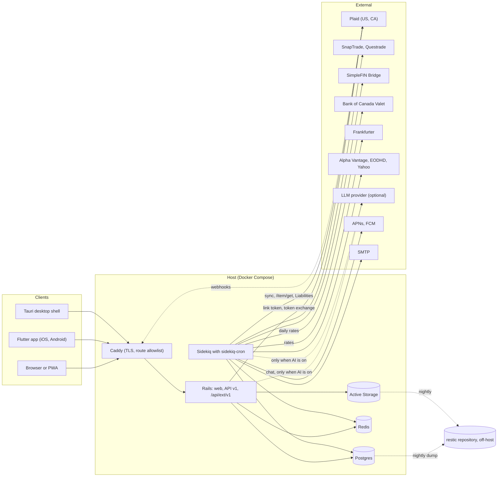
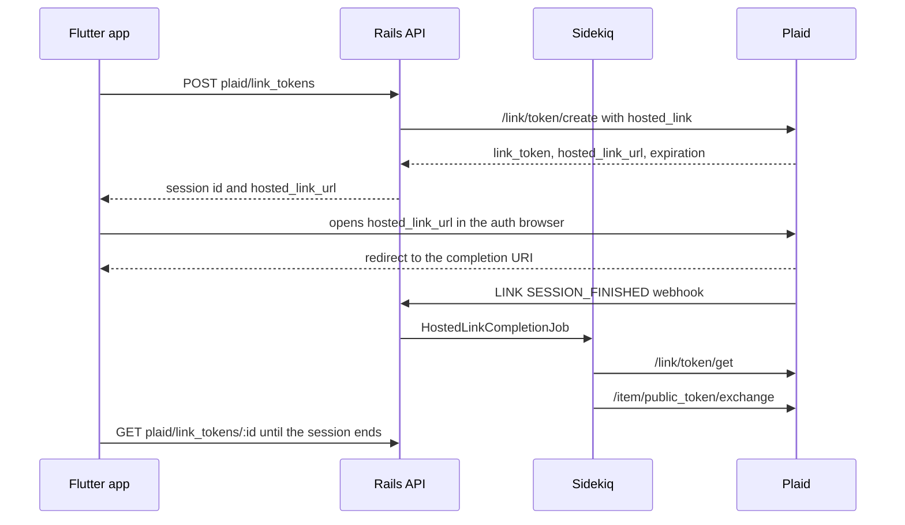
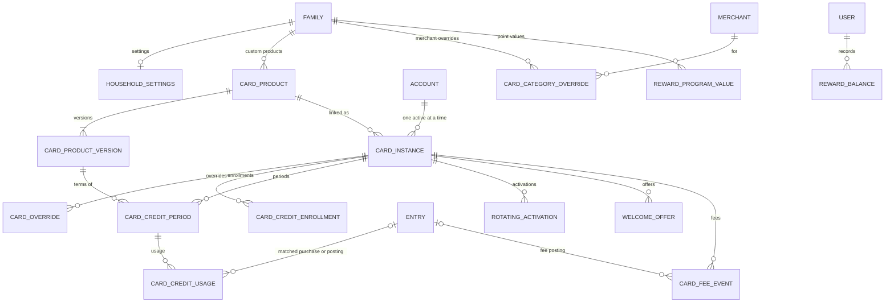

# Design: Rupee

> **DRAFT.** Task 0 was decided on 2026-09-30 (§1.5), and implementation has started with the P0 tasks in `tasks.md`.
>
> Evidence dates 2026-09-28 and 2026-09-29. Sure references are to `we-promise/sure@5e9e3b1`. A file:line reference means the code was read at that commit, not that the behaviour was exercised. The fork, `CoderHahs/rupee`, is based 35 commits later, at `0da863b`. Of the cited files, `user.rb`, `config/initializers/filter_parameter_logging.rb` and `db/schema.rb` changed in between, so their line numbers are re-checked when each hook is made.

## 1. Overview

Rupee is a fork of Sure (`we-promise/sure`). Sure forked Maybe's final release (v0.6.0), so it already holds most of the three-product feature union. This design adds a foundation layer that makes US/CA aggregation and multi-currency correct (P0), card benefits (P1), mobile parity (P2), and the Monarch features Sure lacks (P3).

Paths below are relative to the repository root. Where a path starts with a directory name inside `app/models/`, such as `provider/plaid.rb`, it is short for `app/models/provider/plaid.rb`.

### 1.1 What Sure already provides

- **Multi-currency.** Accounts keep a native currency and the family has a base currency. Conversion is dated: `Money#exchange_to(date:, custom_rate:)` calls `ExchangeRate.find_or_fetch_rate`. Frankfurter is a built-in rate provider.
- **Aggregation.** Plaid, with Canada served by region `us` and its country codes. SnapTrade, Questrade and SimpleFIN providers. US and Canadian investment subtypes with tax treatment (`Investment::SUBTYPES`).
- **Recurring and bills.** Detection, manual series, the bills workspace (overview, all bills, calendar, paycheck plan), an allocator that matches payments to occurrences, and a token-authenticated iCal feed.
- **Planning.** Budgets with rollover and sharing. Goals funded from account allocations, with pledges.
- **AI.** A chat assistant with 35 tool functions, 8 insight generators, an MCP server, AI rules, and Bayes and Jev categorization.
- **API and clients.** API v1 (36 controllers) with Doorkeeper OAuth2 or API keys. A Flutter mobile app of about 17 screens, a Tauri desktop shell and a PWA.
- **Imports.** CSV, QIF, PDF statements, trades, rules, and Mint, YNAB, Actual and Sure exports.
- **Security.** Passkeys, OIDC, MFA, and Active Record encryption of provider tokens. Push through APNs, in managed mode only.

### 1.2 What is new

| Phase                        | Adds                                                                                                                                                                                                                                                                                                     |
| ---------------------------- | -------------------------------------------------------------------------------------------------------------------------------------------------------------------------------------------------------------------------------------------------------------------------------------------------------- |
| P0 foundation                | Fork scaffolding and deployment; the Plaid gem upgrade with MCC and PFC persistence; the Item budget; connection health and a connections page; Bank of Canada rates with bounded carry-forward and no rate of 1; Liabilities mapping and card statement bills; TSX pricing; a family AI switch; backups |
| P1 card benefits             | Catalog, card instances, periods, credit matching, category resolution, the recommender, rotating categories, welcome offers, fees, card value, missed value, reward balances, notifications, assistant tools                                                                                            |
| P2 mobile parity             | The R1.3 areas, mobile Link, mobile push, reconnect and connection status                                                                                                                                                                                                                                |
| P3 Monarch gaps              | Pending-edit carry-over, review mode, receipt extraction and forwarding, saved reports, treemap, weekly recap, forecasting, equity compensation, credit score, flex budgets, outside viewer                                                                                                              |
| P4 connectors and opening up | MX in its development environment, then other aggregators and the §3.2 items for other households                                                                                                                                                                                                        |

### 1.3 Constraints

- **Plaid Trial plan.** Free, real production data, at most 10 Production Items, and described by Plaid as suited to hobbyist use. Removing an Item does not free a slot, so the Item budget is a ledger of Items created, not a count of live rows (support.plaid.com articles 39994173227159, 16110502116887).
- **Upstream moves quickly.** The fork merges at least monthly, so its surface must stay small and checkable (§4.1).
- **AGPLv3.** Network users must be offered the running source (section 13). The Maybe non-affiliation text stays. The Maybe name and logo do not appear.
- **One operator.** Estimates in `tasks.md` assume agent-assisted work by one person.

### 1.4 Key findings

These findings, all read at `5e9e3b1`, shape the design.

| #   | Finding                                                                                                                                                | Evidence                                                                                                                                                                                                                                                                                                                    | Consequence                                                                                                                                  |
| --- | ------------------------------------------------------------------------------------------------------------------------------------------------------ | --------------------------------------------------------------------------------------------------------------------------------------------------------------------------------------------------------------------------------------------------------------------------------------------------------------------------- | -------------------------------------------------------------------------------------------------------------------------------------------- |
| 1   | The pinned Plaid gem cannot return `merchant_category_code`                                                                                            | `Gemfile.lock:524` pins `plaid (41.0.0)`; v51.0.0 has the field; the gem raises on unknown request options                                                                                                                                                                                                                  | Upgrade the gem before R6.4 (D5)                                                                                                             |
| 2   | Sure sends no PFC version                                                                                                                              | `provider/plaid.rb:100-106`: the only option is `include_original_description`                                                                                                                                                                                                                                              | Pin `personal_finance_category_version` (D6)                                                                                                 |
| 3   | The Liabilities credit processor bypasses attribute locks and takes the first APR                                                                      | `plaid_account/liabilities/credit_processor.rb:9` calls `update_accountable_attributes`, which compacts nils and ignores locks (`account/provider_import_adapter.rb:731`); `:12` reads `aprs[0]`                                                                                                                            | Write through `enrich_attributes` (`concerns/enrichable.rb:63-131`), which honours locks and can clear a value; select `purchase_apr` (R9.2) |
| 4   | The allocator accepts entries on either side of a transfer                                                                                             | `recurring_transaction/allocator.rb:83-109` (`allocate_matched!`) has no account or sign check and uses `entry.amount.abs`                                                                                                                                                                                                  | A card series can be paid by the card-side inflow (D7)                                                                                       |
| 5   | `create_from_transfer` takes the funding account and its currency                                                                                      | `recurring_transaction.rb:416-449` sets `currency` from the outflow entry and `bill_type` to transfer                                                                                                                                                                                                                       | BillLinker creates card series itself, in the card's currency (D7)                                                                           |
| 6   | Tolerance 0 makes matching exact, but a manual attach relearns it                                                                                      | `MAX_LEARNED_TOLERANCE_PCT = 25`; `learn_from_manual_attach!` at `allocator.rb:300`                                                                                                                                                                                                                                         | BillLinker resets `amount_tolerance_pct` to 0 on each statement                                                                              |
| 7   | Unresolved rates become 1, and carry-forward is unbounded and unmarked                                                                                 | `rates_for` falls back to 1 (`exchange_rate/provided.rb:98`), as do four of its callers; `account_totals.rb:97` has no nil guard; lookback is earlier-only, 5 days (`:24,73`); gapfill `exchange_rate/importer.rb:55-79`                                                                                                    | Guard `rates_for` and each caller; record `exchange_rates.observed_on` so carry is bounded and marked (D8)                                   |
| 8   | The default rate provider is Twelve Data                                                                                                               | `setting.rb:79`; `provider/registry.rb:225`                                                                                                                                                                                                                                                                                 | Select the fork router at deploy (D9)                                                                                                        |
| 9   | LLM categorization and other AI calls ignore `users.ai_enabled`                                                                                        | `ai_enabled` (default false) gates chat, insight narration and the Bills AI helper (`bills_helper.rb:15`) only; 11 call sites call `Provider::Registry.preferred_llm_provider` directly (§4.10)                                                                                                                             | A family switch that every site goes through (D17)                                                                                           |
| 10  | Push works only in managed mode and only on iOS, and the Flutter app has no push plugin                                                                | `app/services/apns/client.rb` (`hosted?`); `app/controllers/api/v1/push_subscriptions_controller.rb` returns 403 `feature_disabled`                                                                                                                                                                                         | Server flag in P1, client plugin in P2; browser push is dropped (R15.1)                                                                      |
| 11  | A family with no timezone resolves to UTC                                                                                                              | `app/controllers/concerns/localize.rb:129-139`; `families.timezone` has no default                                                                                                                                                                                                                                          | Confirm the timezone in Task 0.6 and before card benefits are enabled (R18.10)                                                               |
| 12  | Bills is a per-user preview feature                                                                                                                    | `user.rb:701-703`; `app/controllers/settings/preferences_controller.rb:16-23`                                                                                                                                                                                                                                               | Each member enables preview features (R8.2)                                                                                                  |
| 13  | Occurrences are generated only for active manual series                                                                                                | `app/jobs/generate_recurring_occurrences_job.rb`; `recurring_transaction/occurrence_generator.rb:29`                                                                                                                                                                                                                        | Card series are created with `manual: true` (D7)                                                                                             |
| 14  | Every sync path starts from `PlaidItem.syncable`                                                                                                       | `plaid_item.rb:30-31` (scopes `active` and `syncable`)                                                                                                                                                                                                                                                                      | Excluding revoked Items there stops all their syncs (R3.6)                                                                                   |
| 15  | SnapTrade, Questrade and SimpleFIN providers exist                                                                                                     | `provider_connection_status.rb` lists 26 providers                                                                                                                                                                                                                                                                          | R2.2, R2.3 and R2.7 are configuration                                                                                                        |
| 16  | Plaid region `us` serves Canada                                                                                                                        | `plaid_items.plaid_region` is `us` or `eu`; Canada is a country code, not a region                                                                                                                                                                                                                                          | No second Plaid region or credential set is needed                                                                                           |
| 17  | Verified webhooks with unhandled codes return 200; the ERROR branch handles only `ITEM_LOGIN_REQUIRED`; `PENDING_EXPIRATION` appears nowhere in `app/` | `app/controllers/webhooks_controller.rb:5` (400 on a bad signature); `plaid_item/webhook_processor.rb:18,26,30`                                                                                                                                                                                                             | A fork dispatcher handles the R3.4-3.6 codes before upstream's switch (§4.3)                                                                 |
| 18  | Connection status is exposed only through the API                                                                                                      | `ProviderConnectionStatus.for_family` is called only from `app/controllers/api/v1/provider_connections_controller.rb:7`                                                                                                                                                                                                     | Add a `/connections` page (R3.8)                                                                                                             |
| 19  | Deleting a Plaid Item never fails on a Plaid error                                                                                                     | `plaid_item.rb:22` (`before_destroy :remove_plaid_item`); `:183-198` rescues `Plaid::ApiError`, logs non-ignorable codes, and continues                                                                                                                                                                                     | Deleting a revoked Item is safe locally; on Trial it still frees no slot                                                                     |
| 20  | The Bills page includes recurring transfers into card and loan accounts                                                                                | `recurring_transaction.rb:273-283` (`payable`); `app/controllers/bills_controller.rb:446-458`; `test/models/recurring_transaction_test.rb:12`                                                                                                                                                                               | Card series appear on Bills with no view changes. A member sees one only with access to both accounts (`recurring_transaction.rb:380-392`)   |
| 21  | The health check's exact-date probe fails Twelve Data, EODHD and Tiingo; the 6th failure deletes the prices, and syncs skip offline securities         | `config/schedule.yml:22-26` (02:00 UTC); `security/health_checker.rb:81-94,109,120-130`; `market_data_importer.rb:26`; `account/market_data_importer.rb:61`; upstream issue #3097                                                                                                                                           | Probe a 7-day window, give no verdict without a provider or on a rate limit, and keep prices (§4.7)                                          |
| 22  | Holdings fall back to the native amount when a conversion fails                                                                                        | `holding/portfolio_cache.rb:42-46`; `holding.rb:259-265`; `holding/trade_calculator_helpers.rb:7-11`                                                                                                                                                                                                                        | The R4.6 exclusion does not reach holdings until these rescues change (open question 15)                                                     |
| 23  | Without explicit encryption keys, provider tokens are stored in plaintext                                                                              | `config/initializers/active_record_encryption.rb:23-38` derives keys from `SECRET_KEY_BASE`, but `encryption_ready?` needs explicit keys (`lib/active_record_encryption_config.rb:47-53`), so the `encrypts` calls in `plaid_item.rb:13-17` never run; `config/initializers/encryption_warning.rb:8-21` only logs a warning | Refuse to boot in production without explicit keys (§7.2)                                                                                    |

### 1.5 Task 0 decisions (2026-09-30)

| Task | Decision                                                            | Consequence                                                                                                     |
| ---- | ------------------------------------------------------------------- | --------------------------------------------------------------------------------------------------------------- |
| 0.1  | Fork Sure as `CoderHahs/rupee`, based at `0da863b`                  | Monthly upstream merges (§7.6)                                                                                  |
| 0.2  | Personal use now; open to other households later                    | The Plaid Trial plan for now; §3.2 lists what opening up needs                                                  |
| 0.3  | The name is Rupee, which is also the AI agent's name                | `PRODUCT_NAME`, Plaid's `client_name`, the app ids and the assistant prompts (§4.12)                            |
| 0.4  | Hosting option A, on a cloud VM                                     | A small cloud VM on a tailnet, with only the webhook and iCal routes public (§3.1)                              |
| 0.5  | A public, open-source repository                                    | It carries the source offer for the running commit (§7.7); CI scans every push for secrets (§8)                 |
| 0.6  | The family time zone is America/New_York (Eastern)                  | Credit period ends, the 08:00 digest and briefing, and bill states all use it (§4.10)                           |

The same decisions added three requirements: connectors beyond Plaid, starting with MX (§4.11); encryption as the first priority (§7.2); and an AI-native agent named Rupee (§4.12).

## 2. Decisions

| ID  | Decision                                                                                                                                                                                                                                                                   | Rejected alternatives                                                                                                                                             | Req                         |
| --- | -------------------------------------------------------------------------------------------------------------------------------------------------------------------------------------------------------------------------------------------------------------------------- | ----------------------------------------------------------------------------------------------------------------------------------------------------------------- | --------------------------- |
| D1  | Fork Sure at `5e9e3b1` and track it.                                                                                                                                                                                                                                       | Greenfield (re-implements hundreds of features); forking Maybe (archived, and Sure is a superset); a separate service beside Sure (duplicates auth, data and UI)  | R22.2                       |
| D2  | Keep AGPLv3. Default to personal use. Commercial use needs a paid Plaid plan and a section 13 source offer (Task 0.2). Task 0.2: personal for now. The public repository carries the source offer (§7.7).                                                                  | Relicensing (needs every copyright holder); a closed fork offered over a network (breaches section 13)                                                            | R22.4-22.6                  |
| D3  | Plaid for US and Canadian banks, cards and loans. SnapTrade and Questrade first for brokerages. SimpleFIN, file import and manual accounts as fallbacks. MX is added as a second aggregator (§4.11, D22).                                                                  | Flinks (from $500 a month); MX, Finicity and Akoya (enterprise or US-only); Teller (US-only)                                                                      | R2.1-2.3, R2.7              |
| D4  | The Item budget is a ledger of Items created. The guard runs on `PlaidItemsController#new`, which issues the link token, in production only. It counts across the whole instance, plus `PLAID_ITEMS_USED_ELSEWHERE`.                                                       | Counting live `plaid_items` rows (removal frees no slot); guarding `create` (Link has already created the Item, so refusing orphans a used slot)                  | R2.5, R2.6                  |
| D5  | Upgrade `plaid` from 41.0.0 to 51.x.                                                                                                                                                                                                                                       | Raw HTTP for `/transactions/sync` (bypasses Sure's provider); waiting for upstream                                                                                | R6.4                        |
| D6  | Send `personal_finance_category_version` explicitly, at the version Sure's PFC matcher expects (v2 expected; open question 21).                                                                                                                                            | Plaid's default, which can change under the app                                                                                                                   | R6.4                        |
| D7  | One manual recurring transfer series per card, from the funding account to the card, in the card's currency. BillLinker upserts one occurrence per statement (§4.5).                                                                                                       | `create_from_transfer` (funding currency); an expense bill with no destination (counts as spending); a separate bills model (duplicates the bills workspace)      | R9.3, R9.4                  |
| D8  | Rate lookup uses earlier dates only, with carry measured from each row's observation date (`exchange_rates.observed_on`, §4.6). A carry of 1-7 days is marked. A longer carry, or no rate, excludes the amount and warns.                                                  | Upstream's lookup (gapfilled rows count as exact matches, so carry is unbounded and unmarked); disabling upstream's gapfill (a larger upstream diff); a rate of 1 | R4.5, R4.6, R4.8            |
| D9  | A rate router: Bank of Canada Valet for CAD pairs whose other currency is one of its 27 series; Frankfurter otherwise and on a miss.                                                                                                                                       | Twelve Data (current default, needs a key); Open Exchange Rates (USD base, no free time series); exchangerate.host (100 requests a month)                         | R4.4                        |
| D10 | Fork code lives in its own namespaces. Upstream edits are limited to the hook list in §4.1. Extensions go through `to_prepare`. A surface check runs in CI.                                                                                                                | Free edits to upstream files (every monthly merge becomes a conflict)                                                                                             | R22.2                       |
| D11 | The card catalog is YAML files in `db/card_catalog/`, validated and loaded all or nothing, versioned by `effective_from`, citing issuer pages.                                                                                                                             | cardapi.dev as the source of truth (paid tiers, terms unverified); scraping; copying unlicensed compilations                                                      | R17.1-17.5, R17.8           |
| D12 | Credit matching runs hourly over transactions changed since a watermark, in tiers, with a confidence threshold.                                                                                                                                                            | Matching inside the import path (an upstream edit on a hot path); ML matching                                                                                     | R18.3-18.6                  |
| D13 | A deterministic recommender: amount times multiplier times point value, minus the FX fee, plus usable credit. With no amount, it uses a notional 100 units of base currency.                                                                                               | LLM ranking (not reproducible or testable)                                                                                                                        | R19.1-19.3                  |
| D14 | Fork notification tables with plan, digest and dispatch jobs. Channels are in-app, email and push. Dedup on type, subject, period and lead time.                                                                                                                           | Extending `notification_deliveries` (it deduplicates rule runs only); a hosted notification service                                                               | R15                         |
| D15 | Two hosting options, chosen in Task 0.4. A: a private network with only the webhook and iCal routes public. B: a public VPS. Chosen: A, on a cloud VM.                                                                                                                     | A PaaS that makes the whole app public by default                                                                                                                 | R21.3, R22.1                |
| D16 | Extend Sure's Flutter app. Link uses Plaid Hosted Link, opened in ASWebAuthenticationSession or an Auth Tab through `flutter_web_auth_2` (§4.9). Push uses `firebase_messaging` with the deployer's Firebase project, which relays to APNs.                                | Separate native apps; a rewrite in another framework; a WebView that loads Link (not allowed for new Plaid customers since 2025-04-24); `plaid_flutter` (§4.9)    | R1.2, R1.3, R1.5            |
| D17 | A household AI switch, off until an admin consents to Rupee at onboarding (§4.12). `Family#permitted_llm_provider` returns nil when it is off, and all 11 LLM call sites use it. Chat, MCP and vector-store uploads stop with it (§4.10). Bayes categorization still runs. | Reusing `users.ai_enabled` (per user, and it does not cover categorization)                                                                                       | R13.3                       |
| D18 | Daily restic backups of a Postgres dump and Active Storage to encrypted off-host storage. Encryption keys are backed up separately. A restore is tested before real accounts are linked, then quarterly.                                                                   | Provider disk snapshots only (same failure domain as the host)                                                                                                    | R21.1, R21.4                |
| D19 | Household-level fork settings (the AI switch, timezone confirmation, card-benefit settings) live in one fork table, `household_settings`.                                                                                                                                  | New columns on `families` (collision risk with upstream migrations); a table per feature                                                                          | R13.3, R18.8, R18.10, R20.4 |
| D20 | TSX and TSXV prices come from Alpha Vantage (`.TRT`, `.TRV`) or EODHD (`TO`, `V`), assigned per security, with no automatic fallback. Yahoo adds no suffix to bare TSX tickers, so it serves US listings and suffixed Canadian tickers only (§4.7).                        | Twelve Data's free tier (TSX coverage unlikely); Yahoo as primary (no official API, and no TSX suffix in Sure)                                                    | R5.4, R5.5                  |
| D21 | Record each price's observation date (`security_prices.observed_on`) and show the last price with that date when no fresh price exists (§4.7).                                                                                                                             | Redefining `provisional` (a boolean); read-time inference; a `source` column                                                                                      | R5.5                        |
| D22 | Add MX Platform API as a second aggregator through Sure's provider generator, in MX's development environment until a contract exists (§4.11).                                                                                                                             | A new abstraction over all providers (conflicts with every upstream merge); Finicity or Akoya now (enterprise contracts)                                          | R2.8, R2.9                  |
| D23 | Encrypt every layer: TLS, WireGuard, a socket or TLS to the database, volume encryption, required Active Record encryption and encrypted backups, with a rehearsed key rotation (§7.2).                                                                                    | Per-column encryption of amounts and names (breaks search and totals)                                                                                             | R21.1, R21.7-21.9           |
| D24 | Rupee is Sure's assistant renamed and made the front door, with confirmed writes, a daily briefing and consent at onboarding (§4.12).                                                                                                                                      | A separate agent service (duplicates the tool registry that chat and MCP share)                                                                                   | R13.1, R13.5-13.8           |

## 3. Architecture

The fork keeps Sure's deployment shape: one Rails app, Sidekiq with sidekiq-cron, Postgres, Redis and Active Storage, behind Caddy.



### 3.1 Hosting options (Task 0.4)

| Aspect         | A: private network                                                                                                      | B: public VPS                                       |
| -------------- | ----------------------------------------------------------------------------------------------------------------------- | --------------------------------------------------- |
| Reachability   | The app is on a tailnet. Tailscale Funnel or a Cloudflare Tunnel exposes Caddy, and Caddy allows only the public routes | The whole app is on the internet behind Caddy       |
| Public routes  | `/webhooks/plaid` and, if enabled, `/bills_feed/:token` (`config/routes.rb:966` and `:588`)                             | Every route                                         |
| Phones         | Need the Tailscale app                                                                                                  | Any network                                         |
| Webhooks       | Through the tunnel. With no tunnel, the daily `/item/get` poll still covers R3.1 and R3.2, but R3.4-3.6 are lost        | Direct                                              |
| Attack surface | Two routes                                                                                                              | Login, API and every controller                     |
| Host           | Hardware already run at home, or a small VM                                                                             | A rented VM                                         |
| Fits           | Personal use by one household                                                                                           | Commercial use, or members who cannot use Tailscale |

With option A, the default Caddy rule returns 404 for every path except the two public ones on the public listener. The tailnet listener serves the whole app. Plaid learns the webhook URL from each link token, and upstream builds it from the request's host (`plaid_items_controller.rb:180-184`), so under option A `FORK_PLAID_WEBHOOK_URL` names the public route instead (§4.9).

**Chosen (Task 0.4): A, on a cloud VM.** A small VM (2 vCPUs, 4 GB) joins the tailnet. Its disks use the provider's volume encryption (§7.2), and Tailscale Funnel or a Cloudflare Tunnel carries the two public routes. The cloud provider is AWS (chosen 2026-10-21): EBS volumes and the S3 backup bucket are encrypted with a customer-managed KMS key, and `deploy/aws/rupee.yml` creates them.

### 3.2 Opening up later (Task 0.2)

Rupee is personal for now. Opening it to other households needs:

- hosting option B, because members of other households will not all join one tailnet;
- a paid Plaid plan (R22.6), and contracts with MX or other aggregators (§4.11);
- a privacy policy and terms of use;
- per-household encryption keys, or a documented reason not to have them (open question 27);
- onboarding that asks each household for its time zone and AI consent (§4.10, §4.12).

Every fork table is scoped to a family, as upstream's are, so none of this needs a data-model change.

## 4. Components

### 4.1 Fork layout

New code lives in fork namespaces:

```text
app/models/card_benefits/          catalog, instances, periods, matching, recommender, value
app/models/fork/                   Fx, Liabilities, notifications, household settings
app/models/concerns/fork/          model extensions applied in to_prepare
app/controllers/concerns/fork/     controller extensions applied in to_prepare
app/controllers/fork/              connections, card benefits, household settings
app/controllers/api/ext/v1/        fork API, inheriting Api::V1::BaseController
app/views/api/ext/v1/              fork API views (jbuilder)
app/views/fork/                    fork views and partials, including banners
app/jobs/fork/                     fork jobs
app/mailers/fork/                  notification mailer
config/routes/fork.rb              drawn from config/routes.rb
config/fork_schedule.yml           fork cron jobs
config/initializers/fork.rb        to_prepare hooks, the schedule loader and the boot checks (§7)
db/card_catalog/                   catalog YAML files
lib/tasks/fork.rake                catalog sync, backfills, ledger backfill, invariant check
bin/check-fork-surface             surface check run in CI
.github/workflows/fork.yml         surface check and nightly network tests (§8)
mobile/lib/fork/                   Flutter screens, services and models (§4.9)
FORK.md                            hook list, merge procedure, upstream PR status
```

New files in upstream directories are allowed where Rails requires them: migrations, and providers such as `provider/bank_of_canada.rb`. `bin/check-fork-surface` compares the branch with the upstream merge base. It fails when a modified upstream file is not in the hook list below, when upstream has created a file at the path of a fork-added file, or when an upstream migration adds a column the fork also adds.

`Api::V1::BaseController` (Doorkeeper or API key, rate limit, access log, timezone switch) is the parent of every fork API controller, so the fork API needs no new auth code.

#### Upstream file edits (hooks)

| File                                                                                                          | Edit                                                                                                                                               | Req                | Upstream candidate   |
| ------------------------------------------------------------------------------------------------------------- | -------------------------------------------------------------------------------------------------------------------------------------------------- | ------------------ | -------------------- |
| `Gemfile`, `Gemfile.lock`                                                                                     | `plaid` 41.0.0 to 51.x; declare `googleauth`, already locked as a dependency (§4.9)                                                                | R6.4, R1.5         | Yes                  |
| `provider/plaid.rb:100-106`                                                                                   | Send `personal_finance_category_version`                                                                                                           | R6.4               | Yes                  |
| `provider/plaid.rb:45-53` (`get_link_token`)                                                                  | A `hosted_link:` keyword, sent only when given (§4.9)                                                                                              | R1.2, R2.1         | Yes                  |
| `plaid_entry/processor.rb:99` (`plaid_extra`)                                                                 | Persist MCC, PFC (primary, detailed, confidence) and `authorized_date`                                                                             | R6.4               | Yes                  |
| `plaid_account/liabilities/credit_processor.rb`                                                               | Write through `enrich_attributes`; headline APR from `purchase_apr`                                                                                | R9.1, R9.2         | Yes                  |
| `plaid_account/liabilities/mortgage_processor.rb`, `student_loan_processor.rb`                                | The same pattern                                                                                                                                   | R9.7               | Yes                  |
| `exchange_rate/provided.rb:14,60` (`find_or_fetch_rate`, `rates_for`)                                         | Earlier-only lookup bounded by `observed_on` (7 days); return the observation date and source; no rate instead of 1                                | R4.5, R4.6, R4.8   | Yes                  |
| `exchange_rate/importer.rb:55-106,203-251`                                                                    | Write `source` and `observed_on` on every upserted row, including gapfilled and inverse rows; re-fetch filled rows dated today or yesterday (§4.6) | R4.5, R4.8         | Yes                  |
| `investment_statement.rb:295`, `concerns/accountable.rb:102`, `app/controllers/reports_controller.rb:565,587` | Exclude and flag instead of using a rate of 1                                                                                                      | R4.6               | Yes                  |
| `balance_sheet/account_totals.rb` (`converted_balance_for`)                                                   | Nil guard; exclude and flag                                                                                                                        | R4.6               | Yes                  |
| Views that show a converted amount (files not located; open question 16)                                      | Render `fork/fx_amount`                                                                                                                            | R4.8               | No                   |
| `provider/registry.rb:225`                                                                                    | Register `bank_of_canada` and `fx_router`                                                                                                          | R4.4               | Yes (Bank of Canada) |
| `app/views/settings/hostings/_provider_selection.html.erb:15-20`                                              | Add `fx_router` to the rate-provider options, which the picker shows disabled when `EXCHANGE_RATE_PROVIDER` is set (`:23-24`)                      | R4.4               | With the provider    |
| `security/price/importer.rb:102-126,292`                                                                      | Carry the observation date with the carried price; write `observed_on` on every row (§4.7)                                                         | R5.5               | Yes                  |
| `provider/alpha_vantage.rb:27,304`, `provider/eodhd.rb:26,51,69`                                              | Map XTSX to `.TRV` and `V`, with CAD for both; Alpha Vantage's reverse map is derived from its forward map (§4.7)                                  | R5.4               | Yes                  |
| `app/views/holdings/show.html.erb:87`, `app/views/holdings/sync_prices.turbo_stream.erb:5`                    | Render `fork/price_label` (§4.7)                                                                                                                   | R5.5               | No                   |
| `app/views/trades/_header.html.erb:69-74`, `app/views/transactions/convert_to_trade.html.erb:59-64`           | Render `fork/price_label`; the trade header shows its price row whenever a stored row exists (§4.7)                                                | R5.5               | No                   |
| The 9 LLM call sites outside `family.rb`, and `family_merchants_controller.rb:31` (§4.10)                     | Use `family.permitted_llm_provider`                                                                                                                | R13.3              | Yes                  |
| `config/routes.rb`                                                                                            | `draw :fork`                                                                                                                                       | R22.2              | No                   |
| `app/views/layouts/application.html.erb`                                                                      | Render `fork/banners`                                                                                                                              | R3.2-3.6, R4.6     | No                   |
| `app/views/settings/_settings_nav.html.erb:8`, `app/helpers/settings_helper.rb:4-12`                          | Links to `/connections` and `/settings/household`                                                                                                  | R3.8, R13.3, R18.8 | No                   |
| The account-add chooser (file not located; open question 16)                                                  | List SnapTrade and Questrade before Plaid for brokerages                                                                                           | R2.7               | No                   |
| The mobile files listed under Mobile hooks (§4.9)                                                             | Mobile tabs, entries, sections, plugins and app ids                                                                                                | R1.2-R1.5          | No                   |

#### Extensions applied in `to_prepare`

| Target                                                                   | Extension                                                                                                                                                                                                                                  | Req            |
| ------------------------------------------------------------------------ | ------------------------------------------------------------------------------------------------------------------------------------------------------------------------------------------------------------------------------------------ | -------------- |
| `PlaidItem`                                                              | Ledger entry after create. `syncable` excludes revoked Items, through a module prepended to the singleton class that calls `super`                                                                                                         | R2.5, R3.6     |
| `PlaidItemsController`                                                   | Item budget guard before `new`, through `Fork::PlaidItemBudget` (§4.2); the webhook URL comes from `FORK_PLAID_WEBHOOK_URL` when it is set (§4.9)                                                                                          | R2.5, R3.4-3.6 |
| `PlaidItem::WebhookProcessor`                                            | Keeps the parsed body and handles `LINK` webhooks for Hosted Link before upstream's Item lookup (§4.9); records the fork's codes, then calls `super` so upstream handling still runs                                                       | R1.2, R3.4-3.6 |
| `PlaidAccount::Liabilities::CreditProcessor` and the two loan processors | After `process`, call `Fork::Liabilities::Recorder`                                                                                                                                                                                        | R9.1, R9.3     |
| `RecurringOccurrence`                                                    | `derived_state` returns `:due`, not `:overdue`, for a `fork-card-` series occurrence whose payments reach the statement minimum (§4.5)                                                                                                     | R9.4           |
| `Transfer`                                                               | After create, write `transfer_fx_details` when the two currencies differ                                                                                                                                                                   | R4.9           |
| `Family`                                                                 | `permitted_llm_provider`; prepends on `resolved_categorization_provider`, `shadow_categorization_provider`, `auto_categorize_transactions`, `auto_detect_transaction_merchants` and `upload_document` (§4.10); associations to fork tables | R13.3          |
| `Family::DataExporter`                                                   | `generate_ndjson` appends the fork's records (§5.6)                                                                                                                                                                                        | R21.6, R23.2   |
| `Family::DataImporter`                                                   | `import!` imports them in the same transaction (§5.6)                                                                                                                                                                                      | R21.6, R23.2   |
| `Security::Resolver`                                                     | `Fork::TsxProviderAssignment`: a bare TSX or TSXV ticker with no explicit provider keeps an enabled TSX provider, else gets `FORK_TSX_PRICE_PROVIDER` (§4.7)                                                                               | R5.4           |
| `Security`                                                               | `current_price_quote`, and `current_price` from it, with the stored-price fallback; `Fork::DetailsThrottle` on `import_provider_details` (§4.7)                                                                                            | R5.5           |
| `Security::Price`                                                        | `before_save` that sets `observed_on` (§4.7)                                                                                                                                                                                               | R5.5           |
| `Security::HealthChecker`                                                | `Fork::HealthCheckPolicy`: 7-day window probe; skip Alpha Vantage and EODHD; no verdict without a provider or on a rate limit; keep prices when offline (§4.7)                                                                             | R5.5           |
| `Assistant` (class methods)                                              | `function_classes` (`assistant.rb:56`) appends the card-benefit tools, so chat and MCP `tools/list` both get them (§4.8)                                                                                                                   | R19.7          |
| `Account`                                                                | `has_one :card_instance`                                                                                                                                                                                                                   | R17.6          |
| `User`                                                                   | Notification preferences and push devices; the `ai_available?` prepend (§4.10)                                                                                                                                                             | R13.3, R15.3   |
| `McpController`                                                          | JSON-RPC error -32010 while the AI switch is off (§4.10)                                                                                                                                                                                   | R13.3          |
| `ImportsController`                                                      | Refuses PDF and document uploads while the AI switch is off (§4.10)                                                                                                                                                                        | R13.3          |
| `ApplicationHelper`                                                      | Card benefits and Connections entries in `mobile_nav_items` and `desktop_nav_items` (`application_helper.rb:85,95,115`)                                                                                                                    | R3.8, R17      |

#### Fork jobs

| Job                            | Schedule (UTC)   | Does                                                                                                                           | Req                             |
| ------------------------------ | ---------------- | ------------------------------------------------------------------------------------------------------------------------------ | ------------------------------- |
| `fork:plaid_health_poll`       | Daily at 06:15   | `/item/get` for every Item; updates the health columns                                                                         | R3.1, R3.2                      |
| `fork:notification_plan`       | Hourly at :00    | Creates due `notification_events`                                                                                              | R15.2, R15.5                    |
| `fork:notification_digest`     | Hourly at :05    | Builds digests for families where it is 08:00 local time                                                                       | R15.4                           |
| `fork:notification_dispatch`   | Every 10 minutes | Delivers pending events on each enabled channel                                                                                | R15.1                           |
| `fork:liability_payment_match` | Hourly at :40    | Matches card payments to statements                                                                                            | R9.4                            |
| `fork:card_credit_match`       | Hourly at :45    | Creates credit periods, then runs credit matching, the fee detector and the welcome-offer tracker                              | R18.1, R18.3-18.5, R20.1, R20.2 |
| `fork:hosted_link_sweep`       | Every 10 minutes | Finishes Hosted Link sessions whose webhook has not arrived (§4.9), and deletes sessions finished more than 30 days ago (§5.4) | R1.2, R2.1                      |

The schedule loader runs when a Sidekiq server boots. It creates or updates each job in `config/fork_schedule.yml`, then removes any job named `fork:*` that is no longer in the file. It never destroys all jobs: sidekiq-cron 2.3.0's `destroy_removed_jobs` removes only jobs whose source is `schedule`, so upstream's own loader leaves fork jobs alone, and the fork's loader must return the favour.

### 4.2 Aggregation and the Item budget

- **Providers.** Plaid (country codes US and CA) for banks, cards and loans. SnapTrade Personal ($0, up to 20 brokerage connections, own accounts only) and Questrade for brokerages, including Wealthsimple and Questrade TFSA, RRSP and FHSA accounts. SimpleFIN Bridge ($1.50 a month) for institutions none of these cover. Liabilities is requested for card and loan Items by upstream's `get_primary_product` (R2.4).
- **Ledger.** `plaid_item_ledger_entries` gets one row per Item ever created: Plaid's `item_id`, institution, environment, created and removed times. `PlaidItem` writes it after create. Deleting an Item sets `removed_at` and keeps the row, because the slot stays used.
- **Count.** Items used equals production ledger rows on the instance plus `PLAID_ITEMS_USED_ELSEWHERE` (default 0). The cap is `PLAID_ITEM_CAP` (default 10). The count spans every family, because the cap belongs to the Plaid team, not to a family. `PLAID_ITEMS_USED_ELSEWHERE` covers Items created before the ledger existed and Items used by other apps on the same Plaid team.
- **Guard.** Before `PlaidItemsController#new` issues a link token, in production only, the guard compares used with cap. At the cap it renders the budget explanation instead of opening Link (R2.5). Update mode (`edit`) is never guarded, because it creates no Item (R2.6). The check lives in `Fork::PlaidItemBudget`, which the mobile link endpoint also calls (§4.9).
- **Why not guard `create`.** By the time `create` runs, Link has finished and the Item exists at Plaid. Refusing the token exchange would leave an Item that uses a slot but that the app cannot see.
- **Backfill.** On deploy, `fork:plaid_ledger_backfill` writes ledger rows for existing `plaid_items`.
- **Display.** The connections page and the account-add flow show "7 of 10 Items used".
- **Brokerage first.** The account-add chooser lists SnapTrade and Questrade above Plaid for brokerages, with a sentence explaining that Plaid Items are reserved for banks and cards (R2.7).
- **Unverified.** Whether Plaid itself refuses Link at the cap is not known (open question 19). If it does, the guard still helps, because it explains the problem before Link opens.

### 4.3 Connection health

**Columns added to `plaid_items`:** `health_checked_at`, `consent_expires_at`, `update_type`, `item_error_code`, `item_error_reason`, `last_successful_update_at`, `pending_disconnect_reason`, `pending_disconnect_at`, `new_accounts_available_at`, `revoked_at` and `revoked_reason`. `plaid_accounts` gets `revoked_at`.

**Poller.** `fork:plaid_health_poll` calls `Provider::Plaid#get_item` (`provider/plaid.rb:77-79`) for every Item and stores `error.error_code`, `error.error_code_reason`, `consent_expiration_time` and `update_type` (R3.1). It also stores `status.transactions.last_successful_update` if Plaid returns it (open question 5). `ITEM_LOGIN_REQUIRED` sets upstream's `requires_update` status. A consent expiry within 14 days creates a `connection.consent_expiring` event for family admins (R3.2).

**Webhooks.** A module prepended to `PlaidItem::WebhookProcessor#process` records these codes and then calls `super`, so upstream's own handling of `ITEM_LOGIN_REQUIRED` and its 200 response are unchanged (R3.7):

| Code                                 | Fork action                                                                                                                                                                                                                  | Req  |
| ------------------------------------ | ---------------------------------------------------------------------------------------------------------------------------------------------------------------------------------------------------------------------------- | ---- |
| `ITEM` / `PENDING_DISCONNECT`        | Store `reason` and `disconnect_time`; notify admins. Reason `INSTITUTION_TOKEN_EXPIRATION` is how US and Canadian consent expiry arrives, so it also sets `consent_expires_at` (R3.2)                                        | R3.4 |
| `ITEM` / `PENDING_EXPIRATION`        | Store the consent expiry; notify admins. Plaid sends this code for UK and EU Items only; US and Canadian Items get `PENDING_DISCONNECT` instead (changelog 2024-10-15). Handled defensively, with the poller as the backstop | R3.2 |
| `ITEM` / `NEW_ACCOUNTS_AVAILABLE`    | Set `new_accounts_available_at`; offer update mode with account selection (`edit` with `add_accounts=true`)                                                                                                                  | R3.5 |
| `ITEM` / `LOGIN_REPAIRED`            | Set status `good`; clear `item_error_*`; clear the prompt                                                                                                                                                                    | R3.5 |
| `ITEM` / `USER_PERMISSION_REVOKED`   | Set `revoked_at`, so `syncable` excludes the Item; ask whether to delete its data                                                                                                                                            | R3.6 |
| `ITEM` / `USER_ACCOUNT_REVOKED`      | Set `plaid_accounts.revoked_at`; the account processor skips it; ask whether to delete the account's data                                                                                                                    | R3.6 |
| `ITEM` / `ERROR` with any other code | Store `item_error_code`                                                                                                                                                                                                      | R3.1 |

**Status and next action.** One status per connection, highest priority first:

| Priority | Status             | Next action shown                                  |
| -------- | ------------------ | -------------------------------------------------- |
| 1        | Revoked            | Delete the synced data, or keep it as history      |
| 2        | Pending disconnect | Reconnect before the disconnect date (update mode) |
| 3        | Login required     | Reconnect (update mode)                            |
| 4        | Consent expiring   | Renew consent (update mode), with the expiry date  |
| 5        | New accounts       | Add accounts (update mode with account selection)  |
| 6        | Sync error         | The error code, and retry                          |
| 7        | Healthy            | None                                               |

**Revoked Items.** The banner offers two choices. Delete removes the Item and its data; `remove_plaid_item` tolerates a Plaid error (finding 19), and on Trial the slot is not freed. Keep leaves the accounts and history in place and stops syncing.

**Connections page.** `/connections` lists every connection from `ProviderConnectionStatus.for_family` (26 providers) merged with the Plaid health columns. Each row shows institution, provider, status, last successful sync and next action, and the page shows the Item budget (R3.8). The same data is served at `/api/ext/v1/connections` for mobile (R3.3, P2).

### 4.4 Transaction signals (R6.4, R6.5)

**What upstream stores.** `plaid_extra` (`plaid_entry/processor.rb:99-110`) keeps `pending`, `pending_transaction_id`, `original_description`, `payment_channel`, `transaction_code`, `payment_meta` and `counterparties` in `transactions.extra["plaid"]`, leaving out blank values. It reads `personal_finance_category.detailed` for category matching (`:179`) but does not store it, and nothing in `app/` reads `authorized_date`. Each import replaces the whole `plaid` namespace: the processor passes `replace_extra_namespaces: ["plaid"]` (`:34`), and `apply_provider_extra` (`account/provider_import_adapter.rb:1079-1087`) writes `existing.except("plaid").deep_merge(incoming)`.

**Change.** `plaid_extra` gains six keys, each left out when Plaid does not send it:

| Key                                                   | Plaid field                   | Note                                                  |
| ----------------------------------------------------- | ----------------------------- | ----------------------------------------------------- |
| `merchant_category_code`                              | `merchant_category_code`      | Needs gem 51.x (finding 1); Plaid added it 2026-08-12 |
| `pfc_primary`, `pfc_detailed`, `pfc_confidence_level` | `personal_finance_category.*` | Version pinned by D6                                  |
| `pfc_version`                                         | The version requested         | Open question 21                                      |
| `authorized_date`                                     | `authorized_date`             | ISO date                                              |

Because the namespace is replaced on every import, a transaction imported before the change keeps its old snapshot until Plaid reports it again. The backfill closes that gap.

**Reader.** `CardBenefits::TransactionSignals.for(entry)` is a plain Ruby object over `extra["plaid"]`. It exposes `mcc`, `pfc_primary`, `pfc_detailed`, `pfc_confidence`, `pfc_version`, `transaction_code`, `payment_channel`, `authorized_date` and `effective_date`. It returns nil for any missing value and never raises, so "not provided" and "not synced yet" look the same to callers. `effective_date` is `authorized_date` when present, else the entry date. Card benefits use it to place a purchase in a period (R18.3), because issuers count a purchase on the day it was made, not the day it posted.

**Backfill.** `fork:plaid_signals_backfill` runs once after the gem upgrade ships (R6.5):

1. It takes one Item at a time. An Item with a sync in progress (`Syncable#syncing?`) is requeued for later.
2. It calls `Provider::Plaid#get_transactions(access_token, next_cursor: nil)` (`provider/plaid.rb:92-114`), which pages through the Item's whole history until `has_more` is false. It never writes `plaid_items.next_cursor`, so the regular sync carries on from its own cursor.
3. It matches each returned transaction to an entry by account, `external_id` (Plaid's `transaction_id`) and source `plaid`: the key the importer itself uses (`account/provider_import_adapter.rb:54`).
4. It merges only the six signal keys into `extra["plaid"]` with `update_columns`. No callbacks, rules, transfer matching or categorization run, and no entry is created, deleted or re-categorized.
5. Plaid transactions with no matching entry (deleted by the user, or never imported) are skipped and counted.
6. Each account is written in its own database transaction. Its entry count and amount sum are taken before and after; if either changed, that account's writes roll back and the account is reported.
7. The report gives the fill rate of each key per institution and country, which answers open questions 3 and 7.

History depth is whatever the Item was created with: up to 730 days for Items created with `days_requested` (`provider/plaid.rb:5,59`), and Plaid's 90-day default for older Items.

Rejected: resetting the cursor and replaying the history through the processor. That reruns rules, transfer matching and categorization on old transactions, and can recreate entries the user deleted.

### 4.5 Liabilities and the card bill (R9)

**Processors.** All three Liabilities processors write through `enrich_attributes(attrs, source: "plaid")` (`concerns/enrichable.rb:63`), which honours `locked_attributes` and can clear a value. Today the credit processor uses `update_accountable_attributes` (finding 3), and the mortgage and student loan processors call `account.loan.update!`. `CreditCard` and `Loan` already include `Enrichable` through `concerns/accountable.rb:15`. The credit processor takes the headline APR from the `aprs` entry whose `apr_type` is `purchase_apr` and leaves it empty when there is none (R9.2).

**Recorder.** After each processor runs, `Fork::Liabilities::Recorder` upserts one `liability_statements` row per statement. The name avoids upstream's `account_statements` table, which holds uploaded statement files.

| Column                                   | Credit                      | Mortgage                | Student loan                |
| ---------------------------------------- | --------------------------- | ----------------------- | --------------------------- |
| `issued_on`                              | `last_statement_issue_date` | Not provided            | `last_statement_issue_date` |
| `due_on`                                 | `next_payment_due_date`     | `next_payment_due_date` | `next_payment_due_date`     |
| `statement_balance`                      | `last_statement_balance`    | Not provided            | `last_statement_balance`    |
| `minimum_due`                            | `minimum_payment_amount`    | `next_monthly_payment`  | `minimum_payment_amount`    |
| `is_overdue`                             | `is_overdue`                | `past_due_amount > 0`   | `is_overdue`                |
| `last_payment_amount`, `last_payment_on` | `last_payment_*`            | `last_payment_*`        | `last_payment_*`            |
| `aprs`                                   | Every `aprs` entry          | `interest_rate`         | `interest_rate_percentage`  |

- `fields_missing` (a text array) lists the fields Plaid did not return. The UI shows "not provided by the institution" for each, never zero (R9.5).
- Identity uses two partial unique indexes: (account_id, issued_on) where `issued_on` is present, and (account_id, due_on) where it is absent. Mortgages have no issue date, so they key on the due date.
- A member can enter or edit a statement by hand (R9.6). The Recorder never overwrites a row whose source is `manual`.
- Re-running a sync updates the same row, so the Recorder is idempotent.

**BillLinker.** Turns each statement into one occurrence on the card's recurring series (D7):

1. **Find the series.** It adopts an existing series whose destination is the card (`recurring_transactions.destination_account_id`). Otherwise it creates one with `manual: true`, `bill_type: "transfer"`, destination the card, currency the card's currency, `amount_strategy: "last"` and `dedup_scope: "fork-card-<card account id>"`. Upstream only ever stamps numeric `dedup_scope` values (`identifier.rb:412`, `declared_bill.rb:100`, `recurring_transaction.rb:515`), so the prefix cannot collide, and the value survives Sure's own export and import (`family/data_exporter.rb:663`, `data_importer.rb:626`). The series keeps upstream's default grace of 3 days (`recurring_occurrence.rb:15`), which absorbs a payment made on the due date that posts a few days later.
2. **Currency.** If the adopted series is in another currency, it records the statement and asks the member to change the series currency. It never creates a second series for the same card.
3. **Funding account.** The series `account_id` is required (`chk_recurring_txns_transfer_requires_source`). It keeps the series' own value; else it takes the outflow account of the card's latest Transfer; else it records the statement and asks the member to choose. A member's choice always wins over inference. Rejected: a funding-account column on `card_instances`, because loans have no card instance.
4. **Occurrence.** It upserts the occurrence at `original_due_on = due_on`, then calls `override_amount!` (`recurring_occurrence.rb:146`). The amount is the statement balance for cards and the minimum due for loans, or the minimum when a card's statement balance is not provided. The series amount is set to the same value, and `amount_tolerance_pct` is reset to 0 on every statement, because a manual attach relearns it (finding 6).
5. **Moved due date.** If the due date changed, the occurrence at the old date is closed with `skip!` (`:130`).
6. **Zero balance.** A statement balance of 0.01 or less creates no occurrence and leaves the series amount unchanged, because `payable` requires an amount above zero (`recurring_transaction.rb:281`).
7. **Previous statement.** When a newer statement is recorded, the previous occurrence, if still open, is closed with `close!("paid", source: "auto")` when payments reached its minimum, and with `close!("missed", source: "auto")` otherwise. Upstream has no status for "minimum paid, balance carried", so the card page labels the closed row that way, and the next statement carries the balance.
8. **Record-only.** A paused or ended series, and a family with `recurring_transactions_disabled`, get the statement recorded and no occurrence.

**Minimum paid is not overdue.** Upstream's `derived_state` (`recurring_occurrence.rb:99-109`) is time-based only: an open occurrence becomes `overdue` after its due date plus the grace days, whatever was paid. A module prepended to `RecurringOccurrence` returns `:due` instead of `:overdue` for an occurrence on a `fork-card-` series whose allocated payments reach the statement's minimum. Upstream's own `partially_paid?` badge then shows the remainder (R9.4).

**PaymentMatcher.** `fork:liability_payment_match` runs hourly:

- **Candidates** are inflows to the card or loan account that are the inflow leg of a Transfer whose outflow kind is `cc_payment` or `loan_payment` (`transaction.rb:73-74`), inflows of kind `cc_payment`, and inflows whose PFC detailed value is `LOAN_PAYMENTS_CREDIT_CARD_PAYMENT`. The last case covers payments from accounts the family has not linked. Refunds and statement credits are inflows too, and are excluded.
- **Window.** A payment counts toward a statement when it is dated after `issued_on` and before the next statement's issue date.
- **Allocation** goes to the oldest open occurrence first, through `allocate_matched!` (`allocator.rb:83-109`), capped so that neither an occurrence nor a payment is over-allocated. The allocator does no account or sign check (finding 4), so the matcher passes only card-side inflows. A payment whose Transfer partner is already allocated to the series is skipped, so upstream matching of the funding-side outflow and fork matching of the card-side inflow never count one payment twice.
- **Cross-check.** Plaid's `last_payment_amount` and `last_payment_date` are not used for allocation. When they disagree with the matched payments, the card page shows the difference.
- The bill states are defined in §6.8.

### 4.6 Exchange rates (R4)

**How upstream converts.**

- `Money#exchange_to` (`lib/money.rb:49-67`) returns the amount unchanged for the same currency (`:53-54`), uses a custom rate when one is given (`:57-58`), and otherwise asks `ExchangeRate.find_or_fetch_rate` (`:60`). A missing or non-positive rate raises `Money::ConversionError` (`:63`).
- `find_or_fetch_rate` (`exchange_rate/provided.rb:14-56`) returns the exact row (`:15`), else the latest row from the previous 5 days (`NEAREST_RATE_LOOKBACK_DAYS`, `:12`, `:23-27`), else fetches one rate (`:31`) and caches it under the date the provider returned (`:37-43`). With no provider configured it returns nil (`:29`).
- `rates_for` (`provided.rb:60-100`) converts in batches. A currency with no exact, nearest or fetched rate gets the warning "No exchange rate found for ... using 1" (`:94`) and falls back to 1 (`:98`). It has five callers, listed below under "Callers of `rates_for`".
- The importer (`exchange_rate/importer.rb:16-106`) gives every day of a range a rate: the provider's if above 0, else the stored one if above 0, else the previous day's (`:55-77`). It upserts the rows (`:79`) and writes an inverse for each, 1 divided by the rate and rounded to 12 places (`:83-94`, `:90`).
- `exchange_rates` has no source or observation column (`schema.rb:827-837`). A filled row therefore looks like an observed one, and the 5-day lookback never runs out: each filled day becomes the base for the next (finding 7).
- Frankfurter's single-date call returns the latest observation on or before the date, under that observation's own date (`provider/frankfurter.rb:42-65`). The importer's comment expects range responses to skip weekends and holidays, which the gapfill then covers (`importer.rb:55-56`).

**Frozen carry.** Read from the code, not observed:

1. An import that runs before the day's rate is published fills today's row with the previous rate.
2. Every later import finds all rows present (`all_rates_exist?`, `:249-251`) and returns early (`:17-21`).
3. So the filled value is permanent.

Account syncs import rates through `Date.current` (`account/market_data_importer.rb:42-49`), and the Bank of Canada publishes by 16:30 ET, so a CAD pair synced in the morning is exposed. The re-fetch rule under "Observation date and source" ends it.

**`Provider::BankOfCanada`** (`provider/bank_of_canada.rb`, new) implements `ExchangeRateConcept` (`exchange_rate_concept.rb:4-18`):

- **Series.** The 27 series of the `FX_RATES_DAILY` group are pinned in the class, each named `FX<CUR>CAD`: AUD, BRL, CHF, CNY, EUR, GBP, HKD, IDR, INR, JPY, KRW, MXN, MYR, NOK, NZD, PEN, PLN, RUB, SAR, SEK, SGD, THB, TRY, TWD, USD, VND and ZAR. A network test in the nightly CI job compares the list with the group (§8).
- **Request.** `GET /valet/observations/FX<CUR>CAD/json` on `www.bankofcanada.ca`, with `start_date` and `end_date`, returns `observations[]` for business days only. Each has `d` and a string value, for example `{"d": "2026-09-25", "FXUSDCAD": {"v": "1.4145"}}`.
- **Direction.** CUR to CAD is the value. CAD to CUR is 1 divided by the value, rounded to 12 places like the importer's inverse rows (`importer.rb:90`).
- **Single date.** `fetch_exchange_rate` requests the 7 days ending on the date and returns the latest observation under its own date, as Frankfurter does. With no observation it returns an error.
- **Terms.** No key is needed, and `max_history_days` is nil. The group is published once each business day by 16:30 ET and described as indicative. The series start dates, request limits and the terms at `bankofcanada.ca/terms` were not checked. Commercial use makes the terms part of Task 0.2.

**`Provider::FxRouter`** (`provider/fx_router.rb`, new):

- **Route.** A pair goes to the Bank of Canada when one side is CAD and the other has a series. Every other pair goes to Frankfurter.
- **Fallback.** It uses Frankfurter when Valet errors or returns no observations, and for the part of a range more than 7 days before Valet's first returned observation.
- **Result.** It returns `Fork::SourcedRate`: the four members of upstream's `Rate` (`date`, `from`, `to`, `rate`) plus `source`, which is `bank_of_canada` or `frankfurter`. The importer reads rates by member name (`importer.rb:33`, `:58-59`), so the extra member passes through.
- **Selection.** It is registered beside `frankfurter` (`provider/registry.rb:168`, `:225`) and selected with `EXCHANGE_RATE_PROVIDER=fx_router`. The variable disables the picker (`_provider_selection.html.erb:23-24`), and every reader of it (`exchange_rate_pair.rb:24`, `balance/sync_cache.rb:139`, `exchange_rate/provided.rb:6`, `importer.rb:114`, `settings/hostings_controller.rb:27`) then agrees on the provider.
- Frankfurter already blends several central banks, the Bank of Canada among them. The router makes CAD pairs use the Bank of Canada daily average itself.

**Observation date and source.** A migration adds two nullable columns to `exchange_rates`: `source` (string) and `observed_on` (date). Every write sets both:

| Row                                     | `observed_on`                  | `source`                                                                       |
| --------------------------------------- | ------------------------------ | ------------------------------------------------------------------------------ |
| Observed, from an import                | The row's own date             | The rate's `source`, else the configured provider name (`importer.rb:113-115`) |
| Filled by the importer's gapfill        | The carried observation's date | The carried observation's source                                               |
| Kept from a stored row during an import | The stored row's value         | The stored row's value                                                         |
| Inverse                                 | Copied from the forward row    | Copied from the forward row                                                    |
| Cached by `find_or_fetch_rate`          | The date the provider returned | The rate's `source`, else the configured provider name                         |

- **Re-fetch.** A filled row dated on the importer's clamped end date, or the day before, counts as missing in `effective_start_date` (`:203-207`) and `all_rates_exist?` (`:249-251`), so it is re-fetched on each import until the rate is published, which ends the frozen carry. The clamp is `normalize_end_date` (`:272-275`). Its comment names America/New_York, but `Date#in_time_zone` returns midnight of the same calendar date, so the clamp is the UTC date (read from the code, not observed; §4.7). Older filled rows are left alone, so the extra requests stop two days after each weekend or holiday. Rejected: a 7-day re-fetch window, because weekend rows would keep `all_rates_exist?` false every day.
- `backfill_inverse_rates_if_needed` (`:230-247`) copies both columns from the forward row.

**Lookup.** `Fork::Fx.lookup(from:, to:, date:)` returns a `Fork::FxQuote` (rate, source, observation date, carry days and row), or nil. `find_or_fetch_rate` and `rates_for` delegate to it:

1. Identity returns a rate of 1, carry 0 and no row.
2. Among the pair's rows dated on or before the date, it keeps those whose observation date, `COALESCE(observed_on, date)`, is at most 7 days earlier, and uses the latest observation. Carry is the date minus the observation date.
3. Carry 0 is exact. Carry 1-7 is used and marked (R4.5).
4. With no such row it fetches one rate, caches it and tries step 2 once more. A miss is cached in `Rails.cache` for 1 hour, so a page with many rows fetches once.
5. Otherwise it returns nil (R4.6).

- A null `observed_on` counts as observed on its own date until the backfill runs.
- `find_or_fetch_rate` still returns an `ExchangeRate` row, and for identity an unsaved row with rate 1, so its callers are unchanged. Rejected: returning a Data object, because callers read `.rate` from the row.
- `Money#exchange_to` still raises `ConversionError` on nil. Where each rescue sends the user is open question 15.
- Carries and misses are recorded for the request in `Fork::RequestFx`, a `CurrentAttributes` class, which the banners read.

**Callers of `rates_for`.** In the fork `rates_for` leaves out a currency with no rate, and each of the five callers treats it as contributing 0:

| Caller                                                                            | Change                          |
| --------------------------------------------------------------------------------- | ------------------------------- |
| `balance_money` (`concerns/accountable.rb:92-105`, uses `:96,102`)                | Skips the account               |
| `convert_to_family_currency` (`investment_statement.rb:291-297`, uses `:282,295`) | Returns 0                       |
| `convert_current` (`reports_controller.rb:562,565`)                               | Returns 0                       |
| `convert_trade` (`reports_controller.rb:583,587`)                                 | Returns 0 for that trade date   |
| `converted_balance_for` (`balance_sheet/account_totals.rb:97`, `:103-108`)        | Gains a nil guard and returns 0 |

- Returning 0 keeps upstream's arithmetic working, and the banner says what was left out. Rejected: returning nil, which crashes code written for a non-nil rate.
- A view that shows that converted balance shows 0 under the banner until it renders `fork/fx_amount` (open question 16). The §8 missing-rate fixture renders every page.

**Display.**

- `fork/banners` shows one banner per missing pair and date, for example "EUR amounts on 2026-09-28 are left out of totals: no EUR to CAD rate within 7 days". It also shows one for each carry of more than 3 days. Carries of 1-3 days, which weekends and long weekends produce, get the amount marker only.
- `fork/fx_amount` renders a converted amount, marked when carried. Hover or tap shows the native amount, the rate, its source, the observation date and "carried N days" (R4.8). Views get converted amounts from models; the only view component that calls `exchange_to` is `UI/account/chart.rb:157`.
- Two views already cope with a missing rate. The account chart hides its converted line when `exchange_to` raises (`UI/account/chart.rb:152-161`), and the dashboard weight guards a zero group total (`pages/dashboard/_balance_sheet.html.erb:92`), so an excluded account shows a weight of 0.
- `fx.missing_rate` notifies admins, deduplicated per pair and date (§4.10).

**Custom rates** are unchanged (R4.7). A rate entered on a transaction or transfer is used as given and never marked as carried (`lib/money.rb:57-58`, `transfer/creator.rb:239-242`).

**Cross-currency transfers (R4.9).**

- Matching is unchanged: a 10% tolerance by default, up to 50% through `TRANSFER_MATCH_EXCHANGE_RATE_TOLERANCE` (`family/auto_transfer_matchable.rb:6-26`), a 4-day window for automatic matches (`:32-59`), and 30 days in the manual dialog.
- `transfer_fx_details` stores both amounts and currencies, the implied rate (inflow divided by outflow), the reference rate from `Fork::Fx.lookup` on the outflow date with its source and observation date, and the spread in basis points: (implied / reference - 1) x 10,000.
- Example: CAD 1,400.00 out and USD 985.00 in, with USD/CAD at 1.4000. The implied CAD to USD rate is 985.00 / 1,400.00 = 0.703571, and the reference is 1 / 1.4000 = 0.714286. The spread is (0.703571 / 0.714286 - 1) x 10,000 = -150 bps, shown as "1.5% below the Bank of Canada rate". With no reference rate, the spread is not provided.

**Net worth by currency (R4.10).** For each native currency the section shows assets minus liabilities in that currency, then the converted base amount. It reuses `totals_by_currency` (`application_helper.rb:172-177`). A currency with no rate shows "not converted" instead of a base amount. Where the section goes is open question 16.

**Rollout.**

1. Run the migration.
2. Set `EXCHANGE_RATE_PROVIDER=fx_router`.
3. Run `fork:fx_backfill`. It re-imports each pair once, in one direction, from the pair's earliest stored date with `clear_cache: true`; the inverse rows are rewritten with it. In restamp mode a day the provider did not observe takes the carried value, not the stored one. Where Twelve Data, the upstream default (finding 8), observed a day that the router's source did not, the stored rate changes. The task reports the number of changed rows and the largest change per pair.
4. Check the invariant that no row has a null `observed_on` (§8).

### 4.7 Security prices (R5)

R5.1-R5.3 and R5.6 use upstream unchanged (§9.5). This section covers TSX and TSXV listings (R5.4) and the last known price (R5.5).

**How upstream prices a security.**

- `price_data_provider` (`security/provided.rb:167-174`) returns the provider named by the security's `price_provider` (`:168-170`). When that provider is disabled or not configured, `provider_for` returns nil (`:23-29`), and so does `price_data_provider` (`:171`). With no assignment it returns the first enabled provider (`:8-14`, `:173`). No path tries a second provider.
- The enabled list is `SECURITIES_PROVIDERS`, in order. When that is empty it is `SECURITIES_PROVIDER`, whose default is `twelve_data` (`setting.rb:80`, `:83`, `:163-171`).
- `current_price` (`security.rb:251-255`) memoizes `find_or_fetch_price(date: Date.current)` (`provided.rb:190-215`). That method returns today's stored row in any currency (`:191-193`). Otherwise it returns nil when the security is offline (`:196`) or has no provider (`:199`). Otherwise it requests that exact date (`:200-204`), returns nil on an error (`:206`), and caches the result under the date the provider returned (`:209-213`). A nil is not memoized, so each call repeats the request.
- A nil shows "Unknown" on the holding page (`holdings/show.html.erb:84-93`, `config/locales/views/holdings/en.yml:93`), hides the price row in the trade header (`trades/_header.html.erb:69-74`), and leaves the trade with no unrealized gain (`trade.rb:80-89`, `:83`).
- `security_prices` has no observation column (`schema.rb:2321-2331`), and `provisional` is shown only in the API (`api/v1/security_prices/_security_price.json.jbuilder:8`).

**The importer** (`security/price/importer.rb`). Read from the code, not observed:

1. **No early return.** An import skips its request only when every date is stored and no row within 7 days is provisional (`:20-23`, `:227-239`, `:241-245`, `security/price.rb:11-14`). Filled rows within 7 days are provisional (`importer.rb:329-343`), and any 8 consecutive days include a Saturday, so for a security that does not trade at weekends every import makes a request. The scope's comment expects weekend rows to be corrected when weekday prices arrive (`price.rb:7-10`).
2. **Window.** The request starts 7 days before the first missing or refetchable date (`importer.rb:157-173`, `:271-282`), clamped to the provider's `max_history_days` (`:160-171`).
3. **Choice.** For each date a stored non-provisional row with a positive price is kept unless `clear_cache` is set (`:89-100`). Otherwise the provider's price is used, and with no positive price the previous day's value and currency are carried (`:102-111`).
4. **Provisional.** Only rows within 7 days are marked provisional (`:113-118`, `:336-339`), so the first import of a long range stores older weekends and holidays as non-provisional filled rows. They look observed.
5. **Upsert.** `upsert_all` runs no callbacks, and rows are unique per security, date and currency (`:345-362`, `:353-357`, `price.rb:5`). A changed currency therefore adds a second row for the date instead of replacing the first. Upstream repaired Warsaw prices stored as USD with a one-off backfill (issue #3128, `security/warsaw_price_currency_backfill.rb`).
6. **End date.** `normalize_end_date` clamps to `Date.current.in_time_zone("America/New_York").to_date` (`importer.rb:372-376`). Its comment names Eastern time, but `Date#in_time_zone` keeps the calendar date, so the clamp is `Date.current`: the UTC date in jobs and the family's date in requests (`app/controllers/concerns/localize.rb:113-115`). The default 02:22 UTC account sync (`auto_sync_scheduler.rb:13-27`) therefore imports through a date that has not begun in New York, and stores the latest close under it as a provisional row.
7. **Currency.** A row is stored as USD when neither the provider nor a stored row supplies a currency (`importer.rb:31`, `:124`).

**Holdings.**

- `get_price` (`holding/portfolio_cache.rb:25-54`) matches the exact date only, preferring stored prices, then trade prices, then holding prices (`:111-158`). The stored query is unordered (`:104-106`) and the first price with the best priority wins (`:163-164`), so on a date with rows in two currencies the result is not defined.
- The forward calculator skips a date with no price (`holding/forward_calculator.rb:50-72`, `:54-58`), and the gapfill copies the previous holding forward with no marker (`holding/gapfillable.rb:5-39`).
- Native-amount fallbacks (`holding/portfolio_cache.rb:42-46`, `holding.rb:259-265`, `holding/trade_calculator_helpers.rb:7-11`) mean the R4.6 exclusion does not reach holdings (finding 22, open question 15). Where the carried-price marker renders is open question 11.

**Health checks** (`security/health_checker.rb`, scheduled at `config/schedule.yml:22-26`). Read from the code, not observed:

1. The job runs at 02:00 UTC on weekdays (`:23`), which is 21:00 or 22:00 the evening before in New York. Its comment says 2:00 AM EST or 3:00 AM EDT.
2. `Security.standard` (`health_checker.rb:32-42`, `security.rb:101`) filters on `kind` and keeps offline securities. A run checks up to 1,000 (`health_checker.rb:15`), each due 7 days after its last check (`:14`, `:39-42`); the comment at `:36` says 30.
3. The probe asks for `Date.current` (`:85-89`), a date that has not begun in New York. Twelve Data, EODHD and Tiingo request that exact date (`provider/twelve_data.rb:199-208`, `provider/eodhd.rb:193-202`, `provider/tiingo.rb:158-167`), so they fail by construction. Yahoo falls back to the latest earlier price and passes (`provider/yahoo_finance.rb:293-328`, `:318-319`). Alpha Vantage is skipped and counted healthy (`health_checker.rb:76-79`, `:83`). If Twelve Data's `end_date` is exclusive, past dates fail as well (open question 23).
4. A security with no provider, including one whose provider is disabled, counts as a failure (`:82`, `:105-117`).
5. The 6th consecutive failure (`:13`, `:109`) marks the security offline with reason `health_check_failed` and deletes its prices (`:120-130`). At one check a week that takes about 5 weeks.
6. Imports skip offline securities (`market_data_importer.rb:26`, `account/market_data_importer.rb:61`), and `find_or_fetch_price` does not request them (`provided.rb:196`). A passing probe brings a security back online (`health_checker.rb:97-103`), but for the three providers above it never passes, so the prices never come back. The tests stub the provider (`test/models/security/health_checker_test.rb:69,97,122,141`), so none exercises a real date (finding 21).

Upstream issue #3097 reports the deletion and the missing-provider count. PR #3098 (open, milestone v0.7.5) keeps the history of a security that ever had a price and stops counting a missing provider. Neither changes the probe date.

**Provider assignment upstream.**

- `Security::Resolver#resolve` tries a stored match, an exact provider match, a close provider match and then an offline security (`security/resolver.rb:14-21`). An exact provider match needs a MIC (`:80`).
- A stored match keeps its provider unless the caller names another (`:56-75`, `:65-70`).
- Both provider matches are saved by `find_or_create_provider_match!` (`:98`, `:128`, `:131-154`). It finds a row by ticker and MIC only (`security.rb:233-245`) and sets the caller's provider, else the match's (`resolver.rb:142-147`). The comment at `:139-141` says automated syncs keep an existing choice, but a search match always carries a provider (`provided.rb:85-93`), so the code replaces it. It reaches an existing row only after the stored lookup misses, for example through its country filter (`security.rb:206`) or a close match with another ticker or MIC.
- Resolving runs a search (`resolver.rb:188`), and search asks every enabled provider (`provided.rb:54-58`). The dedup key includes the provider (`:81`), but neither the ranking (`:138-158`) nor the close-match sort (`resolver.rb:115-122`) does, so which provider a listing gets when two providers return it is not defined. Upstream candidate.
- Plaid resolves by ticker and MIC with no provider (`plaid_account/investments/security_resolver.rb:23-26`). The ticker form it sends for TSX and TSXV holdings is open question 13.

**`Fork::TsxProviderAssignment`** (`concerns/fork/tsx_provider_assignment.rb`, new) is prepended to `Security::Resolver` and wraps `find_or_create_provider_match!`:

- **Scope.** The caller's provider is blank after upstream's validation (`resolver.rb:6`, `:33-38`), the match's MIC is XTSE or XTSX, and the ticker has no ".". Dotted tickers such as `T.TO` are left to upstream.
- **TSX providers.** `alpha_vantage` and `eodhd`. `FORK_TSX_PRICE_PROVIDER` (default `alpha_vantage`) names the preferred one.
- **Choice.** It looks up the row as upstream will (`security.rb:233-245`). If that row is on an enabled TSX provider, it keeps that provider. Otherwise it uses `FORK_TSX_PRICE_PROVIDER` if `Security.provider_for` returns it (`provided.rb:23-29`), else the match's own provider.
- **Mechanism.** It passes `super` a copy of the unsaved match (`provided.rb:85-93`) carrying the chosen provider, so the save and the reactivation stay upstream's (`resolver.rb:149-151`).
- An explicit provider, from a search pick or a remap (`holdings_controller.rb:74-85`), still wins.
- Rejected: a `Security` create hook, because a match always carries its search provider (`provided.rb:85-93`), set before the save (`resolver.rb:142-149`), so the hook never sees a blank one; keeping any stored provider, because upstream's replacement repairs disabled assignments and it widens the fork; keeping any enabled stored provider, which contradicts D20.
- Re-check this wrapper when PR #3098 merges, since it edits the same method.

**Observation date.** A migration adds a nullable `observed_on` (date) to `security_prices`. Every write sets it:

| Row                                     | `observed_on`                                           |
| --------------------------------------- | ------------------------------------------------------- |
| Provider price, from an import          | The row's own date                                      |
| Filled by the importer's gapfill        | The carried observation's date                          |
| Kept from a stored row during an import | The stored row's value                                  |
| Cached by `find_or_fetch_price`         | The date the provider returned, which is the row's date |
| Any other save                          | The row's own date, set by the callback                 |

- The importer carries the observation date with `prev_price_value` (`importer.rb:102-111`) and writes it in each row hash (`:120-126`). When `start_price_value` (`:292`) comes from a stored row, the carry starts from that row's `observed_on`.
- A `before_save` on `Security::Price` sets it to the row's date when it is blank or the price changes (`will_save_change_to_price?`). `upsert_all` skips callbacks, so the importer sets the column itself. Rejected: `||=` alone, because a corrected price would keep an old observation date.
- `fork:backfill_price_observed_on` gives each non-provisional row its own date, and each provisional row the date of the latest earlier non-provisional row of the same security and currency, else its own date. Only rows written after the migration are exact (importer item 4).
- Rejected: inferring the observation at read time from repeated prices, because thin TSXV listings close unchanged on real sessions; redefining `provisional`, a boolean the refetch rules depend on (`importer.rb:241-245`); a `source` column, because a security has one provider at a time and R5.5 needs only the date.

**Current price.** `Security#current_price_quote` returns a memoized `Fork::PriceQuote` (money, observation date, the security's provider and carry days), and `current_price` returns its money:

1. Today's stored row, with no request.
2. Else upstream's `find_or_fetch_price`, called at most once an hour per security whatever the outcome, through a 1-hour `Rails.cache` marker written before the call.
3. Else the latest stored row of any age, offline securities included. The quote is nil only for a security with no rows.

- Carry is `Date.current` minus `COALESCE(observed_on, date)`. The row that the 02:22 UTC sync writes is provisional, with a carry of 1 day or more.
- `trade.rb:82` and the views keep calling `current_price`, so a trade shows its unrealized gain whenever a stored row exists (`trade.rb:80-89`). A page view makes a request only when today has no row, and at most hourly.
- Rejected: preferring a stored row up to 3 days old to any request, because it diverges from upstream's `current_price` and breaks upstream tests that expect a request.

**Display.** `fork/price_label` renders a quote:

- A carry of 0-3 days renders the price normally, with the observation date and the security's provider on hover or tap.
- A longer carry adds "Last price 2026-09-18" (the observation date) to the price.
- A security with no rows shows "No price yet" instead of "Unknown".
- The label replaces the price at `holdings/show.html.erb:87` and `holdings/sync_prices.turbo_stream.erb:5`, and in the price row of the trade header (`trades/_header.html.erb:69-74`), which now shows whenever a row exists. `transactions/convert_to_trade.html.erb:59-64` shows the label and keeps `data-price-cents`.

**Health-check changes.** `Fork::HealthCheckPolicy` (`concerns/fork/health_check_policy.rb`, new) is prepended to `Security::HealthChecker`. It overrides three private methods and leaves `run_check` (`health_checker.rb:49-63`), with its Sentry rescue and its `last_health_check_at` ensure, unchanged:

- **`latest_provider_price`.** With no provider it records no verdict and returns nil. It skips Alpha Vantage and EODHD and counts them healthy, as upstream does for Alpha Vantage (`:83`), because EODHD's 20 requests a day are shared with imports and search (`provider/eodhd.rb:124`, `:206`, `:302-314`). For any other provider it asks `fetch_security_prices` for the 7 days ending `Date.current` and passes on any price above 0. That is one request, correct whether `end_date` is inclusive or exclusive. A response whose error is the provider's own `RateLimitError` records no verdict.
- **`handle_failure`.** After no verdict it does nothing, so only `last_health_check_at` moves (`health_checker.rb:61-62`). Otherwise it runs upstream's (`:105-117`).
- **`convert_to_offline_security!`.** It marks the security offline as upstream does (`:120-130`) but keeps its prices.
- Each of the five providers defines its own `RateLimitError` (`provider/twelve_data.rb:9`, `provider/alpha_vantage.rb:8`, `provider/eodhd.rb:8`, `provider/tiingo.rb:8`, `provider/yahoo_finance.rb:10`). `with_provider_response` puts the transformed error on the response (`provider.rb:40-51`). `RateLimitable` and Twelve Data pass a raised `RateLimitError` through unchanged (`provider/rate_limitable.rb:46-47`, `provider/twelve_data.rb:337-338`), and Yahoo turns HTTP 429 into one (`provider/yahoo_finance.rb:1248-1249`). Twelve Data's per-minute counter waits instead of raising (`provider/twelve_data.rb:299-310`), so its rate-limit error comes from the API (`:328-329`).
- The no-provider rule and the kept prices duplicate PR #3098 and are dropped if it merges. The window probe and the rate-limit rule stay.
- Rejected: deleting prices, because of R5.5; judging health from stored prices, because a quota error writes no rows (`importer.rb:25-28`); clearing `offline_reason` in `handle_success` (`health_checker.rb:97-103`), because no view reads it; waiting for #3098, because it does not change the probe date; overriding `run_check`, which would duplicate its rescue and ensure.
- Upstream candidates: the window probe, and the comments at `health_checker.rb:36` and `schedule.yml:23`.

**Quotas.**

| Provider      | Free tier                                                     | Limit in code                                                         | History in code     | Daily counter                        |
| ------------- | ------------------------------------------------------------- | --------------------------------------------------------------------- | ------------------- | ------------------------------------ |
| Twelve Data   | 8 credits a minute and 800 a day; TSX coverage unlikely (D20) | 7 credits a minute, then waits (`twelve_data.rb:302-306`, `:321-323`) | Not set             | Per minute only (`:299-310`)         |
| Alpha Vantage | 25 requests a day and 5 a minute; latest 100 bars only        | 25 a day, 1 s apart (`alpha_vantage.rb:11`, `:14`, `:241-253`)        | 140 days (`:16-20`) | Keyed on `Date.current` (`:246`)     |
| EODHD         | 20 requests a day; 1 year of daily bars                       | 20 a day, 0.5 s apart (`eodhd.rb:11`, `:14`, `:308-314`)              | 365 days (`:16-19`) | Keyed on `Date.current` (`:302-304`) |
| Yahoo Finance | No official API                                               | No cap; 5 retries (`yahoo_finance.rb:949`)                            | 10 years (`:35`)    | None                                 |

- Tiingo has no Canadian exchange (`provider/tiingo.rb:20-32`) and allows 1,000 requests an hour and 500 symbols a month (`:14`, `:17`).
- The daily counters are keyed on `Date.current`, the UTC date in jobs and the family's date in requests, so they do not follow the vendor's day, and a household can reach the vendor's limit before the code's (read from the code).
- Requests come from:
    - the nightly import, prices then details (`market_data_importer.rb:26-33`);
    - each account sync (`account/market_data_importer.rb:96-97`);
    - "Sync prices" on a holding (`holdings_controller.rb:103-117`);
    - `current_price` on a page view when today has no row: every view upstream, at most hourly in the fork;
    - search, which asks every enabled provider (`provided.rb:54-58`) and caches each provider's results for 5 minutes (`:31-32`, `:116`); a query costs one Alpha Vantage request (`alpha_vantage.rb:95`), one EODHD request (`eodhd.rb:124`) and 5 Twelve Data credits (`twelve_data.rb:97`), and the resolver runs the same search (`resolver.rb:188`);
    - the weekly health check, which skips Alpha Vantage upstream, and EODHD as well in the fork.
- Details cost a second request on the same counter (Alpha Vantage `OVERVIEW`, `alpha_vantage.rb:137-139`; EODHD fundamentals, `eodhd.rb:166-171`) on every import until the security has a name and a logo or website (`provided.rb:227`). Alpha Vantage never returns a logo and gives a website only from `OfficialSite` (`alpha_vantage.rb:154-155`). The only brand-logo source is T-Invest (`provided.rb:261`, `:268-297`). Whether the free tiers return details for TSX listings is open question 12.
- A quota error writes nothing (`importer.rb:25-28`), and the next import retries.

**Estimate.** Securities that one key can price when details keep failing, for a security held in one account and imported by the nightly job and by each sync:

| Provider, daily limit | 1 sync a day                       | 2 syncs a day |
| --------------------- | ---------------------------------- | ------------- |
| Alpha Vantage, 25     | 6; 11 with `Fork::DetailsThrottle` | 4; 7          |
| EODHD, 20             | 5; 9                               | 3; 6          |

- With one sync a day a security costs 4 requests a day, a price and a details request for each of 2 imports, so 25 / 4 = 6.25, rounded down to 6. The throttle cuts details to one a week: 25 / (2 + 1/7) = 11.7, so 11. Page views, search and "Sync prices" come on top.

**`Fork::DetailsThrottle`** (`concerns/fork/details_throttle.rb`, new) is prepended to `Security` around `import_provider_details`:

- It applies when the provider is Alpha Vantage or EODHD, `clear_cache` is not set, and upstream's gate is open (`provided.rb:227`).
- It calls `super` at most once every 7 days per security, through a `fork:details_attempt:<id>` key with a 7-day expiry, written before `super`.
- Rejected: fetching details only when the name is blank, because search results carry names, so EODHD logos and Alpha Vantage websites would never load; upstream's gate alone, because for Alpha Vantage it closes only when `OfficialSite` is present; throttling every provider, because the others have no daily cap in code.
- Upstream candidate.

**Schedule.**

- Prices import at 22:00 UTC on weekdays (`schedule.yml:1-8`), and the comment's 5:00 PM EST or 6:00 PM EDT matches. Health checks run at 02:00 UTC (`:22-26`), and their comment does not match (`:23`). Account syncs run at 02:22 UTC by default (`auto_sync_scheduler.rb:13-27`, `setting.rb:182-183`, `config/initializers/sidekiq.rb:67-72`).
- The window probe makes the hour of the check irrelevant, so the schedule is unchanged. PR #3098 makes the import time configurable.

**TSX and TSXV.**

- XTSE is mapped. Alpha Vantage sends `<ticker>.TRT` (`alpha_vantage.rb:27`) and infers CAD (`:304`); EODHD sends `<ticker>.TO` (`eodhd.rb:26`, `:51`) and maps it to CAD (`:69`).
- XTSX is not. Alpha Vantage sends the bare ticker (`alpha_vantage.rb:260-271`, `:264-265`), which is its form for a US listing (`:24`). EODHD sends `<ticker>.XTSX` (`eodhd.rb:273-283`, `:279`).
- The fork adds XTSX, with CAD:
    - Alpha Vantage: an entry in `MIC_TO_AV_SUFFIX` (`alpha_vantage.rb:23-39`), which also fills `AV_SUFFIX_TO_MIC` because that map is derived from it (`:41-46`), and `TRV` in `infer_currency_from_symbol` (`:292-316`);
    - EODHD: entries in `MIC_TO_EODHD_EXCHANGE` (`eodhd.rb:22-47`), `EODHD_EXCHANGE_TO_MIC` (`:49-57`) and `EXCHANGE_CURRENCY` (`:68-73`). Without the last, `currency_for` returns nil unless a search cached a currency (`:285-299`), and the importer stores nil as USD (`importer.rb:124`).
- Alpha Vantage's documentation uses `SHOP.TRT` and `GPV.TRV` (Appendix A). Whether the free tiers serve these listings, and whether `V` is EODHD's code for the TSX Venture Exchange, is open question 12.

**Yahoo Finance.**

- A ticker from Yahoo's own search, such as `T.TO`, keeps its suffix and prices correctly (`yahoo_finance.rb:211-220`).
- `EXCHANGE_CONFIG` has no XTSE or XTSX entry (`:573-602`), and `normalize_symbol` adds no suffix for them (`:624-630`), so a bare XTSE `T` is priced as AT&T, in USD.
- Upstream candidate: `.TO` and `.V` entries. Rejected: a fork edit, because the fork assigns bare TSX and TSXV tickers to other providers (D20).

**`fork:assign_tsx_providers`** (`lib/tasks/fork.rake`) is shaped like upstream's Warsaw task (`lib/tasks/securities.rake:120-134`, `security/warsaw_price_currency_backfill.rb`). It takes `[dry_run]` or `DRY_RUN`, runs dry by default, and prints a `Result` as JSON:

- It reassigns bare XTSE and XTSX securities that are not on a TSX provider to `FORK_TSX_PRICE_PROVIDER`, which resets `first_provider_price_on` (`security.rb:315-319`).
- It re-imports each with `clear_cache: true`. After a successful import it deletes that security's rows in any other currency, which are another listing's prices, instead of relabelling them as the Warsaw task did.
- It enqueues syncs for the affected accounts (`warsaw_price_currency_backfill.rb:115-129`).
- Offline securities: those with `offline_reason` `provider_disabled` are reassigned and set online, as `reactivate_if_provider_available!` does (`resolver.rb:159-165`). Those with `health_check_failed` are listed and left alone.
- It reports the rows older than the new provider's window (140 days for Alpha Vantage, 365 for EODHD), the dotted tickers it left alone, because Alpha Vantage infers USD for an unknown suffix (`alpha_vantage.rb:300-312`), the number of securities per provider against its daily limit, and the securities whose latest observation is more than 3 days old.

**Rollout.**

1. Run the migration.
2. Set `FORK_TSX_PRICE_PROVIDER`, the Alpha Vantage or EODHD API key, and `SECURITIES_PROVIDERS`, for example `twelve_data,alpha_vantage,eodhd`. The first entry prices unassigned securities (`provided.rb:173`). Yahoo is optional, for US listings, and should not be first: it would price an unassigned bare TSX ticker as a US listing.
3. Run `fork:backfill_price_observed_on`.
4. Run `fork:assign_tsx_providers` dry, review the report, then run it with `[0]`.
5. Check the invariant that no row in `security_prices` has a null `observed_on` (§8).

### 4.8 Card benefits (R17-R20, R13.4)

Neither Sure nor Maybe has card products, earn rules, credits or rewards (Appendix A.6). Upstream `credit_cards` stores only `annual_fee`, `apr`, `available_credit`, `expiration_date`, `minimum_payment`, `subtype` and `locked_attributes` (`db/schema.rb:572-582`). Everything in this section is fork code in `app/models/card_benefits/`, `app/controllers/fork/` and `app/views/fork/`. It touches upstream only through `has_one :card_instance` on `Account` and the `Assistant` extension (§4.1). The worked numbers are in §6.3-§6.7 and §6.9-§6.11.

**Catalog files** (R17.1-R17.5). The catalog is data in the repository, under `db/card_catalog/`:

- `db/card_catalog/products/<slug>.yml`: one product per file. The slug is permanent, so a renamed card keeps it.
- `db/card_catalog/programs.yml`: reward programs, the currency each is valued in, and the default value of one point (R19.5). A cash-back program is valued at 1.00 per unit, so a 2% rule has multiplier "0.02".
- `db/card_catalog/fallback_map.yml`: PFC categories and app categories mapped to catalog categories, used only for purchases without an MCC (§6.5).
- `db/card_catalog/issuers.yml` (optional): each issuer's web domains.

Decimals are YAML strings, so no amount passes through a float. This fictional product is used again in §6.4; `db/card_catalog/programs.yml` values `example-bank-points` at CAD 0.01.

```yaml
slug: "example-bank-voyager"
issuer: "Example Bank"
network: "visa"
country: "CA"
billing_currency: "CAD"
program: "example-bank-points"
issuer_category_map:
    grocery:
        mcc: ["5411", "5422"]
versions:
    - effective_from: "2026-01-01"
      verified_on: "2026-09-01"
      sources:
          - "https://www.example-bank.test/cards/voyager"
      annual_fee: "139.00"
      fx_fee_pct: "2.5"
      earn_rules:
          - key: "grocery"
            category: "grocery"
            multiplier: "5"
            cap:
                amount: "500.00"
                period: "calendar_month"
            after_cap_multiplier: "1"
          - key: "base"
            all_purchases: true
            multiplier: "1"
      credits:
          - key: "travel"
            name: "Annual travel credit"
            amount: "100.00"
            period: "cardmember_year"
            match:
                pfc_primary: ["TRAVEL"]
            posting_pattern: "TRAVEL CREDIT"
      benefits:
          - key: "rental-car"
            kind: "protection"
            name: "Rental car collision coverage"
```

**Loading.** `bin/rails fork:card_catalog_sync` runs `CardBenefits::CatalogLoader`. It reads and validates every file, then writes them all in one database transaction and records a `card_catalog_loads` row with the commit, the counts and the result. Any failure rolls back the whole load, so the previous catalog stays in force (R17.5). The checks:

1. Required keys, types and enum values are present; decimals parse as `BigDecimal`; currencies and countries are ISO codes; each earn rule has exactly one matcher (merchant list, MCC set, issuer category, or all purchases; R17.2).
2. Every `program` is in `db/card_catalog/programs.yml`, and every `category` resolves through the product's `issuer_category_map` or `db/card_catalog/fallback_map.yml`.
3. `effective_from` strictly increases within a product, and `verified_on` is not in the future.
4. Every source is an `https` URL. When `db/card_catalog/issuers.yml` lists the issuer, the host must be one of its domains. This supports R17.8; it is not a legal check.
5. A version that any credit period references is unchanged. The loader compares a digest of the version's canonical JSON (`card_product_versions.content_digest`). A correction to such a version has to be a new version with a later `effective_from`.

- Rejected: editing the catalog in an admin page, because R17.5 asks for reviewable files and an all-or-nothing load; and fetching a third-party card API at runtime, because no source's terms are verified (open question 2).

**Versions and terms** (R17.3, R17.7). `CardBenefits::Terms.for(card_instance, on:)` returns the latest version with `effective_from <= on`, merged with the card's active overrides, or nil before the first version. A credit period stores the version it was created under and a copy of its amount, so a later version never changes an existing period. Periods that start on or after a new `effective_from` use the new terms, and closed periods keep theirs.

**Staleness** (R17.4). It is computed at read time and never stored. A product is stale when its current version's `verified_on` is more than 180 days before the family's local today. Every page, API response and tool result that shows the product, one of its credits or a recommendation for it carries a "terms last verified" badge or `stale: true`.

**Sources** (R17.8). Each version lists the issuer pages it was written from, and the card page links them. Entries are written by hand from those pages. The fork imports no compiled card dataset, because none has verified terms or a license (open question 2).

**Linking an account to a product** (R17.6). A member links a credit-card account to a catalog product or to a custom product. `card_instances` holds the link: account, product, `opened_on`, `started_on` and `ended_on`. At most one row per account has `ended_on` null (a partial unique index), and `Account` gets `has_one :card_instance, -> { where(ended_on: nil) }` (§4.1). `opened_on` anchors cardmember-year credits and the annual fee date.

- A product change, for example a downgrade, ends the current row and starts a new one on the change date. Open credit periods end that day, are marked `ended_by_change`, and are left out of missed value. The new row keeps `opened_on`, because issuers keep the account anniversary.
- A custom product is a `card_products` row with `family_id` set and one version. Its form is prefilled from upstream `credit_cards.annual_fee` (`db/schema.rb:573`); the fork never writes that column.

**Overrides** (R17.7). `card_overrides` holds a member's change to one earn rule (multiplier or cap), one credit (amount, or turned off) or the annual fee, with `effective_from`. `card_category_overrides` maps a merchant to a catalog category, for all cards or for one card, and is step 1 of the category resolver. An override applies to periods and purchases on or after its date.

**Enrollment** (R18.2). A credit marked `requires_enrollment` shows "not enrolled" until a member records enrollment in `card_credit_enrollments`. Until then its periods count no usage and add nothing to available value, and a period that ends is reported as not enrolled rather than expired.

**Periods** (R18.1, R18.10). `CardBenefits::PeriodCalculator` supports `calendar_month`, `calendar_quarter`, `calendar_half`, `calendar_year` and `cardmember_year`. The two yearly bases take `every_years` (default 1), so a credit given once every 4 years is `every_years: 4`. A cardmember year starts on the `opened_on` anniversary, and a 29 February anniversary starts on 28 February in years without one (§6.3). A period ends at the end of its last day in the family's time zone. `fork:card_credit_match` first creates the current and next period of every enabled credit. It does this idempotently (unique card instance, credit and `starts_on`) and only for families whose time zone is confirmed (§4.10).

**Matching usage** (R18.3-R18.6, R18.9). `CardBenefits::CreditMatcher` runs next in `fork:card_credit_match`. It reads card-account entries changed since `credit_match_watermark_at`, less one hour of overlap, and then:

1. Skips pending transactions, and entries the period has already used (usage is unique per period and entry).
2. Counts a purchase that matches a credit as usage in the period containing the purchase date, capped at what the period has left (R18.3). The confidence depends on how it matched: merchant list 0.95, MCC 0.9, PFC with confidence `HIGH` or `VERY_HIGH` 0.8, any other PFC or the app category 0.7 (§6.7). At or above `credit_match_threshold` (default 0.8) the usage counts; below it, a member is asked to confirm (R18.6).
3. Marks the period's usage received when the credit has a `posting_pattern` and a negative entry on the card account matches it (R18.4). A credit without a pattern counts used as received.
4. Reverses the usage of a matched purchase that is refunded within 60 days (R18.5).
5. Keeps manual usage a member adds, and never matches again a purchase and credit that a member rejected (R18.9).

**Purchases** (R19.3, R20.1). `CardBenefits::PurchaseFilter` decides what counts as a purchase for caps, welcome offers and missed value. A purchase is an entry on the card account that meets all of these:

- amount greater than 0 (purchases are positive, `entry.rb:291-292`), `excluded` false (`db/schema.rb:710`), and kind `standard` (`transaction.rb:70-77`);
- not pending;
- PFC primary not `BANK_FEES`, `TRANSFER_IN`, `TRANSFER_OUT` or `LOAN_PAYMENTS`;
- `transaction_code`, when Plaid sends one, not interest, bank charge, membership fee, cash or transfer.

A refund is an entry with amount less than 0 and kind `standard` that is not a credit posting and whose PFC primary is not `TRANSFER_IN`, `LOAN_PAYMENTS` or `INCOME`. Refunds net against purchases. Without Plaid signals only kind, sign and `excluded` apply, and the offer page says so.

- Rejected: a separate exclusions table, because these signals already drive the filter, and a member can already exclude an entry.

**Category resolution** (R19.4). `CardBenefits::CategoryResolver` gives the catalog category of a purchase for one card. It reads signals through `CardBenefits::TransactionSignals.for(entry)` (§4.4) and tries, in order:

1. the family's `card_category_overrides` for the merchant;
2. an earn rule's merchant list;
3. an earn rule's MCC set;
4. the product's `issuer_category_map`;
5. `db/card_catalog/fallback_map.yml` for the PFC category;
6. `db/card_catalog/fallback_map.yml` for the app category.

Steps 5 and 6 run only when the purchase has no MCC, because the MCC is what the issuer uses. A wholesale club with MCC 5300 earns the base rate even when the app category is Groceries (§6.5). Within a step, the rule with the highest multiplier and cap left wins. When no step matches, the all-purchases rule applies.

**Caps** (R19.3). `CardBenefits::CapTracker` sums qualifying purchases per rule and cap period, in the card's billing currency, from the entry amounts (the account currency). It applies purchases in `effective_date` order, then by entry id, so the purchase that crosses a cap splits between the rule's rate and the after-cap rate (§6.6).

**Which card to use** (R19.1-R19.3, R19.5). `CardBenefits::Recommender.call(family:, user:, merchant: nil, mcc: nil, category: nil, amount: nil, currency: nil, on:)`:

1. Takes the active card instances on accounts the user can see (`Account.accessible_by(user)`, `account.rb:70`).
2. For each card, resolves the category and computes amount x multiplier x point value (R19.2.1), applying the cap and the after-cap rate (R19.3). It subtracts the FX fee when the purchase currency differs from the billing currency (R19.2.2), and adds the unused amount of any open, enrolled credit the purchase would use (R19.2.3).
3. Converts each value to the family's base currency with `Fork::Fx.lookup` (§4.6). A card whose conversion has no rate is listed as "not ranked" with the reason, never as zero (R4.6).
4. Ranks by value, then by lower FX fee, then by name. Without an amount it ranks by effective rate (multiplier x point value, less the FX fee) and lists credits without adding them.

It returns `CardBenefits::Recommendation` objects with `value_base`, `components` (earn, FX fee, credit), `reasons` (the rule, the resolver step and the signal that decided the category) and `stale`. Point values come from `db/card_catalog/programs.yml`, and a family can change one in `reward_program_values` (R19.5). §6.4 works one purchase through three cards.

**Rotating categories** (R19.6). A rule marked `activation_required`, with a quarter calendar in the product file, creates one `rotating_activations` row per card and quarter. The rule earns its rate only once a member marks it activated. Until then, `rotating.activate` goes out at the quarter's start and 7 days later (§4.10).

**Welcome offers** (R20.1). Offers differ per applicant, so a member records the spend target, currency and deadline in `welcome_offers`. `CardBenefits::WelcomeOfferTracker` sums purchases, net of refunds, from the offer start through the deadline. `sub.deadline` goes out 14 and 3 days before the deadline (§6.9).

**Annual fee** (R20.2). `CardBenefits::FeeDetector` finds the fee by `transaction_code` `membership fee` when Plaid sends one, and otherwise by the descriptor pattern in the product file, with the amount within 1% of the version's fee. It records a `card_fee_events` row and sets the next fee date one year later. `fee.upcoming` goes out 30 days before that date (§6.10).

**Card value and missed value** (R20.3, R20.4). `CardBenefits::CardValue` gives, per cardmember year, the credits received plus the rewards earned at the program value, minus the annual fee (§6.11). `CardBenefits::MissedValue` lists credits that ended unused, and purchases for which another card the family holds would have earned at least `missed_value_threshold` (default 1.00 in the base currency) more. It takes the other card's cap usage as it actually was and does not re-simulate caps across cards. Periods ended by a product change are left out, and unenrolled credits are reported as not enrolled.

**Reward balances** (R20.5). `reward_balances` holds a member-entered balance per program, with an optional expiry date. `rewards.expiring` goes out 30 days before that date. No loyalty site is read (Out of Scope).

**Settings.** `household_settings` (§5) holds `card_benefits_enabled`, `credit_lead_days` (default 7, R18.8), `credit_match_threshold` (default 0.8), `missed_value_threshold` (default 1.00) and `credit_match_watermark_at`.

**Permissions.** Reads use `AccountPolicy::Scope#resolve` (`policies/account_policy.rb:34`). Linking a product and changing overrides need `update?` (`:12-15`). Recording enrollment, adding manual usage, rejecting a match and activating a rotating category need `annotate?` (`:18-21`). There is no new permission model.

**Pages.** `/card_benefits` lists each card with its credits (amount, used, received, remaining, days left; R18.7), welcome offer, fee dates and value. `/card_benefits/recommendation` answers which card to use for a merchant or category, with an optional amount and currency (R19.1). The routes are in `config/routes/fork.rb`, and the API is in §4.9.

**Assistant tools** (R13.4, R19.7). `get_card_recommendation` and `get_expiring_credits` subclass `Assistant::Function` in `app/models/card_benefits/tools/`. The default is strict mode (`assistant/function.rb:35`), but their parameters are optional, so they set `strict_mode?` false as `get_accounts` does (`assistant/function/get_accounts.rb:19-21`). The `Assistant` extension appends them to `function_classes(user)` (`assistant.rb:56-83`) when a user is present and card benefits are on. Chat builds its list there (`assistant/configurable.rb:106`), and so does MCP (`mcp_controller.rb:83,102`), so both get the tools. They are read-only and call the same services as the pages.

### 4.9 Mobile app (R1.2-R1.5)

The fork extends Sure's Flutter app in `mobile/` (D16). New Dart code lives in `mobile/lib/fork/`, new endpoints live under `/api/ext/v1`, and the upstream mobile files the fork edits are listed under "Mobile hooks" below.

**What exists.**

- 19 screens in `mobile/lib/screens/`. The tabs are Home, Assistant and More, plus Intro when it is enabled (`mobile/lib/screens/main_navigation_screen.dart:77-119`). More opens Account Calendar, which shows balance changes by account rather than bills (`mobile/lib/l10n/app_en.arb:409-413`), and Recent Transactions.
- Sign-in uses the API's auth endpoints (`config/routes.rb:738-744`) or SSO that returns to `sureapp://oauth/callback` (`mobile_device.rb:17`). The Doorkeeper client "Sure Mobile" is public, with scope `read_write` (`mobile_device.rb:21-31`). Requests carry a bearer token or an API key, plus any custom proxy headers the member set (`mobile/lib/services/api_config.dart:72-85`).
- Transactions can be listed, created, edited (notes, category, merchant and tags) and deleted. Deletes made offline are queued in sqflite and replayed (`mobile/lib/services/sync_service.dart:27-134`).
- The biometric lock on return to the foreground (R1.4) uses `local_auth` (`mobile/lib/services/biometric_service.dart`) and is unchanged.
- There is no code for budgets, goals, bills, cash flow, Plaid linking, splits, attachments or push.

**Areas (R1.3).** Upstream's API already serves part of each area. The fork adds the rest.

| Area                  | Mobile today                                                                      | API today                                                                                                                                                       | Fork adds                                                                               | Req                |
| --------------------- | --------------------------------------------------------------------------------- | --------------------------------------------------------------------------------------------------------------------------------------------------------------- | --------------------------------------------------------------------------------------- | ------------------ |
| Dashboard             | Net worth card and account list (`mobile/lib/widgets/net_worth_card.dart`)        | `balance_sheet`, current totals only (`config/routes.rb:779`, `api/v1/balance_sheet_controller.rb:14-19`)                                                       | A net worth trend from `reports/net_worth`; tiles for credits ending soon and bills due | R1.3               |
| Accounts              | List and detail, with holdings in the detail                                      | `accounts` and `balances` (`config/routes.rb:747-748`)                                                                                                          | Connection status from `connections`                                                    | R1.3, R3.8         |
| Transactions          | List, create, edit and delete (`mobile/lib/screens/transaction_edit_screen.dart`) | `transactions`, `categories`, `merchants` and `tags` (`config/routes.rb:751-759`); split edits are refused (`api/v1/transactions_controller.rb:133-142`)        | Splits and photo attachments                                                            | R1.3, R6.1         |
| Budgets               | None                                                                              | `budgets` and `budget_categories`, read-only (`config/routes.rb:749-750`)                                                                                       | A read-only budget screen on those endpoints. Editing stays on the web                  | R1.3, R7.1         |
| Goals                 | None                                                                              | None; the web routes only (`config/routes.rb:467-488`)                                                                                                          | `goals`, read-only                                                                      | R1.3, R11.1        |
| Investments           | Holdings in account detail                                                        | `holdings`, `trades` and `securities` (`config/routes.rb:755-761`)                                                                                              | None                                                                                    | R1.3               |
| Cash flow and reports | None                                                                              | `cash_flow`, with category flows when a Sankey is requested (`config/routes.rb:778`, `api/v1/cash_flows_controller.rb:4-34`, `income_statement/sankey.rb:9-30`) | A cash-flow screen on that endpoint; `reports/net_worth`                                | R1.3, R10.1        |
| Bills                 | None                                                                              | `recurring_transactions`, series only (`config/routes.rb:765`)                                                                                                  | `bills/occurrences`, with mark paid, skip and reopen                                    | R1.3, R8.2         |
| Card benefits         | None                                                                              | None                                                                                                                                                            | `card_benefits/*` and a Cards tab                                                       | R1.3, R19.7        |
| Account linking       | None                                                                              | `provider_connections` (status only) and `sync` (`config/routes.rb:783-787`)                                                                                    | `connections`, and `plaid/link_tokens` for Hosted Link                                  | R1.3, R2.1, R3.3   |
| Notifications         | None                                                                              | `push_subscriptions`, managed mode and iOS only (`config/routes.rb:781`)                                                                                        | `push_devices`, `notifications` and `notification_preferences`                          | R1.5, R15.1, R15.3 |

**Fork API.** Paths are relative to `/api/ext/v1`.

| Endpoint                                                                                                      | Does                                                                                                                                                                  | Scope       | Req                                |
| ------------------------------------------------------------------------------------------------------------- | --------------------------------------------------------------------------------------------------------------------------------------------------------------------- | ----------- | ---------------------------------- |
| `GET card_benefits/cards`                                                                                     | The cards the user can see, each with its credits (amount, used, received, remaining, days left), welcome offer progress, next fee date and value per cardmember year | read        | R18.7, R20.1, R20.3                |
| `GET card_benefits/recommendation`                                                                            | `CardBenefits::Recommender` (§4.8) for a merchant, MCC or category, with an optional amount and currency                                                              | read        | R19.1, R19.7                       |
| `GET card_benefits/credits/expiring`                                                                          | Open, enrolled credits with value left whose period ends within the lead time                                                                                         | read        | R18.8                              |
| `POST card_benefits/enrollments`                                                                              | Records that a member enrolled in a credit                                                                                                                            | write       | R18.2                              |
| `POST card_benefits/usages`                                                                                   | Records manual usage                                                                                                                                                  | write       | R18.9                              |
| `PATCH card_benefits/usages/:id`                                                                              | Confirms or rejects a match below the threshold                                                                                                                       | write       | R18.6, R18.9                       |
| `POST card_benefits/rotating_activations/:id/activate`                                                        | Marks a rotating category activated                                                                                                                                   | write       | R19.6                              |
| `POST`, `PUT` and `DELETE transactions/:id/split`                                                             | Splits a transaction, replaces its split, or removes it                                                                                                               | write       | R1.3, R6.1                         |
| `GET` and `POST transactions/:id/attachments`, `GET` and `DELETE transactions/:id/attachments/:attachment_id` | Lists, uploads, downloads and deletes attachments                                                                                                                     | read, write | R1.3, R6.1                         |
| `GET goals`, `GET goals/:id`                                                                                  | Goals with progress and status                                                                                                                                        | read        | R1.3, R11.1                        |
| `GET bills/occurrences`                                                                                       | Occurrences in a date window, with their state                                                                                                                        | read        | R1.3, R8.2                         |
| `POST bills/occurrences/:id/mark_paid`, `/skip` and `/reopen`                                                 | The web's bill actions                                                                                                                                                | write       | R1.3, R8.2                         |
| `GET reports/net_worth`                                                                                       | The net worth series for a period                                                                                                                                     | read        | R1.3, R10.1                        |
| `GET connections`                                                                                             | The §4.3 connection list with status and next action, and the Item budget                                                                                             | read        | R2.5, R3.3, R3.8                   |
| `POST plaid/link_tokens`                                                                                      | Starts a Hosted Link session, for a new connection or in update mode                                                                                                  | write       | R1.2, R2.1, R2.5, R2.6, R3.3, R3.5 |
| `GET plaid/link_tokens/:id`                                                                                   | The session's status and the Items it created                                                                                                                         | read        | R1.2, R2.1                         |
| `POST push_devices`, `DELETE push_devices/:id`                                                                | Registers or removes a push token                                                                                                                                     | write       | R1.5                               |
| `GET notifications`, `GET notifications/:id`, `PATCH notifications/:id`                                       | The in-app inbox, and marking a notification read                                                                                                                     | read, write | R15.1                              |
| `GET notification_preferences`, `PATCH notification_preferences`                                              | The per-type, per-channel switches                                                                                                                                    | read, write | R15.3                              |

- **Base.** Controllers in `app/controllers/api/ext/v1/` inherit `Api::V1::BaseController`, so they get its authentication, the family time zone and its error handlers (`api/v1/base_controller.rb:24-45`). Routes are drawn in `config/routes/fork.rb`. Responses are jbuilder views in `app/views/api/ext/v1/`, like upstream's (`api/v1/accounts/_account.json.jbuilder`), and lists page with pagy as upstream's do (`api/v1/balances_controller.rb:14-18`).
- **Scopes.** Reads call `authorize_scope!(:read)` and writes `authorize_scope!(:write)` (`api/v1/base_controller.rb:197-215`), so a read-only API key gets 403 `insufficient_scope` on every write.
- **Permissions.** Each endpoint applies its web controller's rule and answers 403 in JSON where the web redirects. A split needs owner or full control of the account (`splits_controller.rb:89-91`, `concerns/account_authorizable.rb:10-22`). An upload needs owner, full control or read-write, and a deletion owner or full control (`transaction_attachments_controller.rb:101-105`). A bill action needs a writable account (`recurring_occurrences_controller.rb:65-71`). Card-benefit writes follow §4.8.
- **Preview gates.** Upstream ships bills and goals as preview features (`concerns/recurring_feature_guardable.rb:13-18`, `goals_controller.rb:2`). Their endpoints answer 403 `feature_disabled` unless the user has preview features on (`user.rb:701-703`), as upstream's insights endpoint does (`api/v1/insights_controller.rb:20-27`). The bill endpoints also answer 403 when the family has turned recurring transactions off (`db/schema.rb:864`). The card-benefit endpoints answer 403 `feature_disabled`, and the app hides the Cards tab, when `household_settings.card_benefits_enabled` is false.
- **Upstream candidates.** The endpoints for splits, attachments, goals, bills and the net worth series fill gaps in upstream's own API (open question 22). Rejected: adding them to `api/v1` controllers in place, which would add upstream hooks for features upstream may add itself.

**Splits.** `POST transactions/:id/split` takes `splits`, a list of `name`, `amount_cents`, `category_id` and `excluded`. The amounts use the sign of the API's `signed_amount_cents` (`api/v1/transactions/_transaction.json.jbuilder:15`). They are converted from minor units with the currency's factor (`:12`) and negated into the entry's sign, as the web controller does (`splits_controller.rb:19`), and then passed to `Entry#split!` (`entry.rb:450-483`). A total that differs from the parent amount is refused with 422 and the model's message (`:452-454`). Only a splittable transaction can be split (`transaction/splittable.rb:4-6`). `PUT` calls `unsplit!` and `split!` in one database transaction, as the web update does (`splits_controller.rb:57-60`), and `DELETE` calls `unsplit!` (`entry.rb:486-494`). A split child resolves to its parent (`splits_controller.rb:93-95`), and every write ends with `sync_account_later` (`:23`).

**Attachments.** The list returns metadata only. A download redirects to the blob URL, as the web action does (`transaction_attachments_controller.rb:6-9`), and a deletion purges the file (`:74`). An upload is multipart and takes `attachments[]`. The model sets the limits: 10 per transaction, 10 MB each, and JPEG, PNG, GIF, WebP or PDF only (`transaction.rb:19-24`, `:406-424`). The count is checked under a row lock, as on the web (`transaction_attachments_controller.rb:20-30`). HEIC is not in the list, and iPhone cameras save HEIC by default, so the app re-encodes each photo to JPEG and scales it down before upload.

**Bills.** `GET bills/occurrences` takes `from` and `to`, defaulting to overdue occurrences plus the next 30 days. It lists the occurrences of series the user can see, scoped as the web does (`recurring_occurrences_controller.rb:55-60`), each with `derived_state` (`recurring_occurrence.rb:99-111`). Card bills from §4.5 appear with their statement and minimum amounts. The three actions call `RecurringTransaction::Allocator#mark_paid!` (`recurring_transaction/allocator.rb:141-159`), `skip!` (`recurring_occurrence.rb:130-132`) and `reopen!` (`:138-140`), as the web actions do (`recurring_occurrences_controller.rb:24-37`). Snoozing and amount overrides stay on the web.

**Goals and net worth.** `GET goals` returns `Goal.prepared_for(family)`, the list the web index builds (`goals_controller.rb:18`), with `progress_amount_money` (`goal.rb:652`), `progress_percent` (`:667`) and `status` (`:832`). Editing goals stays on the web. `GET reports/net_worth` takes a `Period` key (`period.rb:12`) and returns `BalanceSheet#net_worth_series` (`balance_sheet.rb:41-43`) for the user's balance sheet (`family.rb:494-497`), serialized by `Series#as_json` (`series.rb:71-81`). It is the series the dashboard chart draws (`pages/dashboard/_net_worth_chart.html.erb:4`). Spending by category comes from upstream's `cash_flow` with `include=sankey` (`api/v1/cash_flows_controller.rb:32`).

**Cards tab.** A Cards tab after Home lists each card's credits, soonest-ending first, with the "terms last verified" badge that §4.8 requires. Its search answers which card to use: the member picks one of the family's merchants (`config/routes.rb:752`), types a merchant name, or picks a category, and may add an amount and currency. Rotating categories that need activation show an Activated button.

**Linking with Hosted Link** (R1.2, R2.1, R2.5, R2.6, R3.3, R3.5). Hosted Link runs Plaid Link on a Plaid-hosted page, which the app opens in the system's authentication browser through `flutter_web_auth_2`: ASWebAuthenticationSession on iOS, and on Android an Auth Tab, a Custom Tab variant the plugin has used since 5.0. Plaid's Hosted Link docs, read on 2026-09-29, give the contract:

- Setting `hosted_link.is_mobile_app` marks the session as opened from an app. `completion_redirect_uri` may use a custom scheme and needs no Dashboard registration.
- Plaid opens the completion URI when the user finishes and when the user exits, so the redirect says nothing about the outcome.
- The server reads the result from the LINK `SESSION_FINISHED` webhook, whose `status` is `SUCCESS` or `EXITED` and which carries `public_tokens`, or from `/link/token/get`. The latter keeps session data for six hours after a session ends, and Plaid recommends its `results` object over `on_success`.
- The pricing note covers only Link Delivery, a per-link fee for sending the link by SMS or email, which the fork does not use.

The plaid gem Sure pins, 41.0.0 (`Gemfile.lock:524`), already has the request's `hosted_link`, the response's `hosted_link_url`, the session `results` of `/link/token/get` and the `SESSION_FINISHED` webhook model, so this work does not wait for the D5 upgrade.



1. **Request.** Without `plaid_item_id`, the request asks for a new connection. `require_connector_create!` runs (`concerns/connector_authorizable.rb:30-35`), then the §4.2 budget check, which answers 409 `item_budget_exhausted` with the used and cap counts (R2.5). With `plaid_item_id`, the request asks for update mode: `require_connector_manage!` runs (`:40-44`) and the budget check does not, because update mode creates no Item (R2.6). `account_selection_enabled` asks Plaid to offer new accounts, as the web edit does (`plaid_items_controller.rb:30`) (R3.5). The controller includes `ConnectorAuthorizable` with `connects_provider PlaidItem`, sets `@plaid_item`, which the concern reads (`concerns/connector_authorizable.rb:52-56`), and overrides `deny_connector_access!` (`:58-71`) to answer in the API's JSON format.
2. **Link token.** `Fork::HostedLink` calls `get_link_token` on `Provider::Registry.plaid_provider_for_region(:us)`, as `Family` does (`family/plaid_connectable.rb:47-49`). It passes `hosted_link: { completion_redirect_uri: "sureapp://plaid/hosted-link-complete", is_mobile_app: true }`, the family id as `user_id`, as upstream does (`family/plaid_connectable.rb:36-37`), the webhook URL, and `redirect_url` set to `FORK_MOBILE_REDIRECT_URI` or nil. The gem leaves a nil `redirect_uri` out of the request, because the field is not nullable. `Fork::HostedLink` keeps the whole response (`provider/plaid.rb:64-66`), where `Family#get_link_token` keeps only `.link_token` (`family/plaid_connectable.rb:43`). Update mode passes the Item's `access_token` and repeats the `ITEM_NOT_FOUND` handling of `plaid_item.rb:54-66`, answering 409 `item_not_found` so that the app offers to remove and relink. Other Plaid errors answer 502, with the Plaid code and message when the code is one the web shows (`plaid_items_controller.rb:133-148`, `:162-170`).
3. **Session row.** `plaid_link_sessions` stores family, user, `plaid_item_id`, mode (`new` or `update`) and `link_token`. The token is encrypted deterministically, so the webhook can find the row, as `mobile_device.rb:6` does for `device_id`. The row also holds a status (`pending`, `completed`, `exited`, `expired` or `failed`), `expires_at` from the response's `expiration`, `last_checked_at`, `processed_token_digests` and the created `plaid_item_ids`. The app gets the session id and `hosted_link_url`. The URL opens this family's Link session for anyone who holds it, so the server neither stores nor logs it.
4. **App.** The app calls `FlutterWebAuth2.authenticate` with the URL and the callback scheme `sureapp`, then polls `GET plaid/link_tokens/:id` every 2 seconds for up to a minute, showing "Finishing connection". When the browser closes without the redirect (Cancel on iOS, the close button on Android), the app polls once and says the connection did not finish. The sweep in step 8 settles the row either way.
5. **Webhook.** A module prepended to `PlaidItem::WebhookProcessor` keeps the parsed body in `initialize`, where upstream keeps four fields (`plaid_item/webhook_processor.rb:4-10`), and handles `webhook_type` `LINK` in `process` before calling `super`. It finds the session by `link_token` and enqueues `Fork::HostedLinkCompletionJob`. A LINK webhook with no matching session is logged at info level and dropped. Without this branch, upstream reports every LINK webhook to Sentry as an unknown Item, because the webhook has no `item_id` (`:13-16`, `:44-55`). The branch rescues and reports its own errors, as upstream's `process` does (`:32-35`), so Plaid still gets a 200.
6. **Completion job.** Under a row lock, the job returns unless the session is pending. It calls `/link/token/get` through the provider's public `client` (`provider/plaid.rb:2`) and reads `link_sessions[].results.item_add_results[]`: public token, institution and accounts.
    - New connection: for each result whose token digest is not in `processed_token_digests`, it sets `Current.session` to an unsaved session for the requesting user, as the API base controller does (`api/v1/base_controller.rb:316-326`), because `Current.user` derives from it (`current.rb:9-11`) and `create_plaid_item!` records `Current.user` as the owner (`family/plaid_connectable.rb:17-31`, `:25`). It calls `create_plaid_item!` with the institution name and region `us`, then records the digest. The §4.2 ledger row comes from the `PlaidItem` extension after create, so an Item linked from a phone counts against the budget like any other. Multi-Item Link is not requested, so a session adds at most one Item.
    - Update mode: no token is exchanged. The job calls `sync_later_with_provider_refresh` (`plaid_item.rb:109-112`), as the web `sync` action does (`plaid_items_controller.rb:51-52`). The next successful import sets the Item back to `good` (`plaid_item/importer.rb:10`), which clears the reconnect prompt (R3.3).
    - A finished session with an exit and no results becomes `exited`.
7. **Poll.** `GET plaid/link_tokens/:id` returns the status and, once complete, the new Item ids. When the session is pending and `last_checked_at` is more than 60 seconds old, the request also enqueues the job, so completion does not depend on the webhook arriving.
8. **Sweep.** `fork:hosted_link_sweep` runs every 10 minutes. It runs the job for sessions pending for more than 10 minutes, and marks a session `expired` 6 hours after the link token's `expiration`, because Plaid keeps session results for 6 hours after a session ends. Whether Plaid sends `SESSION_FINISHED` with `EXITED` when a user closes the page without finishing, and how soon, is open question 17.
9. **Webhook URL.** It is built as on the web (`plaid_items_controller.rb:180-184`), which in production takes the request's host. Under hosting option A a phone reaches the app through its tailnet name, which need not be the tunnel's public name, so `FORK_PLAID_WEBHOOK_URL`, when set, replaces the URL for web and mobile links (§3.1).

**Upstream edit.** `get_link_token` (`provider/plaid.rb:45-53`) gains a `hosted_link: nil` keyword, added to the request only when given. Upstream candidate: Yes.

- Rejected: calling `Family#get_link_token` or `PlaidItem#get_update_link_token` (`plaid_item.rb:46-53`), which return the token only and drop `hosted_link_url` (`family/plaid_connectable.rb:43`).
- Rejected: building the request in the fork from the public `client`, which would copy the products and history settings of `provider/plaid.rb:55-62` and drift from them.

**Redirect URI and OAuth** (optional). A `redirect_uri` matters only for institutions that authenticate with OAuth in their own app. Plaid lists Chase and Chime as the only US institutions with app-to-app authentication, and Canadian institutions do not use OAuth on Plaid. Plaid requires the URI to be HTTPS, on the Dashboard allowlist and free of query parameters, and Hosted Link cannot use `android_package_name`, so app-to-app needs a universal link on iOS and a verified App Link on Android. `FORK_MOBILE_REDIRECT_URI` names that page. Its domain must serve `/.well-known/apple-app-site-association` and `/.well-known/assetlinks.json`. Under hosting option A that is a small static site on a separate domain, so the app host still exposes only its two routes (R21.3). A universal link needs the Associated domains capability, which free provisioning does not have (see Install below). Without the setting, `redirect_uri` is left out, and OAuth that runs in the browser still works. What Chase and Chime do inside the authentication browser without a universal link is open question 18.

**Push notifications** (R1.5).

- **Devices.** `push_devices` holds user, platform (`ios` or `android`), token (encrypted deterministically, unique), app version and `last_registered_at`. `POST push_devices` upserts by token. The app calls it at start and on each token refresh, and calls `DELETE push_devices/:id` on sign-out and when the member turns push off.
- **Firebase project.** The app uses `firebase_messaging` with the deployer's own Firebase project; neither `google-services.json` nor `GoogleService-Info.plist` is in the repository today. A build flag (`--dart-define=FORK_PUSH=true`) turns Firebase on, so a deployer without a Firebase project still gets a working app with in-app and email notifications.
- **No token until push is on.** FCM's automatic initialization is off, through `FirebaseMessagingAutoInitEnabled` on iOS and the two meta-data flags Firebase documents for Android. Firebase's docs say a generated token uploads an identifier and configuration data to Firebase, so with this setting nothing reaches Firebase until a member turns push on, and push is off by default (§4.10).
- **Sending.** `Fork::Push::FcmClient` calls FCM's HTTP v1 API with a service-account token from `googleauth`. The gem is already in the lockfile as a dependency of another gem (`Gemfile.lock:282`), and the fork declares it in the `Gemfile`. Credentials come from `FORK_FCM_PROJECT_ID` and `FORK_FCM_CREDENTIALS_BASE64`. A payload carries a title, a short body with no amounts or balances, and the notification id, well under FCM's 4096-byte limit. The app loads the rest from `GET notifications/:id`. `fork:notification_dispatch` (§4.1) sends to devices registered in the last 90 days, the window `MobileDevice.active` uses (`mobile_device.rb:19`).
- **Errors.** Following Firebase's error reference: `UNREGISTERED` (404) deletes the device; `UNAVAILABLE`, `INTERNAL` and `QUOTA_EXCEEDED` are retried with backoff, honouring `Retry-After`; `THIRD_PARTY_AUTH_ERROR` means the APNs key in Firebase is invalid, and notifies the family's admins. Other errors are logged.
- **Platforms.** iOS delivery through FCM needs the Push notifications and Background modes capabilities and an APNs authentication key uploaded to Firebase (Firebase's Flutter setup). Android delivery needs Google Play services on the phone, so a phone without them gets in-app and email notifications only. Firebase's pricing page lists Cloud Messaging as no-cost.
- Rejected: upstream's `push_subscriptions` and `Apns::Client`, which run in managed mode only (`apns/client.rb:15-21`, `api/v1/push_subscriptions_controller.rb:27-32`) and reach iOS only.
- Rejected: UnifiedPush, which needs a distributor app on each Android phone and has no iOS path.

**Install and distribution.**

- **Name and ids.** Task 0.3 renames the app: the Android `applicationId` and namespace (`mobile/android/app/build.gradle:55`, `:80`), the iOS bundle id (`mobile/ios/Runner.xcodeproj/project.pbxproj:375`, `:514`, `:543`), the display name (`mobile/android/app/src/main/AndroidManifest.xml:8`, `mobile/ios/Runner/Info.plist:7-8`) and Plaid's `client_name` (`provider/plaid.rb:48`), which Link shows as "Sure Finances" until then. Distinct ids also let the fork's app sit beside upstream's on one phone. Hosted Link needs neither id in the Plaid Dashboard.
- **Android.** A signed release APK, sideloaded. Upstream's release build signs with the deployer's keystore when one is configured (`mobile/android/app/build.gradle:68-77`, `:89-91`). No fees.
- **iOS.** Free provisioning installs from Xcode, but the profile lasts 7 days, and Apple's capability table (checked 2026-09-29) marks Push notifications and Associated domains for the paid programs only. Push and universal links on iOS therefore need the Apple Developer Program ($99 a year), which also allows TestFlight and ad hoc builds. The push entitlements live in a separate build configuration, because free provisioning cannot sign an app that has them. This and Firebase's pricing resolve open question 14. Whether AGPL terms allow App Store or TestFlight distribution is open question 10.

**Offline.** The new screens are online-only and show the existing `mobile/lib/widgets/connectivity_banner.dart` when offline. The offline delete queue is unchanged. Card-benefit answers need the server, because the recommender runs there (§4.8).

**Mobile hooks.** Everything else is new code in `mobile/lib/fork/`. `bin/check-fork-surface` treats these files as it treats the Rails hooks (§4.1).

| File                                              | Edit                                                                                                                                                                                                                                                                                                                                | Req              |
| ------------------------------------------------- | ----------------------------------------------------------------------------------------------------------------------------------------------------------------------------------------------------------------------------------------------------------------------------------------------------------------------------------- | ---------------- |
| `mobile/pubspec.yaml`                             | Add `flutter_web_auth_2` 5.x, `image_picker`, `firebase_core` and `firebase_messaging`. Raise the Dart floor (`mobile/pubspec.yaml:7`) from 3.3 to 3.5, which `flutter_web_auth_2` 5.1.0 requires; the plugin's Flutter floor, 3.24, is already below Sure's 3.27 (`:8`)                                                            | R1.2, R1.3, R1.5 |
| `mobile/android/app/src/main/AndroidManifest.xml` | Add the plugin's callback activity with a `sureapp` filter for host `plaid`, beside the existing `oauth` filter (`mobile/android/app/src/main/AndroidManifest.xml:28-33`). Set `android:taskAffinity=""` on it and on `MainActivity` (`:11-18`), as the plugin advises. Add the FCM auto-init and analytics meta-data, set to false | R1.2, R1.5       |
| `mobile/ios/Runner/Info.plist`                    | Add `NSCameraUsageDescription` and `NSPhotoLibraryUsageDescription`, which `image_picker` requires, and `FirebaseMessagingAutoInitEnabled` set to NO                                                                                                                                                                                | R1.3, R1.5       |
| `mobile/ios/Runner.xcodeproj/project.pbxproj`     | The new bundle id (Task 0.3), and a push build configuration with the Push notifications and Background modes capabilities                                                                                                                                                                                                          | R1.5             |
| `mobile/android/app/build.gradle`                 | The new `applicationId` and namespace (Task 0.3), and the Google services plugin in push builds only                                                                                                                                                                                                                                | R1.5             |
| `mobile/lib/main.dart`                            | Initialize Firebase and the message handlers in push builds                                                                                                                                                                                                                                                                         | R1.5             |
| `mobile/lib/screens/main_navigation_screen.dart`  | The Cards tab (`mobile/lib/screens/main_navigation_screen.dart:77-119`)                                                                                                                                                                                                                                                             | R1.3, R19.7      |
| `mobile/lib/screens/more_screen.dart`             | Entries for Budgets, Goals, Bills, Cash flow, Connections and Notifications (`mobile/lib/screens/more_screen.dart:22-55`)                                                                                                                                                                                                           | R1.3             |
| `mobile/lib/screens/dashboard_screen.dart`        | The net worth trend, and the credits and bills tiles                                                                                                                                                                                                                                                                                | R1.3             |
| `mobile/lib/screens/transaction_edit_screen.dart` | The split and attachment sections                                                                                                                                                                                                                                                                                                   | R1.3, R6.1       |
| `mobile/lib/l10n/app_en.arb`                      | New strings, appended at the end                                                                                                                                                                                                                                                                                                    | R1.3             |

**Rejected alternatives.**

- `plaid_flutter`, the native Link SDK: on Android it needs `android_package_name` on the Dashboard allowlist, and OAuth still needs a universal link on iOS, so it adds setup without removing any. Hosted Link is chosen, which answers open question 6.
- Loading Link in a WebView: not allowed for new Plaid customers since 2025-04-24 (D16).
- `url_launcher` alone: the external browser gives the app no completion callback.
- Opening the web app's connect page in the authentication browser: the member would have to sign in again there, and the browser would hold a second session.

### 4.10 Notifications, the AI switch and the time zone (R13.3, R15, R18.10)

#### Notifications (R15)

**Events.** Every reminder is a row in `notification_events`, one per recipient.

| Type                            | Created when                                                                                 | Lead                                                   | Recipients                                                          | Req   |
| ------------------------------- | -------------------------------------------------------------------------------------------- | ------------------------------------------------------ | ------------------------------------------------------------------- | ----- |
| `connection.consent_expiring`   | The poller finds consent ending within 14 days (§4.3)                                        | 14 days                                                | Family admins and the Item's owner                                  | R3.2  |
| `connection.pending_disconnect` | A `PENDING_DISCONNECT` webhook arrives (§4.3)                                                | None                                                   | Admins and the owner                                                | R3.4  |
| `connection.login_required`     | An Item enters `requires_update`                                                             | None                                                   | Admins and the owner                                                | R3.3  |
| `connection.new_accounts`       | A `NEW_ACCOUNTS_AVAILABLE` webhook arrives                                                   | None                                                   | The owner                                                           | R3.5  |
| `connection.revoked`            | A `USER_PERMISSION_REVOKED` or `USER_ACCOUNT_REVOKED` webhook arrives                        | None                                                   | Admins and the owner                                                | R3.6  |
| `bill.due`                      | An occurrence becomes `due` (`recurring_occurrence.rb:99-111`)                               | The series' `notify_days_before` (`db/schema.rb:2154`) | Members who can see the series (`recurring_transaction.rb:380-392`) | R15.2 |
| `bill.overdue`                  | An occurrence becomes `overdue`, once `overdue_grace_days` have passed (`db/schema.rb:2156`) | None                                                   | The same                                                            | R15.2 |
| `credit.expiring`               | An enrolled credit has value left and its period ends within `credit_lead_days` (§4.8)       | 7 days by default                                      | Members who can see the card's account (`account.rb:70`)            | R18.8 |
| `sub.deadline`                  | A welcome offer's deadline nears (§4.8)                                                      | 14 and 3 days                                          | The same                                                            | R20.1 |
| `fee.upcoming`                  | The next annual fee nears (§4.8)                                                             | 30 days                                                | The same                                                            | R20.2 |
| `rotating.activate`             | A rotating quarter needs activation (§4.8)                                                   | At its start and 7 days later                          | The same                                                            | R19.6 |
| `rewards.expiring`              | A reward balance nears its expiry date (§4.8)                                                | 30 days                                                | The member who recorded it                                          | R20.5 |
| `fx.missing_rate`               | An amount is excluded for want of a rate (§4.6)                                              | None                                                   | Admins                                                              | R4.6  |
| `recap.weekly`                  | Monday at 08:00 local time (P3)                                                              | None                                                   | Every member                                                        | R10.4 |

Card bills from §4.5 are ordinary series, so they get `bill.due` and `bill.overdue` like any other bill.

**Identity** (R15.5). A dated reminder is identified by type, subject, period and lead. For `credit.expiring` the period is the credit period and the lead is the lead-days value; for `sub.deadline` the lead is 14 or 3. A unique index on (user, type, subject, period key, lead key) makes a repeated plan run a no-op. A condition, such as a login problem, takes as its period the date it was first seen, and a new event is created only after the previous one resolves, so an Item that needs a login for a week produces one event, not seven. For `fx.missing_rate` the subject is the currency pair and the period is the amount's date, as §4.6 requires.

**Pipeline.**

1. `fork:notification_plan` (hourly) runs each source (connections, bills, card benefits and FX) per family inside `Time.use_zone` with the family's zone, because upstream's `derived_state` reads `Date.current` (`recurring_occurrence.rb:102`) and a job otherwise runs in UTC. It inserts events with `insert_all` against the unique index. Payloads carry ids, never amounts.
2. Events are created only for members whose preferences turn the type on for at least one channel.
3. `fork:notification_digest` (hourly, acting on families where it is 08:00 local time) gathers each member's undelivered card-benefit events (`credit.expiring`, `sub.deadline`, `fee.upcoming`, `rotating.activate` and `rewards.expiring`) into one `notification_digests` row, so a member gets at most one card-benefit digest a day (R15.4). Other events are not held for the digest.
4. `fork:notification_dispatch` (every 10 minutes) sends each undelivered event or digest on the member's enabled channels: email through `Fork::NotificationMailer`, and push through `Fork::Push::FcmClient` (§4.9). In-app needs no send, because the inbox reads the events. `notification_event_deliveries` holds one row per event or digest and channel, with the attempt count and the last error. A failed send is retried with backoff, up to 5 attempts, and then marked failed.

- Rejected: reusing upstream's `notification_deliveries` (`db/schema.rb:1770-1778`), which records emails sent by rule actions and is unique on rule and transaction (D14).
- Rejected: a hosted notification service, which would send household data to another party.

**Channels and preferences** (R15.1, R15.3).

- `notification_preferences` holds one row per member, type and channel that differs from the default. The defaults are in-app on, email on and push off.
- Settings gets a Notifications page, and §4.9 serves the same switches to the app.
- `/notifications` lists a member's events, newest first, and each links to its subject: the connections page, the bill or the card. The `ApplicationHelper` extension shows the unread count (§4.1).
- `Fork::NotificationMailer` (`app/mailers/fork/notification_mailer.rb`) renders one event or one digest in the member's locale. Its links use `APP_DOMAIN`, as upstream's mailers do (`config/environments/production.rb:78`), so under hosting option A they open only on the tailnet.
- Browser push is dropped (finding 10). Upstream's push is iOS-only and managed-only, and the app covers phones.

#### AI switch (R13.3)

`household_settings.ai_enabled` is the switch. It stays false until an admin consents to Rupee (§4.12). With it off, no household data reaches an LLM provider, Jev or an MCP client.

- **Why a new switch.** Upstream's per-member `users.ai_enabled` (default false, `db/schema.rb:2810`) gates chat, insight narration and the Bills AI helper. Categorization, merchant detection and PDF import call the LLM whenever a key is configured, and `categorization_provider` defaults to `llm` (`db/schema.rb:845`) (finding 9). Jev, the other categorization provider, is TypeSafe's classification API (`provider/jev.rb:13`), also a third party.
- **The gate.** `Family#permitted_llm_provider` returns `Provider::Registry.preferred_llm_provider` (`provider/registry.rb:26-33`) when the switch is on, and nil when it is off. Every site below goes through it.

| Site                                                 | Does                                                                                          | Change   | With AI off                                                                                                                                                                                               |
| ---------------------------------------------------- | --------------------------------------------------------------------------------------------- | -------- | --------------------------------------------------------------------------------------------------------------------------------------------------------------------------------------------------------- |
| `bills_helper.rb:15`                                 | Shows the Bills smart-fill and smart-configure actions                                        | In place | Hidden                                                                                                                                                                                                    |
| `recurring_transaction/ai_setup_suggester.rb:65`     | Suggests a bill's setup for those actions                                                     | In place | Raises its own error (`recurring_transaction/ai_setup_suggester.rb:49`), which both callers rescue (`recurring_transactions/smart_fills_controller.rb:39`, `bills/smart_configurations_controller.rb:25`) |
| `insight/body_writer.rb:81`                          | Writes insight text                                                                           | In place | The template text (`insight/body_writer.rb:75-79`)                                                                                                                                                        |
| `family/auto_merchant_detector.rb:69`                | Detects merchants in a batch                                                                  | In place | Not reached, because the `auto_detect_transaction_merchants` prepend returns first                                                                                                                        |
| `provider_merchant/enhancer.rb:78`                   | Enhances provider merchants                                                                   | In place | Returns zero counts (`provider_merchant/enhancer.rb:9`)                                                                                                                                                   |
| `rule/registry/transaction_resource.rb:55`           | Offers the merchant-detection rule action                                                     | In place | Not offered                                                                                                                                                                                               |
| `pdf_import.rb:219`                                  | Processes an uploaded PDF                                                                     | In place | Not reached, because the imports prepend refuses the upload                                                                                                                                               |
| `pdf_import.rb:247`                                  | Extracts a statement's transactions                                                           | In place | The same                                                                                                                                                                                                  |
| `assistant/function/import_bank_statement.rb:98`     | The chat tool for statement import                                                            | In place | Its no-provider result (`assistant/function/import_bank_statement.rb:99-101`); chat and MCP are off as well                                                                                               |
| `family_merchants_controller.rb:31`                  | Decides whether the merchants page offers enhancement (`family_merchants/index.html.erb:107`) | In place | Not offered                                                                                                                                                                                               |
| `family.rb:188` (`resolved_categorization_provider`) | Picks Jev or the LLM for categorization                                                       | Prepend  | nil, so the categorization rule action is not offered (`rule/registry/transaction_resource.rb:50-52`)                                                                                                     |
| `family.rb:223` (`shadow_categorization_provider`)   | Picks the provider for shadow runs                                                            | Prepend  | nil, so no shadow runs                                                                                                                                                                                    |

- **Other `Family` prepends.** `auto_categorize_transactions` (`family.rb:456-480`) runs only the local Bayes categorizer when the switch is off. Upstream runs Bayes first and hands the rest to `AutoCategorizer`, which raises without a provider (`family/auto_categorizer.rb:10`), so rules made while AI was on would otherwise fail on every run. `Family::BayesCategorizer` needs no provider (`family/bayes_categorizer.rb:1-7`). `auto_detect_transaction_merchants` (`family.rb:486-488`) returns without work, because the detector raises without a provider (`family/auto_merchant_detector.rb:10`). `upload_document` (`family/vector_searchable.rb:40`) returns nil, which its callers already treat as a failed upload (`imports_controller.rb:231-235`, `process_pdf_job.rb:77-79`).
- **Why prepends for `family.rb`.** The file had 32 upstream commits between 2026-06-01 and the pinned commit, against 10 for `pdf_import.rb`, `bills_helper.rb` and `insight/body_writer.rb` together, so the fork leaves it unedited. The 10 in-place edits are one line each, and they are the upstream candidate.
- **Members and guests.** A prepend on `User#ai_available?` (`user.rb:198`) returns false when the switch is off, so `ai_enabled?` (`:219-221`) is false for every member. That turns off web chat (`messages_controller.rb:2`), the API chat endpoints (`api/v1/base_controller.rb:329-333`) and insight narration (`insight/body_writer.rb:79`), and it covers chat's own provider lookup (`assistant/provided.rb:4-10`), which does not use `preferred_llm_provider`. Upstream turns AI on for every guest (`user.rb:710-724`), so the prepend also returns false for guests unless `household_settings.ai_for_guests` is true (default false). An invited adviser (R14.2) then cannot send household data to an LLM through chat unless an admin allows it.
- **MCP.** A module prepended to `McpController#dispatch_jsonrpc` (`mcp_controller.rb:53-67`) answers every method with JSON-RPC error -32010, "AI features are off for this household", when the authenticated user's switch is off. MCP hands the family's data to an outside AI client, so the switch covers it. It authenticates with a `read_write` Doorkeeper token or `MCP_API_TOKEN` (`mcp_controller.rb:133-160`). The code is in JSON-RPC's server-error range, -32000 to -32099, and upstream's controller uses only the standard codes (`:23`, `:45`, `:64`, `:105`). Rejected: -32001, which version 1 of the MCP TypeScript SDK defines as `RequestTimeout`, so clients built on it would report a timeout.
- **Imports.** Prepends on `ImportsController#create_pdf_import` and `#create_document_import` (`imports_controller.rb:182-193`, `:195-236`) refuse the upload with a message that names the switch, instead of letting a PDF import fail later with "provider not configured" (`pdf_import.rb:220`).
- **Left alone.** `ai_health.rb:160` stays, because the AI health page reports configuration and its probes send only synthetic inputs (`ai_health/probe.rb:239`, `:321`, `:332`). So does `app/models/eval/`, the developers' evaluation harness, which `lib/tasks/evals.rake` runs against datasets loaded from YAML files (`eval/dataset.rb:17-18`).
- **Surface check.** `bin/check-fork-surface` fails when `preferred_llm_provider`, `for_concept(:llm)` or `get_provider(:openai)` appears in `app/` outside the sites above, the registry and `app/models/eval/`. An AI feature that upstream adds later then fails CI at the merge instead of bypassing the switch.

#### Time zone (R18.10)

- A family may have no time zone. `families.timezone` has no default, the validation skips a blank value (`family.rb:779-782`), and requests then fall back to the app default (`localize.rb:129-139`) (finding 11).
- Jobs run outside `switch_timezone`, which wraps requests only (`localize.rb:113-115`). Every fork job therefore sets the family's zone itself, with UTC when it is blank, and reads no family date from `Time.zone` or `Date.current` outside that block.
- `household_settings.timezone_confirmed_at` records that an admin confirmed the zone (Task 0.6). Until then, admins see a banner, and card benefits cannot be turned on, because period ends (R18.10), digest times (R15.4) and bill states all depend on the zone. The confirmation form pre-fills the browser's zone and writes the answer to `families.timezone`.

### 4.11 Connectors beyond Plaid (R2.8, R2.9)

**What exists.** Sure already runs 26 connection providers side by side (`provider_connection_status.rb`), each as an Item and Account model pair behind the same sync, health and connections-page code. It also ships a generator for new ones, `rails g provider:family` for per-family credentials and `rails g provider:global` for site-wide ones (`docs/api/rails_provider_generator.md`). MX is not among the 26.

**MX Platform API** (Appendix A.10). REST with JSON. One MX user holds members, a member is one institution login, and a member holds accounts and transactions. Members link through MX's Connect Widget, which has a web SDK and mobile SDKs. MX aggregates each member in the background about every 24 hours and sends webhooks. Development keys are free from MX's Client Dashboard. Production needs a request for access, an IP allowlist for every host that calls the API, OAuth registration for OAuth institutions, and a paid contract.

**Design.**

- `rails g provider:global mx client_id api_key:secret base_url` creates `MxItem` (one per member), `MxAccount`, the adapter, the controller and the settings form. The generated credential fields are encrypted like every other provider's.
- An `MxItem` is `credential_scope :per_connection`, as `PlaidItem` is (`plaid_item.rb:7`), so a member who links a bank sees nothing of anyone else's connections.
- Entries use `source` `mx` and MX's transaction guid as `external_id`, the same identity the importer uses for Plaid (`account/provider_import_adapter.rb:54`).
- MX's category and merchant fields go into `extra["mx"]`. `CardBenefits::TransactionSignals` gains one reader per source, so card benefits work on MX transactions with whatever signals MX provides. Whether MX sends MCCs is open question 26.
- A member's `connection_status` maps onto the statuses in §4.3. `CONNECTED` is healthy. Statuses that need the member, such as `CHALLENGED` (MFA), `DENIED` (wrong credentials) and `EXPIRED`, become login required. The rest are sync errors that show MX's status. Task 34 checks the mapping against MX's full status list.
- The account-add chooser offers, per institution, the connectors that cover it: SnapTrade and Questrade first for brokerages (R2.7), then Plaid, then MX.

**Access gates** (R2.9). Until a production contract exists, MX runs only in its development environment, and the account-add chooser hides it from members. What the development environment can reach is open question 25. The Plaid Item budget (§4.2) stays Plaid-only. MX's contract decides whether MX needs a budget of its own, and if it does, the ledger gains a provider column.

- Rejected: a new aggregator abstraction over all providers, because Sure's per-provider pattern already works and a rewrite would conflict with every upstream merge.
- Rejected, for now: Finicity and Akoya, which also need enterprise contracts. They follow the same pattern when the app opens to other households (§3.2).

### 4.12 Rupee, the AI agent (R13)

Rupee is Sure's assistant, renamed and made the front door of the app. The chat panel is on every page, the mobile app gets a Rupee tab (P2), and the dashboard opens with Rupee's daily briefing.

**Name.** The product name comes from `config.x.product_name`, which defaults to "Sure" when `PRODUCT_NAME` is unset (`config/initializers/brand.rb:2`). `config/initializers/fork.rb` runs after it and sets the default to "Rupee". The two system prompts name the assistant "Sure" in their text (`assistant/configurable.rb:15`, `:78`), so the fork interpolates the product name there. The prompt is built once when the class loads, so it stays byte-stable and provider prompt caching still works. This is an upstream candidate.

**Tools.** Rupee uses Sure's tool registry (`assistant.rb:56-83`), which chat and MCP share. The fork adds read-only tools: the card tools (§4.8), `get_connection_health` (the §4.3 statuses) and `get_upcoming_reminders` (the member's undelivered notification events, §4.10).

**Writes need a yes** (R13.6). Sure's write tools, such as `update_transaction`, `delete_transaction` and `update_budget`, apply as soon as the model calls them. In web and mobile chat the fork turns each write into a proposal card that shows the change, and it applies only when the member confirms. MCP is unchanged, because an MCP client asks its own user before calling a tool.

**Daily briefing** (R13.7). At 08:00 local time, alongside the digest, Rupee writes a short briefing from the member's events: bills due, credits expiring, connection problems and excluded amounts. The model writes the text when AI is on, and a template writes it when AI is off, as upstream's insight writer already does (`insight/body_writer.rb:75-79`). Payloads carry ids, so the model sees only what the tools return.

**Consent** (R13.3, R13.8). AI native does not mean silent. A new household meets Rupee in onboarding. An admin picks the model provider (OpenAI, Anthropic, or a self-hosted OpenAI-compatible endpoint through `OPENAI_URI_BASE`, `provider/registry.rb:84`), sees which data Rupee sends, and consents. That sets `household_settings.ai_enabled` and records `ai_consented_at` and `ai_consented_by_id`. Until then Rupee shows a "set up Rupee" card, and no household data leaves the host. For the most privacy, a self-hosted model keeps everything on the household's own machine, at some cost in answer quality.

- Rejected: a separate agent service, which would duplicate the tool registry that chat and MCP already share.
- Rejected: Rupee without the household switch, because then no one could show that data never left.

## 5. Data model

The fork adds 24 tables and 15 columns on four upstream tables. The P3 tables in §5.6 are sketches, to be designed with their phase.

### 5.1 Conventions

- **Keys and types.** Every fork table uses a uuid primary key defaulting to `gen_random_uuid()`, as upstream does (`db/schema.rb:827`). Money is `decimal(19,4)`, the precision of `entries.amount` (`db/schema.rb:704`), with a currency code beside it. Thresholds are `decimal(3,2)` with a range check, like `categorization_confidence_threshold` (`db/schema.rb:844`). Enumerations are strings with a check constraint, as in `recurring_occurrences` (`db/schema.rb:2104-2105`).
- **Migrations.** Fork migrations live in `db/migrate/` with names of the form `<timestamp>_fork_<name>`, so the surface check can tell them apart. `db/schema.rb` is generated, so `bin/check-fork-surface` treats it separately: it loads upstream's schema at the merge base, runs the fork migrations, dumps the result and requires it to match the committed file. After an upstream merge, `db/schema.rb` is regenerated rather than hand-merged.
- **Upstream columns.** Every column the fork adds to an upstream table is nullable with no default. On Postgres 16 that migration changes only the catalog and rewrites no rows. Each such column is listed in `FORK.md`, and the surface check fails when an upstream migration adds a column of the same name (§4.1).
- **Encryption.** Fork models follow upstream's pattern: `include Encryptable` and `encrypts` inside `if encryption_ready?` (`concerns/encryptable.rb:8-10`, `plaid_item.rb:13-17`). A column that must be found by value is encrypted deterministically and can carry a unique index, as `invitations.token` does (`invitation.rb:8-11`, `db/schema.rb:1507`). `encryption_ready?` is true only when the keys are set explicitly (`lib/active_record_encryption_config.rb:47-53`), so §7 makes explicit keys a boot requirement.
- **Settings rows.** `household_settings` is created on first read, so existing families need no backfill.

### 5.2 Household and aggregation tables

| Table                       | Columns                                                                                                                                                                                                                                                                                            | Constraints and indexes                                                                                                             | Req                                |
| --------------------------- | -------------------------------------------------------------------------------------------------------------------------------------------------------------------------------------------------------------------------------------------------------------------------------------------------- | ----------------------------------------------------------------------------------------------------------------------------------- | ---------------------------------- |
| `household_settings`        | `family_id`; `ai_enabled` (false until consent); `ai_consented_at`; `ai_consented_by_id`; `ai_for_guests` (false); `timezone_confirmed_at`; `card_benefits_enabled` (false); `credit_lead_days` (7); `credit_match_threshold` (0.80); `missed_value_threshold` (1.00); `credit_match_watermark_at` | Unique `family_id`, cascade on family delete; `credit_lead_days` between 1 and 60; threshold between 0 and 1                        | R13.3, R13.8, R18.8, R18.10, R20.4 |
| `plaid_item_ledger_entries` | `family_id`; `plaid_item_id`; `plaid_id` (Plaid's `item_id`); `institution_id`; `institution_name`; `environment` (`sandbox` or `production`); `created_at`; `removed_at`                                                                                                                          | Unique `plaid_id`. `family_id` is nullified and `plaid_item_id` carries no foreign key, so the row outlives the Item and the family | R2.5                               |
| `liability_statements`      | `account_id`; `recurring_occurrence_id`; `source` (`plaid` or `manual`); `issued_on`; `due_on`; `statement_balance`; `minimum_due`; `currency`; `is_overdue`; `last_payment_amount`; `last_payment_on`; `aprs` (jsonb, every entry with its `apr_type`); `fields_missing` (text array)             | Unique (`account_id`, `issued_on`) where `issued_on` is present; unique (`account_id`, `due_on`) where it is absent (§4.5)          | R9.1, R9.5-9.7                     |
| `transfer_fx_details`       | `transfer_id`; `outflow_amount`, `outflow_currency`; `inflow_amount`, `inflow_currency`; `implied_rate`; `reference_rate`, `reference_source`, `reference_observed_on` (all null without a reference); `spread_bps` (`decimal(9,1)`)                                                               | Unique `transfer_id`, cascade on transfer delete; rates `decimal(20,10)`                                                            | R4.9                               |

### 5.3 Card benefit tables

| Table                     | Columns                                                                                                                                                                                                                                               | Constraints and indexes                                                                                                                                | Req                  |
| ------------------------- | ----------------------------------------------------------------------------------------------------------------------------------------------------------------------------------------------------------------------------------------------------- | ------------------------------------------------------------------------------------------------------------------------------------------------------ | -------------------- |
| `card_catalog_loads`      | `commit`; `result` (`ok` or `failed`); `counts` (jsonb); `snapshot` (jsonb: the programs and the fallback map); `error`; `started_at`; `finished_at`                                                                                                  | None                                                                                                                                                   | R17.5                |
| `card_products`           | `family_id` (null for catalog products); `slug`; `issuer`; `network`; `country`; `billing_currency`; `program_key`; `issuer_category_map` (jsonb); `retired_at`                                                                                       | Unique `slug` where `family_id` is null; unique (`family_id`, `slug`) otherwise                                                                        | R17.1, R17.6         |
| `card_product_versions`   | `card_product_id`; `effective_from`; `verified_on`; `annual_fee`; `fx_fee_pct` (`decimal(5,3)`); `terms` (jsonb: earn rules, credits, benefits, rotating calendar); `sources` (text array); `content_digest`                                          | Unique (`card_product_id`, `effective_from`); delete restricted while a period references the version                                                  | R17.1-17.3, R17.8    |
| `card_instances`          | `account_id`; `card_product_id`; `opened_on`; `started_on`; `ended_on`                                                                                                                                                                                | Unique `account_id` where `ended_on` is null; `ended_on` not before `started_on`; cascade on account delete                                            | R17.6                |
| `card_overrides`          | `card_instance_id`; `target_kind` (`earn_rule`, `credit` or `annual_fee`); `target_key`; `multiplier`; `cap_amount`; `amount`; `disabled`; `effective_from`; `created_by_id`                                                                          | Unique (`card_instance_id`, `target_kind`, `target_key`, `effective_from`)                                                                             | R17.7                |
| `card_category_overrides` | `family_id`; `merchant_id`; `card_instance_id` (null for all cards); `category_key`                                                                                                                                                                   | Unique (`family_id`, `merchant_id`) where `card_instance_id` is null; unique (`merchant_id`, `card_instance_id`) otherwise; cascade on merchant delete | R17.7, R19.4         |
| `card_credit_enrollments` | `card_instance_id`; `credit_key`; `enrolled_on`; `recorded_by_id`                                                                                                                                                                                     | Unique (`card_instance_id`, `credit_key`)                                                                                                              | R18.2                |
| `card_credit_periods`     | `card_instance_id`; `card_product_version_id`; `credit_key`; `starts_on`; `ends_on`; `amount` and `currency` (copied from the version or override); `ended_by_change`                                                                                 | Unique (`card_instance_id`, `credit_key`, `starts_on`); `ends_on` not before `starts_on`                                                               | R17.3, R18.1, R18.10 |
| `card_credit_usages`      | `card_credit_period_id`; `entry_id` (null for manual usage); `kind` (`purchase`, `posting` or `manual`); `state` (`applied`, `suggested` or `rejected`); `amount`; `confidence`; `matched_by`; `reversed_at`; `reversed_by_entry_id`; `decided_by_id` | Unique (`card_credit_period_id`, `entry_id`) where `entry_id` is present; cascade on entry delete                                                      | R18.3-18.6, R18.9    |
| `rotating_activations`    | `card_instance_id`; `rule_key`; `quarter_starts_on`; `activated_at`; `activated_by_id`                                                                                                                                                                | Unique (`card_instance_id`, `rule_key`, `quarter_starts_on`)                                                                                           | R19.6                |
| `welcome_offers`          | `card_instance_id`; `spend_target`; `currency`; `starts_on`; `deadline_on`; `bonus_description`; `achieved_on`                                                                                                                                        | `deadline_on` not before `starts_on`                                                                                                                   | R20.1                |
| `card_fee_events`         | `card_instance_id`; `entry_id`; `amount`; `currency`; `posted_on`; `detected_by` (`transaction_code`, `descriptor` or `manual`); `next_fee_on`                                                                                                        | Unique (`card_instance_id`, `entry_id`); `entry_id` nullified on entry delete                                                                          | R20.2                |
| `reward_balances`         | `family_id`; `user_id`; `program_key`; `balance` (points); `as_of`; `expires_on`                                                                                                                                                                      | Unique (`family_id`, `user_id`, `program_key`)                                                                                                         | R20.5                |
| `reward_program_values`   | `family_id`; `program_key`; `value` (`decimal(19,6)`, one point in the program currency); `currency`                                                                                                                                                  | Unique (`family_id`, `program_key`)                                                                                                                    | R19.5                |

- **Usage rows.** A matched purchase is a `purchase` row, a statement credit that matches the posting pattern is a `posting` row, and a member's entry is a `manual` row. Used is the sum of applied purchase and manual rows that are not reversed. Received is the sum of posting rows, or equals used for a credit without a posting pattern. A rejected row stays, so the same purchase is never matched to that credit again (R18.9).
- **Programs and the fallback map** are small and change only with a catalog load, so they live in the latest successful load's `snapshot` rather than in tables. `CardBenefits::Catalog.current` reads it.
- **Retired products.** A slug that disappears from the files is marked `retired_at` rather than deleted, because card instances and periods still reference it.
- **Two nullable-column unique indexes.** `card_category_overrides` uses two partial indexes rather than `NULLS NOT DISTINCT`, which upstream's schema never uses.



### 5.4 Notification, linking and device tables

| Table                           | Columns                                                                                                                                                                                                                                                         | Constraints and indexes                                                                                                      | Req          |
| ------------------------------- | --------------------------------------------------------------------------------------------------------------------------------------------------------------------------------------------------------------------------------------------------------------- | ---------------------------------------------------------------------------------------------------------------------------- | ------------ |
| `notification_events`           | `user_id`; `family_id`; `event_type`; `subject_type`; `subject_key` (a record id, or a currency pair such as `USD-CAD`); `period_key`; `lead_key` (empty when none); `payload` (jsonb, ids only); `notification_digest_id`; `read_at`; `resolved_at`            | Unique (`user_id`, `event_type`, `subject_type`, `subject_key`, `period_key`, `lead_key`); cascade on user and family delete | R15.2, R15.5 |
| `notification_digests`          | `user_id`; `family_id`; `digest_on`                                                                                                                                                                                                                             | Unique (`user_id`, `digest_on`)                                                                                              | R15.4        |
| `notification_event_deliveries` | `notification_event_id` or `notification_digest_id`; `channel` (`email` or `push`); `status` (`pending`, `sent`, `failed` or `skipped`); `attempts`; `next_attempt_at`; `last_error`; `sent_at`                                                                 | Exactly one parent; unique (parent, `channel`) through two partial indexes                                                   | R15.1        |
| `notification_preferences`      | `user_id`; `event_type`; `channel` (`in_app`, `email` or `push`); `enabled`                                                                                                                                                                                     | Unique (`user_id`, `event_type`, `channel`)                                                                                  | R15.3        |
| `plaid_link_sessions`           | `family_id`; `user_id`; `plaid_item_id` (update mode only); `mode` (`new` or `update`); `link_token` (deterministic encryption); `status`; `expires_at`; `last_checked_at`; `processed_token_digests` (text array); `plaid_item_ids` (uuid array); `error_code` | Unique `link_token`; status check (§4.9)                                                                                     | R1.2, R2.1   |
| `push_devices`                  | `user_id`; `platform` (`ios` or `android`); `token` (deterministic encryption); `app_version`; `last_registered_at`                                                                                                                                             | Unique `token`; index on `last_registered_at` for the 90-day send window; cascade on user delete                             | R1.5         |

- A subject is not a foreign key, because some subjects are not rows (a currency pair) and events outlive their subjects. The inbox shows "no longer available" for a subject that has been deleted.
- In-app delivery needs no row, because the inbox reads the events (§4.10).
- `fork:hosted_link_sweep` also deletes sessions that finished more than 30 days ago; their token digests matter only while a session can still complete.

### 5.5 Columns added to upstream tables

| Table             | Columns                                                                                                                                                                                                                                                                    | Written by                                   | Req        |
| ----------------- | -------------------------------------------------------------------------------------------------------------------------------------------------------------------------------------------------------------------------------------------------------------------------- | -------------------------------------------- | ---------- |
| `plaid_items`     | `health_checked_at`, `consent_expires_at`, `last_successful_update_at`, `pending_disconnect_at`, `new_accounts_available_at` and `revoked_at` (datetime); `update_type`, `item_error_code`, `item_error_reason`, `pending_disconnect_reason` and `revoked_reason` (string) | The poller and the webhook extension (§4.3)  | R3.1-3.6   |
| `plaid_accounts`  | `revoked_at` (datetime)                                                                                                                                                                                                                                                    | The webhook extension (§4.3)                 | R3.6       |
| `exchange_rates`  | `source` (string), `observed_on` (date)                                                                                                                                                                                                                                    | The importer and `find_or_fetch_rate` (§4.6) | R4.5, R4.8 |
| `security_prices` | `observed_on` (date)                                                                                                                                                                                                                                                       | The importer and the `before_save` (§4.7)    | R5.5       |

The existing unique index on (`from_currency`, `to_currency`, `date`) serves the rate lookup, which filters on the date first, so `exchange_rates` gets no new index. The two backfills in §4.6 and §4.7 fill `observed_on` for existing rows.

### 5.6 Deletion and export

**Deletion** (R21.6). Foreign keys are chosen so that upstream's deletion paths need no change:

- Deleting a family (`user.rb:473-480` when the last member leaves, and `admin/families_controller.rb:14`) cascades to `household_settings`, the notification tables, `plaid_link_sessions`, the family's custom products and its card tables. Only `plaid_item_ledger_entries` keeps its rows, with `family_id` nullified, because the Items stay counted against the Plaid cap.
- `Family::FinancialDataReset` destroys entries, merchants and accounts (`family/financial_data_reset.rb:134-166`). Card instances cascade from accounts, usages from entries and category overrides from merchants, following the pattern of `entries` on `accounts` (`db/schema.rb:2965`). The family's settings survive a reset, because they are not financial data.
- Deleting a member cascades to their preferences, events, deliveries, link sessions and push devices. Their `reward_balances` rows are deleted with them, and the `*_by_id` columns elsewhere are nullified.

**Export** (R21.6, R23.2). Upstream writes one NDJSON line per record in `generate_ndjson` (`family/data_exporter.rb:243-551`), and its importer ignores record types it does not know (`family/data_importer.rb:152`). So a fork export still imports into plain Sure, without the fork's data.

- A prepend on `Family::DataExporter#generate_ndjson` appends lines of type `Fork::HouseholdSettings`, `Fork::LiabilityStatement`, `Fork::CardProduct` (custom products, with their versions), `Fork::CardInstance` (with the catalog slug), `Fork::CardOverride`, `Fork::CardCategoryOverride`, `Fork::CardCreditEnrollment`, `Fork::CardCreditPeriod`, `Fork::CardCreditUsage`, `Fork::RotatingActivation`, `Fork::WelcomeOffer`, `Fork::CardFeeEvent`, `Fork::RewardBalance` and `Fork::RewardProgramValue`.
- A prepend on `Family::DataImporter#import!` imports them in the same database transaction as upstream's records (`family/data_importer.rb:111`). It resolves accounts, merchants and transactions through the importer's id mappings (`:87-98`), and resolves a usage's entry through its transaction.
- Not exported: the catalog (it is in the repository), the ledger (it belongs to the instance), notifications and deliveries, link sessions and push devices (operational), and `transfer_fx_details`, which the `Transfer` extension rebuilds as transfers import. Upstream exports no users, so per-member preferences are not exported either.

### 5.7 P3 tables (sketch)

| Table                  | Holds                                                                                    | Req          |
| ---------------------- | ---------------------------------------------------------------------------------------- | ------------ |
| `equity_grants`        | Kind (RSU, ISO, NSO, ESPP), grant date, shares, strike price, security, vesting schedule | R12.1, R12.2 |
| `equity_vests`         | Grant, vest date, shares, price on the vest date, transferred-to account                 | R12.3-12.6   |
| `forecast_scenarios`   | Name, contributions, return assumptions, withdrawals, and the base scenario it varies    | R11.2-11.4   |
| `saved_reports`        | Name, report kind, filters, grouping and date range                                      | R10.2        |
| `credit_scores`        | Member, bureau, scoring model, score and date                                            | R16.1        |
| `budget_category_flex` | Budget category and group (fixed, flexible or non-monthly)                               | R7.3         |
| `transaction_reviews`  | Transaction, reviewed at and by whom                                                     | R6.7         |
| `receipt_extractions`  | Attachment, extracted merchant, date and total, status, and the transaction offered      | R6.8, R6.9   |

R6.9 also needs an inbound mail path. `rails/all` loads Action Mailbox, but Sure has not installed it: no inbound-email table and no mailboxes. That is designed with P3.

## 6. Worked examples

Every number below was checked with exact decimal arithmetic. The family's base currency is CAD, and its time zone is America/New_York and confirmed. `example-bank-voyager` is the fictional product in §4.8, with points at CAD 0.01.

### 6.1 A carried rate (R4.5, R4.6)

A USD 100.00 purchase on Saturday 2026-09-26. The Bank of Canada publishes no rate on weekends. The latest `FXUSDCAD` observation is Friday 2026-09-25, at 1.4145.

- Upstream's gapfill writes a row dated 2026-09-26. The fork writes that row with `observed_on` 2026-09-25 and source `bank_of_canada` (§4.6).
- `Fork::Fx.lookup` returns 1.4145 with a carry of 1 day. The amount converts to CAD 141.45 and gets the carried-rate marker. It gets no banner, because the carry is 3 days or less.
- If the latest observation were 2026-09-18, the carry would be 8 days. The amount is then left out of CAD totals, the page shows "USD amounts on 2026-09-26 are left out of totals: no USD to CAD rate within 7 days", and admins get `fx.missing_rate`.

### 6.2 A cross-currency transfer (R4.9)

On 2026-09-25, CAD 1,420.00 leaves a Canadian chequing account and USD 1,000.00 arrives in a US account, and upstream matches them as one transfer. `transfer_fx_details` records:

| Field                   | Value                                              |
| ----------------------- | -------------------------------------------------- |
| Implied CAD to USD rate | 1,000.00 / 1,420.00 = 0.704225                     |
| Reference rate          | 1 / 1.4145 = 0.706964 (Bank of Canada, 2026-09-25) |
| Spread                  | (0.704225 / 0.706964 - 1) x 10,000 = -38.7 bps     |
| Shown as                | "0.39% below the Bank of Canada rate"              |

### 6.3 Cardmember years from 29 February (R18.1, R18.10)

A card opened on 2024-02-29 has these cardmember years:

| Year | Starts     | Ends       | Why                                                     |
| ---- | ---------- | ---------- | ------------------------------------------------------- |
| 1    | 2024-02-29 | 2025-02-27 | Opened on the leap day                                  |
| 2    | 2025-02-28 | 2026-02-27 | 2025 has no 29 February, so the anniversary is the 28th |
| 3    | 2026-02-28 | 2027-02-27 | Same                                                    |
| 4    | 2027-02-28 | 2028-02-28 | 2028 is a leap year, so year 5 starts on the 29th       |
| 5    | 2028-02-29 | 2029-02-27 | Back on the leap day                                    |

Each year ends at the end of its last day in America/New_York. With a 7-day lead, a year-3 credit with value left produces `credit.expiring` on 2027-02-20, delivered in that morning's 08:00 digest.

### 6.4 Which card for groceries (R19.1-R19.3)

A CAD 120.00 purchase at MCC 5411, with no cap used yet this month. The family holds three cards:

| Card                                                                      | Rule                   | Earn               | FX fee | Value    |
| ------------------------------------------------------------------------- | ---------------------- | ------------------ | ------ | -------- |
| Voyager (CAD billing, 5x grocery at CAD 0.01)                             | `grocery`, by MCC 5411 | 120.00 x 5 x 0.01  | None   | CAD 6.00 |
| A fictional US card (USD billing, 4x grocery, points at USD 0.015, 0% FX) | Grocery, by MCC 5411   | 120.00 x 4 x 0.015 | None   | CAD 7.20 |
| A flat 1.5% CAD card                                                      | All purchases          | 120.00 x 0.015     | None   | CAD 1.80 |

- The US card bills about USD 84.84, earns about USD 5.09 in points, and that converts back to CAD 7.20. The purchase and the point value are converted at the same rate, so the rate cancels out.
- The ranking is the US card, Voyager, then the flat card. The US card's reason reads "4x grocery (MCC 5411); points at USD 0.015".
- If the US card charged a 3% FX fee, it would lose 120.00 x 0.03 = CAD 3.60 and fall to CAD 3.60. Voyager would then rank first.

### 6.5 A wholesale club (R19.4)

A CAD 200.00 purchase at Costco, which posts with MCC 5300 and is categorized as Groceries in the app.

- Voyager's grocery rule matches MCCs 5411 and 5422 only. The purchase has an MCC, so resolver steps 5 and 6 (PFC and the app category) do not run, and the all-purchases rule applies: 200.00 x 1 x 0.01 = CAD 2.00.
- If a member adds a `card_category_overrides` row mapping Costco to grocery for Voyager, step 1 matches: 200.00 x 5 x 0.01 = CAD 10.00. The recommendation says the category came from the member's override, because the issuer may still pay the base rate.

### 6.6 A monthly cap (R19.3)

Voyager's grocery rule earns 5x up to CAD 500.00 a calendar month, then 1x. September's grocery purchases:

| Date       | Amount | Cap used before | At 5x  | At 1x | Points |
| ---------- | ------ | --------------- | ------ | ----- | ------ |
| 2026-09-03 | 180.00 | 0.00            | 180.00 | 0.00  | 900    |
| 2026-09-12 | 250.00 | 180.00          | 250.00 | 0.00  | 1,250  |
| 2026-09-20 | 140.00 | 430.00          | 70.00  | 70.00 | 420    |

The month earns 2,570 points, worth CAD 25.70. After 2026-09-20 the recommender ranks Voyager at 1x for groceries until 2026-10-01.

### 6.7 Matching a travel credit (R18.3-R18.6)

Voyager's CAD 100.00 travel credit matches PFC primary `TRAVEL`, and the threshold is 0.80.

1. A CAD 60.00 airline purchase with PFC confidence `VERY_HIGH` matches at 0.8. That meets the threshold, so it is an applied `purchase` row of 60.00, leaving 40.00.
2. A CAD 70.00 hotel purchase with confidence `MEDIUM` matches at 0.7. That is below the threshold, so it becomes a suggested row for 40.00, the amount left. A member confirms it and it becomes applied. Used is now 100.00.
3. A CAD -100.00 entry described "TRAVEL CREDIT" matches the posting pattern and is recorded as a `posting` row. Received is now 100.00.
4. If the hotel stay is refunded within 60 days, its row is reversed. Used falls to 60.00, and the credit shows 40.00 left again, while received stays 100.00.

### 6.8 Card bill states (R9.3, R9.4)

A statement issued 2026-09-20 for CAD 1,200.00, minimum CAD 35.00, due 2026-10-15. The card's series has `notify_days_before` 5 and upstream's default grace of 3 days (`recurring_occurrence.rb:15`). The states follow `derived_state` (`recurring_occurrence.rb:99-111`):

| Dates               | State without the fork change | State with it                                                                |
| ------------------- | ----------------------------- | ---------------------------------------------------------------------------- |
| Up to 2026-10-09    | Upcoming                      | Upcoming                                                                     |
| 2026-10-10 to 10-18 | Due                           | Due; `bill.due` goes out on 2026-10-10                                       |
| From 2026-10-19     | Overdue                       | Due while payments reach the minimum; otherwise overdue, with `bill.overdue` |

- A CAD 35.00 payment on 2026-10-14 is allocated to the occurrence. Upstream's `partially_paid?` (`recurring_occurrence.rb:89-91`) shows the badge with CAD 1,165.00 remaining, and from 2026-10-19 the fork keeps the occurrence due rather than overdue.
- A CAD 20.00 payment instead leaves it below the minimum, so it becomes overdue on 2026-10-19.
- Confirmed payments totalling CAD 1,200.00 close it as paid, through upstream's allocator (`recurring_transaction/allocator.rb:164-172`, `:204-219`).
- When the next statement arrives, BillLinker closes this occurrence as paid, labelled "minimum paid, balance carried", because payments reached the minimum (§4.5, step 7).

### 6.9 Welcome offer progress (R20.1)

An offer of spend CAD 3,000.00 between 2026-10-01 and 2026-12-31. By 2026-12-17 the card shows CAD 2,530.00 of purchases and a CAD 80.00 refund. The annual fee and an interest charge also posted, and the purchase filter excludes both.

- Progress is 2,530.00 - 80.00 = CAD 2,450.00, with CAD 550.00 to go.
- `sub.deadline` goes out 14 days before the deadline, on 2026-12-17, and 3 days before, on 2026-12-28.

### 6.10 Annual fee detection (R20.2)

Voyager's fee is CAD 139.00. An entry posts on 2026-03-02 with `transaction_code` `membership fee`. Without a code, a descriptor match counts when the amount is within 1%, so between CAD 137.61 and CAD 140.39. The detector records a `card_fee_events` row with `next_fee_on` 2027-03-02, and `fee.upcoming` goes out 30 days earlier, on 2027-01-31.

### 6.11 Card value (R20.3)

A Voyager opened on 2025-03-01 has the cardmember year 2026-03-01 to 2027-02-28. In that year it received the CAD 100.00 travel credit, earned 18,400 points (CAD 184.00 at 0.01), and charged the CAD 139.00 fee from §6.10.

Value = 100.00 + 184.00 - 139.00 = CAD 145.00.

## 7. Security and operations (R21, R22)

### 7.1 Exposure and TLS (R21.3)

- **Routes.** Under hosting option A, Caddy's public listener serves only `/webhooks/plaid` and, if enabled, `/bills_feed/:token` (§3.1). Everything else, including the MCP endpoint and the API, answers only on the tailnet. Under option B every route is public, and MFA and rate limits carry the load.
- **TLS.** Caddy terminates TLS on both listeners. Production defaults to `force_ssl` and `assume_ssl` on (`config/environments/production.rb:45`, `:49`), but upstream's example compose file turns both off (`compose.example.yml:54-55`). The fork's compose file leaves them on, because Caddy is always in front.
- **Host names.** Upstream leaves host authorization commented out (`config/environments/production.rb:105-110`). `config/initializers/fork.rb` sets `config.hosts` to `APP_DOMAIN` and, under option A, the tunnel's public host, so a request with another `Host` header is refused. Initializers run before the middleware stack is built, so no upstream file changes.
- **Webhooks.** Signatures are verified before any processing (`webhooks_controller.rb:11`), and any exception returns 400 (`:16-19`). A LINK webhook for an unknown session is logged and answered 200 (§4.9), so it neither pages Sentry nor invites retries.

### 7.2 Keys and secrets (R21.1)

**The finding** (finding 23). Sure encrypts provider credentials only when the Active Record encryption keys are set explicitly. In self-hosted mode without them, the initializer derives keys from `SECRET_KEY_BASE` (`config/initializers/active_record_encryption.rb:23-38`). `encryption_ready?` still returns false in that case (`lib/active_record_encryption_config.rb:47-53`), so every `encrypts` inside the guard is skipped, and Plaid access tokens are stored in plaintext (`plaid_item.rb:13-17`). Upstream only logs a warning (`config/initializers/encryption_warning.rb:8-21`). Its example compose file also ships a fixed default `SECRET_KEY_BASE` (`compose.example.yml:52`).

**The fork's rule.** In production, `config/initializers/fork.rb` refuses to boot unless:

1. all three `ACTIVE_RECORD_ENCRYPTION_*` variables are set, and
2. `SECRET_KEY_BASE` is set and differs from the example compose default.

The keys come from `bin/rails db:encryption:init` before the first boot. An instance that has already run without keys enables them with `ACTIVE_RECORD_ENCRYPTION_SUPPORT_UNENCRYPTED_DATA` (`config/initializers/active_record_encryption_compat.rb:9-13`), runs `security:backfill_encryption` (`lib/tasks/security_backfill.rake:14`), then turns that variable off again.

**Storage.** The three encryption keys, `SECRET_KEY_BASE`, the Plaid client id and secret, `FORK_FCM_CREDENTIALS_BASE64`, SMTP credentials and provider API keys live in an environment file with mode 600 on the host. Upstream's `.gitignore` already excludes `.env` files. The encryption keys and the restic password are also kept in a password manager, outside the host and outside the backup repository. Losing the encryption keys makes every encrypted column unreadable, in the backups too.

**Fork columns.** `plaid_link_sessions.link_token` and `push_devices.token` are encrypted deterministically (§5.1). The Hosted Link URL is never stored (§4.9).

**Layers** (R21.1, R21.7-21.9). Encryption is the first priority, so every layer has one:

| Layer                       | How                                                                                                                           |
| --------------------------- | ----------------------------------------------------------------------------------------------------------------------------- |
| Public traffic              | TLS at Caddy, with HSTS from `force_ssl` (§7.1)                                                                               |
| Private traffic             | Tailscale's WireGuard tunnel between members' devices and the cloud VM                                                        |
| Database connections        | A Unix socket when Postgres runs on the VM; `sslmode=verify-full` when it is a managed database                               |
| Disks                       | The cloud provider's volume encryption for the database and Active Storage volumes, with a customer-managed key where offered |
| Credentials and identifiers | Active Record encryption, required at boot (§7.2)                                                                             |
| Backups                     | restic's AES-256 repository encryption, with the password held off the host (§7.4)                                            |

- **Application-level coverage.** With keys set, Sure encrypts provider credentials and raw provider payloads (`plaid_account.rb:6-10`), and members' emails, names and MFA secrets (`user.rb:13-21`). The fork adds its link and push tokens (§5.1).
- **Not encrypted per column:** amounts, dates, account and transaction names, and notes. Search and totals query them, for example the `lower(name)` index on entries (`db/schema.rb:725`), so they rely on disk encryption. Rejected: encrypting them per column, which breaks search, sorting and SQL totals.
- **Key rotation** (R21.9). Rails accepts a list of primary keys, where the last one encrypts and the earlier ones still decrypt. Rotation adds a new key, re-saves the encrypted records, then drops the old key once nothing uses it. `FORK.md` holds the runbook, and it is rehearsed on the restored scratch host before real accounts are linked.
- **Opening up.** Rails encrypts every household with the same keys. Per-household keys are open question 27, for when other households join (§3.2).

### 7.3 Logs (R21.5)

- Upstream's filter matches parameter names partially, and `:token`, `:secret` and `:_key` are on its list (`config/initializers/filter_parameter_logging.rb:6-18`). That already covers `public_token`, `link_token`, `access_token` and a push `token`. It does not cover `hosted_link_url`, so the fork appends it.
- Plaid returns account masks, not full account numbers, for the products the fork requests (`plaid_accounts.mask`, `db/schema.rb:1904`).
- Fork log lines carry ids and codes, never names, amounts or balances, the same rule as notification payloads (§4.10).
- When `SENTRY_DSN` is set, Sentry receives application logs as well as errors (`config/initializers/sentry.rb:1-11`), so log contents leave the host. Under option A the fork leaves it unset by default.

### 7.4 Backups and restore (R21.4, D18)

Upstream's `bin/db-backup.sh` pipes `pg_dump` through gzip and copies the file with rclone (`bin/db-backup.sh:72-76`). The file is not encrypted, and Active Storage is not included. The fork uses restic instead:

| Item          | Setting                                                                                             |
| ------------- | --------------------------------------------------------------------------------------------------- |
| What          | A nightly `pg_dump --format=custom` of the database, and the Active Storage volume                  |
| Where         | An S3-compatible bucket off the host                                                                |
| Encryption    | restic's repository key, with the password held outside the host                                    |
| Retention     | 7 daily, 4 weekly and 12 monthly snapshots (`restic forget --prune`)                                |
| Integrity     | `restic check` weekly, with `--read-data-subset` monthly                                            |
| Not backed up | Redis. It holds Sidekiq queues and caches, and the fork's schedule is reloaded from its file (§4.1) |

**Restore drill.** Restore the latest snapshot to a scratch host, boot it with the same keys, and confirm three things: the app starts, a Plaid access token decrypts, and account and entry counts match the source. The drill runs before real accounts are linked (Task 0.4) and quarterly after that, and each run is dated in `FORK.md`.

### 7.5 Access and AI (R13.3, R21.2)

- MFA, passkeys and OIDC are upstream's (existing).
- The AI switch is off by default, and guests get no AI unless `ai_for_guests` is on (§4.10). With AI off, MCP answers -32010 and no household data leaves the host for an LLM.
- Push payloads and emails carry no amounts (§4.9, §4.10).

### 7.6 Upstream merges (R22.2)

Once a month:

1. Merge upstream `main` into a branch and resolve conflicts, staying within the hook list.
2. Regenerate `db/schema.rb` rather than hand-merging it (§5.1).
3. Run `bin/check-fork-surface`, then the full test suite.
4. Take a backup, then deploy.
5. Update `FORK.md` with the merged commit and the status of each upstream PR.

### 7.7 Licensing (R22.4-22.6)

The footer shows the running commit and links to its source, which covers AGPLv3 section 13 when anyone other than the operator uses the app. The README states that the app is based on Maybe Finance and Sure, is not affiliated with Maybe Finance Inc., and uses neither the Maybe name nor its logo. Whether AGPL terms fit App Store and TestFlight distribution is open question 10.

## 8. Testing

**Framework.** The fork uses upstream's stack: Minitest with fixtures, Mocha, WebMock and VCR (`test/test_helper.rb:20-56`). WebMock blocks real network access, so fork tests use cassettes or stubs. Fork tests live in `test/fork/` and `test/models/card_benefits/`. Upstream's CI job runs `bin/rails test` (`.github/workflows/ci.yml:156`), which already includes them. The surface check and the nightly network test go in a new `.github/workflows/fork.yml`, so no upstream workflow changes.

| Area                  | Tests                                                                                                                                                                                                                                                                                                                                                                                                                  | Req                     |
| --------------------- | ---------------------------------------------------------------------------------------------------------------------------------------------------------------------------------------------------------------------------------------------------------------------------------------------------------------------------------------------------------------------------------------------------------------------- | ----------------------- |
| Surface               | `bin/check-fork-surface` on every push: hook list, file collisions, column collisions, and the regenerated schema (§4.1, §5.1)                                                                                                                                                                                                                                                                                         | R22.2                   |
| Rate providers        | The router runs upstream's shared provider test (`test/interfaces/exchange_rate_provider_interface_test.rb:3`) with cassettes. The Bank of Canada provider gets its own contract test for CAD pairs, because the shared test asks for USD to GBP, which Valet does not publish                                                                                                                                         | R4.4                    |
| Nightly network       | Outside WebMock, on a schedule: Valet's series list still contains the 27 series the router maps (D9), and Frankfurter answers. A renamed series fails the build instead of turning into missing rates                                                                                                                                                                                                                 | R4.4                    |
| Carry and exclusion   | The §6.1 cases. A fixture family with a EUR account and no EUR rates renders every GET page with no error and no rate of 1, shows the banner, and leaves the amount out of totals. Upstream tests that stub `find_or_fetch_rate` to return nil (for example `test/models/budget_available_cash_test.rb:129`) pin today's fallback, and each one the hooks change is updated in the same commit and listed in `FORK.md` | R4.5, R4.6, R4.8        |
| Invariants            | `fork:check_invariants`, run in CI on fixtures and after every deploy and backfill: no null `observed_on` in `exchange_rates` or `security_prices`; every card series has a `fork-card-` scope and the card's currency; no credit period overlaps another for the same credit                                                                                                                                          | R4.5, R5.5, R9.3, R18.1 |
| Webhooks              | Upstream's webhook controller test is empty (`test/controllers/webhooks_controller_test.rb:3-7`). The fork adds one test per code in §4.3, the LINK webhooks from §4.9, a bad signature (400) and an unhandled verified code (200)                                                                                                                                                                                     | R3.4-3.7, R1.2          |
| Health and budget     | Poller parsing of `/item/get` fixtures, status priority (§4.3), the Item budget guard at 9, 10 and 11 Items, and update mode never guarded                                                                                                                                                                                                                                                                             | R2.5, R2.6, R3.1-3.3    |
| Signals backfill      | Entry counts and sums unchanged per account, no callbacks run, and the fill-rate report (§4.4)                                                                                                                                                                                                                                                                                                                         | R6.4, R6.5              |
| Liabilities and bills | `purchase_apr` selection, `fields_missing`, the BillLinker steps, and the §6.8 states                                                                                                                                                                                                                                                                                                                                  | R9.1-9.7                |
| Card benefits         | Each example in §6.3-§6.7 and §6.9-§6.11 is a test, with its numbers as the assertions. Periods tile every day from 2024 to 2030 with no gap or overlap, for every basis. The catalog loader rejects each defect in its check list and leaves the previous catalog in force                                                                                                                                            | R17-R20                 |
| Notifications         | A second planner run creates nothing; one event per condition; the digest hour across the America/New_York changes on 2026-11-01 and 2027-03-14; retries stop after 5 attempts                                                                                                                                                                                                                                         | R15.2-15.5              |
| AI switch             | With the switch off: no request to any LLM host (WebMock fails the test otherwise), MCP returns -32010, PDF import is refused, and Bayes categorization still runs. `bin/check-fork-surface` fails on a new direct provider lookup (§4.10)                                                                                                                                                                             | R13.3                   |
| Export and deletion   | A fork export imports into a fresh family with the same card data; a plain Sure import of it succeeds and skips fork records; family deletion and a financial data reset leave no orphaned fork rows (§5.6)                                                                                                                                                                                                            | R21.6, R23.2            |
| Hosted Link           | Stubbed `/link/token/get` responses for success, exit and expiry, and the sweep. A manual end-to-end run in the Plaid Sandbox, where an update-mode session expires after 30 minutes                                                                                                                                                                                                                                   | R1.2, R2.1              |
| Mobile                | Flutter unit tests beside upstream's in `mobile/test/`, for the fork screens and services. A manual device checklist for the auth session on iOS and the Auth Tab on Android, push on both, and the biometric lock                                                                                                                                                                                                     | R1.2-R1.5               |
| Secrets               | A secret scanner on every push and pull request, over the whole history on the first run; a committed key fails the build                                                                                                                                                                                                                                                                                              | R22.7                   |
| Encryption            | In production the app refuses to boot without explicit keys or with the example `SECRET_KEY_BASE`; every encrypted column round-trips; the key rotation runbook runs on the restored scratch host                                                                                                                                                                                                                      | R21.1, R21.9            |
| Rupee                 | The prompts carry the product name; a write tool call in chat makes a proposal and changes nothing until confirmed; the briefing falls back to the template with AI off                                                                                                                                                                                                                                                | R13.5-13.7              |
| MX                    | Against MX's development environment: member creation, account and transaction import with source `mx`, and the status mapping (§4.11)                                                                                                                                                                                                                                                                                 | R2.8, R2.9              |

The restore drill (§7.4) is an operations check rather than a CI test, and its result is recorded in `FORK.md`.

## 9. Feature matrix

Every feature of Monarch, Maybe and Sure, with its source, status and phase. Sure forked Maybe's final release, so a Maybe feature is also a Sure feature unless noted.

- **Source**: where the feature comes from. "Fork" means none of the three has it.
- **Status**:
    - **Existing**: code for it is present at the pin, not exercised.
    - **Configuration**: existing, but needs setup.
    - **Changed**: upstream behaviour altered through a hook.
    - **New**: fork code.
    - **Approximation**: covers the need without matching Monarch.
    - **Dropped** or **Out of scope**: not built.
- **Phase**: "Existing" for features kept as they are.

### 9.1 Access (R1)

| Feature                              | Source               | Status                                                                       | Phase    | Req        |
| ------------------------------------ | -------------------- | ---------------------------------------------------------------------------- | -------- | ---------- |
| Desktop web app                      | Maybe, Sure, Monarch | Existing                                                                     | Existing | R1.1       |
| PWA                                  | Sure                 | Existing                                                                     | Existing | R1.1       |
| Tauri desktop shell                  | Sure                 | Existing; builds macOS targets only (`desktop/src-tauri/tauri.conf.json:46`) | Existing | R1.1       |
| iOS and Android app                  | Sure, Monarch        | Existing, about 17 screens                                                   | Existing | R1.2       |
| Mobile parity for the R1.3 areas     | Monarch              | New                                                                          | P2       | R1.3       |
| Linking from the phone (Hosted Link) | Monarch              | New                                                                          | P2       | R1.2, R2.1 |
| Biometric lock                       | Sure                 | Existing                                                                     | Existing | R1.4       |
| Push notifications                   | Monarch              | New; upstream push is iOS-only and managed-only (finding 10)                 | P2       | R1.5       |

### 9.2 Aggregation (R2)

| Feature                                            | Source        | Status                                                            | Phase    | Req        |
| -------------------------------------------------- | ------------- | ----------------------------------------------------------------- | -------- | ---------- |
| Plaid, US and Canada                               | Sure, Monarch | Existing                                                          | Existing | R2.1       |
| Plaid gem 51.x                                     | Fork          | Changed (D5)                                                      | P0       | R6.4       |
| SnapTrade and Questrade brokerages                 | Sure          | Configuration                                                     | P0       | R2.2       |
| SimpleFIN, file import and manual accounts         | Sure          | Existing                                                          | Existing | R2.3       |
| Other providers in `provider_connection_status.rb` | Sure          | Existing, not configured                                          | Existing | R2.3       |
| MX, a second aggregator                            | Fork          | New; development environment until a contract exists (D22)        | P4       | R2.8, R2.9 |
| Liabilities requested for cards and loans          | Sure          | Existing                                                          | Existing | R2.4       |
| Item budget and ledger                             | Fork          | New                                                               | P0       | R2.5       |
| Repair through update mode only                    | Fork          | New                                                               | P0       | R2.6       |
| Brokerage connectors offered first                 | Fork          | New                                                               | P0       | R2.7       |
| The name shown in Link                             | Sure          | Changed: "Sure Finances" (`provider/plaid.rb:48`) becomes "Rupee" | P0       | R22.4      |

### 9.3 Connection health (R3)

| Feature                                                                       | Source        | Status                                                         | Phase    | Req      |
| ----------------------------------------------------------------------------- | ------------- | -------------------------------------------------------------- | -------- | -------- |
| Daily `/item/get` poll                                                        | Fork          | New                                                            | P0       | R3.1     |
| Consent-expiry warning                                                        | Fork          | New                                                            | P0       | R3.2     |
| Reconnect on `ITEM_LOGIN_REQUIRED`                                            | Sure          | Existing on the web; new on mobile                             | P0, P2   | R3.3     |
| `PENDING_DISCONNECT`, `NEW_ACCOUNTS_AVAILABLE`, `LOGIN_REPAIRED`, revocations | Fork          | New                                                            | P0       | R3.4-3.6 |
| Signature check, and 200 for unhandled codes                                  | Sure          | Existing                                                       | Existing | R3.7     |
| Connections page                                                              | Monarch, Fork | New; upstream exposes status only through the API (finding 18) | P0       | R3.8     |

Until the P1 notification pipeline lands, connection problems reach admins through banners and the connections page.

### 9.4 Multi-currency (R4)

| Feature                                       | Source               | Status                                         | Phase    | Req        |
| --------------------------------------------- | -------------------- | ---------------------------------------------- | -------- | ---------- |
| Native and base currencies                    | Maybe, Sure, Monarch | Existing                                       | Existing | R4.1, R4.2 |
| Conversion at the amount's date               | Sure                 | Existing                                       | Existing | R4.3       |
| Bank of Canada and Frankfurter router         | Fork                 | New (D9)                                       | P0       | R4.4       |
| Carry of at most 7 days, marked               | Fork                 | Changed (D8)                                   | P0       | R4.5       |
| No rate of 1; exclusion and warning           | Fork                 | Changed (finding 7)                            | P0       | R4.6       |
| Custom rate on a transaction                  | Sure                 | Existing                                       | Existing | R4.7       |
| Both amounts, with the rate's source and date | Fork                 | New; some views not located (open question 16) | P0       | R4.8       |
| Cross-currency transfers                      | Sure, Fork           | Matching existing; implied rate and spread new | P0       | R4.9       |
| Net worth by currency                         | Fork                 | New view over upstream's balance sheet         | P0       | R4.10      |

### 9.5 Accounts and investments (R5)

R5.1-R5.3 and R5.6 use upstream unchanged. R5.4 and R5.5 are fork changes.

| Feature                                      | Source               | Status                                                 | Phase    | Req  |
| -------------------------------------------- | -------------------- | ------------------------------------------------------ | -------- | ---- |
| Nine account types                           | Maybe, Sure, Monarch | Existing                                               | Existing | R5.1 |
| US and Canadian subtypes with tax treatment  | Sure                 | Existing                                               | Existing | R5.2 |
| Holdings, trades, cost basis and performance | Maybe, Sure, Monarch | Existing                                               | Existing | R5.3 |
| TSX and TSXV prices                          | Fork                 | Changed: suffix maps and per-security assignment (D20) | P0       | R5.4 |
| US listings through Yahoo                    | Sure                 | Existing, with no automatic fallback (D20)             | Existing | R5.4 |
| Last known price with its date               | Fork                 | Changed (D21)                                          | P0       | R5.5 |
| Health check that keeps prices               | Fork                 | Changed (finding 21)                                   | P0       | R5.5 |
| Property, vehicle and crypto valuation       | Sure, Monarch        | Existing                                               | Existing | R5.6 |

### 9.6 Transactions (R6)

| Feature                                                | Source               | Status                                               | Phase    | Req         |
| ------------------------------------------------------ | -------------------- | ---------------------------------------------------- | -------- | ----------- |
| Search, filters, categories, tags, merchants and notes | Maybe, Sure, Monarch | Existing                                             | Existing | R6.1        |
| Splits                                                 | Sure, Monarch        | Existing                                             | Existing | R6.1        |
| Attachments, up to 10 per transaction                  | Sure, Monarch        | Existing                                             | Existing | R6.1        |
| Rules, including AI rules                              | Sure, Monarch        | Existing                                             | Existing | R6.1        |
| Automatic categorization (LLM, Jev, Bayes)             | Sure, Monarch        | Existing; the LLM and Jev only with the AI switch on | Existing | R6.1, R13.3 |
| Transfer detection                                     | Maybe, Sure, Monarch | Existing                                             | Existing | R6.2        |
| Pending and posted pair review                         | Sure                 | Existing                                             | Existing | R6.3        |
| MCC, PFC and authorized date, with a backfill          | Fork                 | New                                                  | P0       | R6.4, R6.5  |
| Edits carried from pending to posted                   | Monarch              | New                                                  | P3       | R6.6        |
| Review mode                                            | Monarch              | New                                                  | P3       | R6.7        |
| Receipt extraction                                     | Monarch              | New                                                  | P3       | R6.8        |
| Receipts forwarded by email                            | Monarch              | New; needs an inbound mail path (§5.7)               | P3       | R6.9        |

### 9.7 Budgets (R7)

| Feature                                        | Source        | Status                            | Phase    | Req  |
| ---------------------------------------------- | ------------- | --------------------------------- | -------- | ---- |
| Monthly category budgets, household and member | Sure, Monarch | Existing                          | Existing | R7.1 |
| Rollover per category                          | Sure, Monarch | Existing                          | Existing | R7.1 |
| Base-currency budgets at dated rates           | Sure          | Existing, with the R4.6 exclusion | P0       | R7.2 |
| Flex budgeting                                 | Monarch       | New                               | P3       | R7.3 |
| Shared budgets                                 | Sure          | Existing                          | Existing | R7.4 |

### 9.8 Recurring, bills and statements (R8, R9)

| Feature                                       | Source        | Status                                                       | Phase    | Req        |
| --------------------------------------------- | ------------- | ------------------------------------------------------------ | -------- | ---------- |
| Recurring detection, list and calendar        | Sure, Monarch | Existing                                                     | Existing | R8.1       |
| Bills workspace                               | Sure          | Existing; a preview feature each member enables (finding 12) | Existing | R8.2       |
| iCal feed of bills                            | Sure          | Existing                                                     | Existing | R8.3       |
| Subscription audit                            | Sure          | Existing                                                     | Existing | R8.4       |
| Liabilities fields, every APR, `purchase_apr` | Fork          | Changed (finding 3)                                          | P0       | R9.1, R9.2 |
| A bill occurrence per card statement          | Monarch, Fork | New (D7)                                                     | P0       | R9.3       |
| Minimum paid is due, not overdue              | Fork          | Changed                                                      | P0       | R9.4       |
| "Not provided by the institution"             | Fork          | New                                                          | P0       | R9.5       |
| Manual statements                             | Fork          | New                                                          | P0       | R9.6       |
| Mortgage and student loan statements          | Fork          | New                                                          | P0       | R9.7       |
| Canadian bill sync beyond Liabilities         | Monarch (US)  | Out of scope                                                 | None     | R9.5       |

### 9.9 Reports (R10)

| Feature                                                                 | Source               | Status                | Phase    | Req   |
| ----------------------------------------------------------------------- | -------------------- | --------------------- | -------- | ----- |
| Net worth over time, balance sheet and dashboard                        | Maybe, Sure, Monarch | Existing              | Existing | R10.1 |
| Cash flow with a Sankey view, income statement and spending by category | Sure, Monarch        | Existing              | Existing | R10.1 |
| Printable reports and CSV export                                        | Sure                 | Existing              | Existing | R10.1 |
| Saved report configurations                                             | Monarch              | New                   | P3       | R10.2 |
| Spending treemap with drill-down                                        | Monarch              | New; absent from Sure | P3       | R10.3 |
| Weekly recap                                                            | Monarch              | New                   | P3       | R10.4 |
| Cash flow and net worth on mobile                                       | Fork                 | New                   | P2       | R1.3  |

### 9.10 Goals and forecasting (R11)

| Feature                                         | Source        | Status                                          | Phase    | Req   |
| ----------------------------------------------- | ------------- | ----------------------------------------------- | -------- | ----- |
| Goals funded from accounts, with pledges        | Sure, Monarch | Existing; a preview feature each member enables | Existing | R11.1 |
| Net worth projection                            | Monarch Plus  | New                                             | P3       | R11.2 |
| Scenario comparison                             | Monarch Plus  | New                                             | P3       | R11.3 |
| Early-withdrawal penalty for a US 401(k) or IRA | Monarch Plus  | New                                             | P3       | R11.4 |

### 9.11 Equity compensation (R12)

| Feature                                                     | Source  | Status | Phase | Req          |
| ----------------------------------------------------------- | ------- | ------ | ----- | ------------ |
| Grants (RSU, ISO, NSO, ESPP) with vesting schedules         | Monarch | New    | P3    | R12.1        |
| Vested and unvested value, and vested shares in net worth   | Monarch | New    | P3    | R12.2, R12.3 |
| Recorded vests, transfers to a brokerage and upcoming vests | Monarch | New    | P3    | R12.4-12.6   |

### 9.12 AI (R13)

| Feature                                          | Source               | Status               | Phase    | Req   |
| ------------------------------------------------ | -------------------- | -------------------- | -------- | ----- |
| Chat assistant with tools                        | Maybe, Sure, Monarch | Existing             | Existing | R13.1 |
| MCP server                                       | Sure                 | Existing             | Existing | R13.1 |
| AI rules                                         | Sure                 | Existing             | Existing | R13.1 |
| Eight insight generators                         | Sure, Monarch        | Existing             | Existing | R13.2 |
| Household AI switch, off until consent           | Fork                 | New (finding 9, D17) | P0       | R13.3 |
| Rupee: the agent's name and the app's front door | Fork                 | New (D24)            | P0       | R13.5 |
| Consent to Rupee at onboarding                   | Fork                 | New                  | P0       | R13.8 |
| Writes confirmed before they apply               | Fork                 | New                  | P1       | R13.6 |
| Daily briefing                                   | Fork                 | New                  | P1       | R13.7 |
| Card tools for the assistant                     | Fork                 | New                  | P1       | R13.4 |

### 9.13 Household (R14)

| Feature                                                 | Source                          | Status                          | Phase    | Req   |
| ------------------------------------------------------- | ------------------------------- | ------------------------------- | -------- | ----- |
| Members, invitations, per-account sharing and ownership | Maybe, Sure, Monarch            | Existing                        | Existing | R14.1 |
| Outside read-only viewer limited to chosen accounts     | Monarch (advisor collaboration) | Approximation                   | P3       | R14.2 |
| Advisor marketplace                                     | Monarch                         | Out of scope                    | None     | R14.2 |
| Roadmap voting                                          | Monarch                         | Out of scope; a product process | None     | None  |

### 9.14 Notifications (R15)

| Feature                          | Source | Status                                                        | Phase  | Req   |
| -------------------------------- | ------ | ------------------------------------------------------------- | ------ | ----- |
| In-app inbox                     | Fork   | New                                                           | P1     | R15.1 |
| Email                            | Fork   | New                                                           | P1     | R15.1 |
| Push to phones                   | Fork   | New; the server in P1, the app in P2                          | P1, P2 | R15.1 |
| Browser push                     | Sure   | Dropped; upstream's is iOS-only through APNs, in managed mode | None   | R15.1 |
| Preferences per type and channel | Fork   | New                                                           | P1     | R15.3 |
| One card-benefit digest a day    | Fork   | New                                                           | P1     | R15.4 |
| Each reminder sent once          | Fork   | New                                                           | P1     | R15.5 |

### 9.15 Credit score (R16)

| Feature                         | Source                      | Status                                                                                 | Phase | Req   |
| ------------------------------- | --------------------------- | -------------------------------------------------------------------------------------- | ----- | ----- |
| Scores entered by hand, charted | Fork, approximating Monarch | Approximation                                                                          | P3    | R16.1 |
| Automatic score pulls           | Monarch                     | Out of scope: no bureau or aggregator integration. Monarch's source is open question 9 | None  | R16.2 |

### 9.16 Card benefits (R17-R20)

None of the three products has card benefits (Appendix A.6), so every row is fork code, new in P1 unless noted.

| Feature                                                   | Status            | Phase  | Req               |
| --------------------------------------------------------- | ----------------- | ------ | ----------------- |
| Catalog files, validation and all-or-nothing load         | New               | P1     | R17.1-17.3, R17.5 |
| Staleness badge                                           | New               | P1     | R17.4             |
| Issuer sources on every version                           | New               | P1     | R17.8             |
| Card instances and custom products                        | New               | P1     | R17.6             |
| Member overrides                                          | New               | P1     | R17.7             |
| Credit periods, including cardmember years                | New               | P1     | R18.1, R18.10     |
| Enrollment                                                | New               | P1     | R18.2             |
| Usage matching, postings, refunds and confirmation        | New               | P1     | R18.3-18.6, R18.9 |
| Credit view: amount, used, received, remaining, days left | New               | P1     | R18.7             |
| Expiry reminders                                          | New               | P1     | R18.8             |
| Which card to use                                         | New               | P1     | R19.1-19.3        |
| Category resolver                                         | New               | P1     | R19.4             |
| Point values per program and family                       | New               | P1     | R19.5             |
| Rotating-category activation                              | New               | P1     | R19.6             |
| Recommendation on the web, the assistant and mobile       | New; mobile in P2 | P1, P2 | R19.7             |
| Welcome offer progress                                    | New               | P1     | R20.1             |
| Annual fee detection and reminder                         | New               | P1     | R20.2             |
| Card value per cardmember year                            | New               | P1     | R20.3             |
| Missed-value report                                       | New               | P1     | R20.4             |
| Reward balances with expiry reminders                     | New               | P1     | R20.5             |
| Card-linked offer automation                              | Out of scope      | None   | None              |
| Loyalty-account scraping                                  | Out of scope      | None   | R20.5             |

### 9.17 Security, deployment and licensing (R21, R22)

| Feature                                        | Source | Status                                                                    | Phase    | Req          |
| ---------------------------------------------- | ------ | ------------------------------------------------------------------------- | -------- | ------------ |
| Encrypted provider credentials                 | Sure   | Changed: explicit keys required at boot (§7.2)                            | P0       | R21.1        |
| MFA, passkeys and OIDC                         | Sure   | Existing                                                                  | Existing | R21.2        |
| TLS and the public route allowlist             | Fork   | New                                                                       | P0       | R21.3        |
| Encryption at every layer                      | Fork   | New (D23)                                                                 | P0       | R21.7, R21.8 |
| Key rotation runbook                           | Fork   | New                                                                       | P0       | R21.9        |
| Encrypted off-host backups with restore drills | Fork   | New; upstream's script is unencrypted and covers the database only (§7.4) | P0       | R21.4        |
| Log filtering                                  | Sure   | Changed: adds `hosted_link_url` (§7.3)                                    | P0       | R21.5        |
| Export and deletion of family data             | Sure   | Existing; fork records added (§5.6)                                       | P1       | R21.6        |
| Docker deployment                              | Sure   | Existing                                                                  | P0       | R22.1        |
| Fork namespaces, surface check, monthly merges | Fork   | New                                                                       | P0       | R22.2        |
| Upstream pull requests                         | Fork   | New                                                                       | P0       | R22.3        |
| AGPL notices and the source offer              | Fork   | New                                                                       | P0       | R22.4, R22.5 |
| Public repository with secret scanning         | Fork   | New                                                                       | P0       | R22.7        |
| A paid Plaid plan for commercial use           | Fork   | Policy, decided in Task 0.2                                               | P0       | R22.6        |

### 9.18 Imports and exports (R23)

| Feature                                              | Source      | Status                                 | Phase    | Req   |
| ---------------------------------------------------- | ----------- | -------------------------------------- | -------- | ----- |
| CSV, QIF, PDF statement, trade and rule imports      | Maybe, Sure | Existing                               | Existing | R23.1 |
| Imports from Mint, YNAB, Actual and Sure             | Sure        | Existing                               | Existing | R23.1 |
| Full family export                                   | Sure        | Existing; fork records appended (§5.6) | P1       | R23.2 |
| Transaction CSV for spreadsheets, through an API key | Sure        | Existing                               | Existing | R23.2 |

Two ideas appear in none of the three products and are recorded but not planned: TFSA, RRSP and FHSA contribution-room tracking, and cross-border tax reporting.

## 10. Open questions

The numbers are stable, because the sections above cite them. Resolved questions keep their row.

| #   | Question                                                                                                                     | Raised in        | How to answer                                                         | Blocks                                       |
| --- | ---------------------------------------------------------------------------------------------------------------------------- | ---------------- | --------------------------------------------------------------------- | -------------------------------------------- |
| 1   | Do the Bank of Canada's terms allow daily automated use of Valet by an app?                                                  | D9, §4.6         | Read the terms of use; ask the Bank if they are silent                | The default CAD provider; Frankfurter covers |
| 2   | Does any card dataset license its data for reuse?                                                                            | D11, §4.8        | Read each dataset's terms                                             | Nothing; entries are written by hand         |
| 3   | How often do US and Canadian Items return `merchant_category_code`?                                                          | §4.4             | The backfill's fill-rate report                                       | Resolver accuracy (R19.4)                    |
| 4   | Resolved before this draft; kept so that later numbers stay stable                                                           |                  |                                                                       |                                              |
| 5   | Does `/item/get` return `status.transactions.last_successful_update` for these Items?                                        | §4.3             | The first production poll                                             | Nothing; the column stays null otherwise     |
| 6   | Answered: Hosted Link through `flutter_web_auth_2` (§4.9)                                                                    | §4.9             |                                                                       |                                              |
| 7   | How often do Items return PFC confidence and `authorized_date`, per country?                                                 | §4.4             | The backfill's fill-rate report                                       | Matching confidence (R18.6)                  |
| 8   | Which Liabilities fields does Plaid return for the household's Canadian cards?                                               | R9.5, §4.5       | Link the first Canadian card and read `fields_missing`                | Canadian bill quality, not the design        |
| 9   | Where do Monarch's credit scores come from?                                                                                  | R16, §9.15       | Monarch's help center                                                 | Nothing; scores are entered by hand          |
| 10  | Do AGPLv3 terms fit App Store and TestFlight distribution?                                                                   | §4.9, §7.7       | Legal reading, if the app is ever published                           | Store distribution only                      |
| 11  | Where should the carried-price marker render in holdings views?                                                              | §4.7             | Walk the holdings views with a carried price                          | R5.5 display                                 |
| 12  | Do the free tiers of Alpha Vantage and EODHD serve TSX and TSXV prices and details, and is `V` EODHD's code for TSX Venture? | §4.7             | One request per provider for a TSX and a TSXV ticker                  | The TSX provider choice (D20)                |
| 13  | What ticker form does Plaid send for TSX and TSXV holdings?                                                                  | §4.7             | Link a Canadian brokerage in Sandbox or production                    | TSX resolution for Plaid holdings            |
| 14  | Resolved: free provisioning lacks Push notifications and Associated domains; FCM is free (§4.9)                              | §4.9             |                                                                       |                                              |
| 15  | Where does each `ConversionError` rescue send the user, and how should the holdings fallbacks change?                        | §4.6, finding 22 | Read each rescue; decide per page                                     | R4.6 in holdings                             |
| 16  | Which files render converted amounts, and which is the account-add chooser?                                                  | §4.1             | Search the views with the §8 missing-rate fixture                     | R4.8 coverage; R2.7                          |
| 17  | Does Plaid send `SESSION_FINISHED` with `EXITED` when the user closes Link without finishing, and how soon?                  | §4.9             | A Sandbox run                                                         | Nothing; the sweep covers it                 |
| 18  | What do Chase and Chime do inside the authentication browser without a universal link?                                       | §4.9             | A production link with each                                           | Whether `FORK_MOBILE_REDIRECT_URI` is needed |
| 19  | Does Plaid refuse Link once the Trial cap is reached?                                                                        | §4.2             | Plaid support                                                         | Nothing; the guard runs first                |
| 20  | Resolved before this draft; kept so that later numbers stay stable                                                           |                  |                                                                       |                                              |
| 21  | Which PFC version does Sure's matcher expect?                                                                                | D6, §4.4         | Read the matcher's category list against Plaid's v1 and v2 taxonomies | The pinned version (D6); v2 expected         |
| 22  | Does upstream want the fork's API endpoints for splits, attachments, goals, bills and net worth?                             | §4.9             | An issue upstream                                                     | Nothing; they live under `/api/ext/v1`       |
| 23  | Is Twelve Data's `end_date` exclusive?                                                                                       | §4.7             | One request with the same start and end date                          | Nothing while Twelve Data is not selected    |
| 24  | Which of the household's US and Canadian institutions does MX cover?                                                         | §4.11            | MX's institution search, in its development environment               | Whether MX adds coverage beyond Plaid        |
| 25  | Can MX's development environment reach real institutions, or only test ones?                                                 | §4.11            | MX support or the Client Dashboard                                    | Whether MX is usable before a contract       |
| 26  | Does MX send merchant category codes on transactions?                                                                        | §4.11            | One development-environment transaction                               | Card benefits on MX transactions             |
| 27  | Should each household get its own encryption keys once others join?                                                          | §3.2, §7.2       | A design pass before opening up                                       | Opening up only                              |

## Appendix A. Sources

Sure references are to `we-promise/sure@5e9e3b1`. External sources were read on 2026-09-28 or 2026-09-29, as noted.

### A.1 Plaid

- **Plans** (2026-09-28). The Trial plan: free, production data, at most 10 Production Items, described as suited to hobbyist use; removing an Item frees no slot (support articles 39994173227159 and 16110502116887).
- **Link** (2026-09-29). Hosted Link: `hosted_link`, the completion redirect and `is_mobile_app`. `/link/token/get` keeps session results for 6 hours and reports `SESSION_FINISHED` as `SUCCESS` or `EXITED`. Loading Link in a WebView is not allowed for new customers since 2025-04-24. The OAuth guide lists Chase and Chime as the US institutions with app-to-app authentication; Canadian institutions do not use OAuth.
- **Items and webhooks** (2026-09-28). `PENDING_DISCONNECT` carries consent expiry for US and Canadian Items (changelog 2024-10-15); `PENDING_EXPIRATION` is for UK and EU Items.
- **Transactions** (2026-09-28). `merchant_category_code` (changelog 2026-08-12), and `personal_finance_category` with its confidence level.
- **Liabilities** (2026-09-28). The credit, mortgage and student loan fields. The sample response lists `balance_transfer_apr` first. Canadian coverage is limited.
- **plaid-ruby** (2026-09-29). The model files of gem versions 41.0.0 and 51.0.0. Both have the Hosted Link request and session fields; only 51.x has `merchant_category_code`.

### A.2 Bank of Canada

- **Valet API documentation** (2026-09-28). The `FX_RATES_DAILY` group: 27 daily series named `FX<CUR>CAD`, with no observations on weekends and holidays. The terms of use are open question 1.

### A.3 Frankfurter

- **Frankfurter documentation** (2026-09-28). An open API over the European Central Bank's reference rates, used with no key.

### A.4 Monarch

- **Monarch's website and help center** (2026-09-28). The features marked Monarch in §9: budgets including flex budgeting (not re-verified in the latest pass, R7.3), recurring and bill tracking, reports, goals, forecasting and scenarios (Monarch Plus), equity, credit score, advisor collaboration, the weekly recap, transaction review and receipts.

### A.5 Price providers

- **Alpha Vantage documentation** (2026-09-28). Toronto listings use `.TRT`, as in `SHOP.TRT`, and TSX Venture listings use `.TRV`, as in `GPV.TRV`. The free tier allows 25 requests a day.
- **EODHD exchange list** (2026-09-28). `TO` is the Toronto Stock Exchange. Whether `V` is TSX Venture is open question 12.
- **Twelve Data** (2026-09-28). Whether `end_date` is exclusive is open question 23.
- **Yahoo Finance.** No official API. Sure adds no suffix to bare TSX tickers (§4.7).

### A.6 Card benefits in the three products

- **Sure and Maybe** (2026-09-29). At `5e9e3b1`, `db/schema.rb` and `app/models` contain no card product, earn rule, credit, reward or welcome offer table or model. `credit_cards` holds only the fields listed in §4.8 (`db/schema.rb:572-582`). Sure contains Maybe's final release, so this covers Maybe too.
- **Monarch** (2026-09-28). Its help center describes no card-benefit tracking.

### A.7 Mobile

- **Apple** (2026-09-29). The supported-capabilities table marks Push notifications and Associated domains for the Apple Developer Program and the Enterprise Program only. Free provisioning profiles last 7 days. The Developer Program costs $99 a year.
- **Firebase** (2026-09-29). The pricing page lists Cloud Messaging at no cost. The FCM HTTP v1 error codes are `UNREGISTERED`, `UNAVAILABLE`, `INTERNAL`, `QUOTA_EXCEEDED` and `THIRD_PARTY_AUTH_ERROR`, and a message payload is limited to 4096 bytes.
- **Flutter packages** (2026-09-29). `flutter_web_auth_2` 5.1.0 requires Dart 3.5 and Flutter 3.24 (its pubspec and podspec). `image_picker` needs usage-description keys in `Info.plist` on iOS and none on Android.

### A.8 MCP and licensing

- **MCP TypeScript SDK** (2026-09-29). In versions 1.12.0, 1.17.4 and 1.20.0, `ErrorCode` defines -32000 as `ConnectionClosed` and -32001 as `RequestTimeout`, so the fork uses -32010. JSON-RPC 2.0 reserves -32000 to -32099 for server-defined errors.
- **AGPLv3** (2026-09-29). The `LICENSE` file at the pin. Section 13 requires offering the source to network users.
- **Sure's README** (2026-09-29). Its guidance for forks: keep the AGPLv3 license, state that the fork is based on Maybe Finance and not affiliated with or endorsed by Maybe Finance Inc., and do not use the Maybe name or logo (`README.md:54-57`).

### A.9 Sure's tracker

- **Issue #3097** (2026-09-28). The health check deleting prices, and the missing-provider count (finding 21).
- **PR #3098** (2026-09-28). Open, milestone v0.7.5. It keeps the history of a security that ever had a price, stops counting a missing provider, and makes the import time configurable, overlapping part of §4.7.

### A.10 MX

- **MX documentation** (2026-09-30). The Platform API reference (users, members, accounts and transactions), account aggregation with background aggregation about every 24 hours, the Connect Widget SDKs, and the integration checklist: free development keys, an IP allowlist, OAuth registration and a production-access request.
- **Pricing** (2026-09-30). MX publishes no price list. A third-party catalogue (apis.io) estimates annual contracts in the tens of thousands of dollars. That is a rough signal, not a quote.
